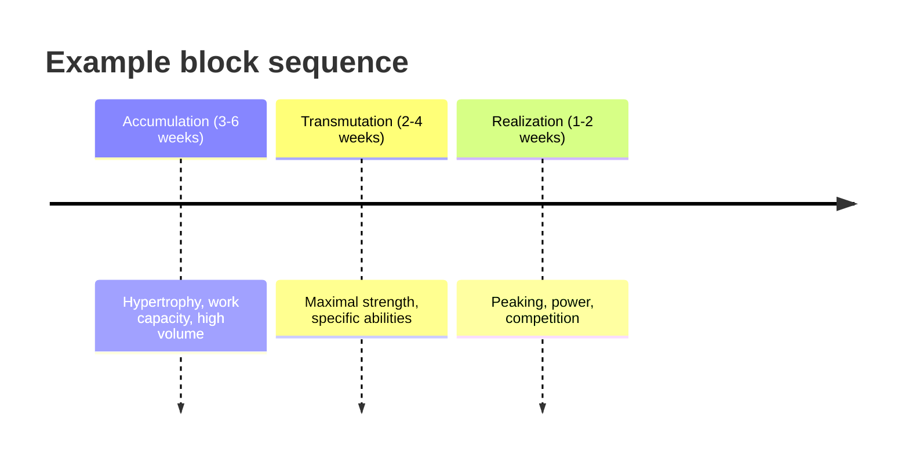

# Block periodization

## Summary

Block periodization trains one main quality in a concentrated block of time, from about a week to a month. A first block might focus on building strength, a second on hypertrophy, a third on endurance or competition-specific work. Each block builds on the previous one. It suits intermediate and advanced athletes, for whom it is harder to make progress by training everything at once.

## Prerequisites

- [Periodization](periodization.md)

## Core concepts

### Definition

*Block periodization* is a model in which training is organized into concentrated mesocycles (blocks), each targeting a small number of abilities. Vladimir Issurin described a common sequence: accumulation (general abilities, high volume), transmutation (specific abilities) and realization (peaking).

### Analogy

Block periodization is like studying for exams one subject at a time with intense focus, rather than a little of every subject each day. Each subject is learned deeply in its block, and later blocks build on earlier ones. The analogy breaks because, unlike knowledge, physical qualities fade if not maintained, so some maintenance work continues in every block.

### Mechanism

Concentrating stimuli for one quality creates a stronger signal for that adaptation than spreading effort thin. Residual training effects (how long a quality lasts after its block) guide the order: qualities that last longer (aerobic base, maximal strength) come earlier, those that fade faster (speed, peak power) come last.

The diagram shows a sequence of blocks.

## Worked example

A powerlifter preparing for a meet 12 weeks away follows three blocks: 5 weeks of hypertrophy and work capacity (sets of 8 to 10 at 65 to 75 percent), 5 weeks of strength (sets of 3 to 5 at 80 to 90 percent), then a 2-week realization block with heavy singles and reduced volume before the meet. Each block keeps a small amount of work from the previous block to maintain it.

## Trade offs and when to use it

- Concentrated stimuli help advanced athletes progress, but qualities not trained in a block decline; maintenance work and sensible block length limit this.

## Common mistakes

- **Dropping all other qualities completely in a block.** Keep minimal maintenance.
- **Using very short blocks for beginners.** Beginners progress on simpler plans.

## Practice

1. What are the three classic block types in Issurin's model?
2. Why are speed and power often trained last?
3. Who benefits most from block periodization?

### Answers

1. Accumulation, transmutation and realization.
2. Their training effects fade fastest, so they are trained close to competition.
3. Intermediate and advanced athletes.

## Further reading

- Issurin, V. B. (2010). New horizons for the methodology and physiology of training periodization. Sports Medicine, 40(3), 189-206. [DOI](https://doi.org/10.2165/11319770-000000000-00000). Review describing block periodization.
