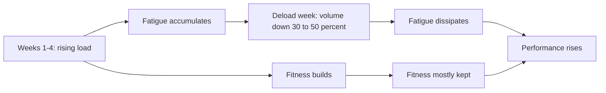

# Deloads

## Summary

A deload is a planned period of reduced training stress, usually a week, to allow recovery from accumulated fatigue. A yearly plan must contain breaks; training cannot be at full throttle all the time. Muscles grow during recovery, not during the workout itself. Deloads can be local (reduced load for one area during a high-volume plan), active (lighter training) or passive (complete rest). How long and how often depends on many factors; a 2023 expert consensus suggested deloads of about a week every 4 to 8 weeks for strength and physique athletes.

## Prerequisites

- [General adaptation syndrome](general-adaptation-syndrome.md)

## Core concepts

### Definition

A *deload* is a deliberate, short-term reduction in training volume, intensity or both, while usually maintaining frequency, to reduce fatigue and support adaptation.

### Analogy

A deload is like a scheduled pit stop in a long race. Cars that never stop eventually wear out their tires and lose speed; a planned stop costs a little time but lets the car finish faster. The analogy breaks because a deload is not complete rest in most cases; the "car" keeps moving slowly.

### Mechanism

Training creates fatigue as well as fitness. Fatigue masks fitness; reducing stress for a few days lets fatigue dissipate faster than fitness declines, so performance often rises after a deload. During recovery, the processes that build muscle take place.

**Types.**

- **Local deload**: reducing work for one body part or pattern during a demanding, high-volume plan.
- **Active deload**: lighter training (for example volume reduced by 30 to 50 percent, intensity kept or slightly lowered) when there is no general fatigue after a plan.
- **Passive deload**: total rest after a very hard training plan.

**Factors that determine deload length and timing.**

- diet;
- recovery quality (sleep, stress);
- supplements and pharmacology (anabolic drug use changes recovery);
- training level;
- cycle length;
- total volume and intensity;
- frequency over the whole plan.

The diagram shows fitness and fatigue across a mesocycle and deload.

## Worked example

A lifter follows a 5-week block in which weekly sets rise from 12 to 18 per muscle and performance stalls in week 5 with poor sleep and joint aches. In week 6, they keep the same exercises and loads but cut sets in half and stop each set 3 to 4 repetitions short of failure. In week 7, they start a new block and match or exceed their week-4 performance.

## Trade offs and when to use it

- Deloads reduce injury and burnout risk and often improve performance, but deloading too often wastes training time. Some coaches deload reactively (when performance and well-being decline) rather than on a fixed schedule.

## Common mistakes

- **Treating a deload as a week of maximal testing.** It is for recovery.
- **Never deloading.** Fatigue accumulates and progress stalls.

## Practice

1. Name three types of deload.
2. Give three factors that influence deload length.
3. Why does performance often improve after a deload?

### Answers

1. Local, active and passive deloads.
2. Diet, recovery, training level (also cycle length, volume and intensity, frequency, pharmacology).
3. Fatigue dissipates faster than fitness declines.

## Further reading

- Bell, L., Nolan, D., Immonen, V. et al. (2023). Integrating deloading into strength and physique sports training programmes: an international Delphi consensus approach. Sports Medicine - Open, 9, 87. [DOI](https://doi.org/10.1186/s40798-023-00633-0). Delphi consensus on deloading in strength and physique sports.
- Haff, G. G., Triplett, N. T. (Eds.) (2016). *Essentials of Strength Training and Conditioning (4th ed.)*. Human Kinetics. Recovery and tapering.
