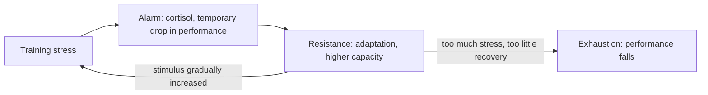

# General adaptation syndrome

## Summary

The general adaptation syndrome (GAS), described by Hans Selye in 1936, explains how the body responds to stress, including training. It has three stages: alarm (the immediate reaction, with stress hormones such as cortisol), resistance (adaptation, in which the body becomes able to cope with the stress) and exhaustion (when the stress is too great or too long, performance falls). Training plans apply this model: they impose stress, allow adaptation and avoid exhaustion, and they increase the stimulus progressively as the body adapts.

## Prerequisites

- [Training programming](training-programming.md)

## Core concepts

### Definition

The *general adaptation syndrome* is a model of the body's non-specific response to stressors. *Progressive overload* is the gradual increase of training stress to keep stimulating adaptation. *Supercompensation* is the idea that after recovery from a training stress, performance rises above the starting level for a while.

### Analogy

GAS is like learning to carry heavier boxes at work. The first heavy box makes you sore (alarm); after some weeks you carry it easily (resistance); if you keep adding boxes without rest, you eventually break down (exhaustion). To keep improving, you add boxes gradually and take days off. The analogy breaks because adaptation is not one process: muscles, tendons, nerves and metabolism adapt at different speeds.

### Mechanism

Training adaptations are the main element through which the body, exposed to stress (training), recovers and becomes stronger. Physical adaptations make it possible to reach a physique goal. Once the body has adapted to a type of training, the plan must change to impose new stressors.

**Stages.**

1. **Alarm**: immediate reaction to the stressor; stress hormones, including cortisol and adrenaline, are activated; performance temporarily drops.
2. **Resistance**: the body tries to return to balance. If it can adjust to the stimulus, adaptation occurs, and the adapted body can cope with the imposed stress.
3. **Exhaustion**: failure to adapt because the effort is too great. Too strong a stimulus reduces performance and can lead to exhaustion (overreaching and, if prolonged, overtraining).

**Progressive overload.** Changes in the plan gradually increase the training stimulus. The body adapts to stress, so to progress, the stimulus must keep rising; otherwise development stops.

The diagram shows the stages and the role of progression.

## Worked example

A runner increases weekly distance from 30 to 50 km in one week. In the first days, legs feel heavy and resting heart rate rises (alarm). If the 50 km week is repeated with good sleep and nutrition, after 2 to 3 weeks it feels normal (resistance). If the runner instead adds 10 km every week without easier weeks, fatigue accumulates, performance falls and injury risk rises (exhaustion). A common guideline is to increase load gradually, with lighter weeks every 3 to 6 weeks.

## Trade offs and when to use it

- GAS is a useful framework but simplifies: Selye studied severe stressors in animals, and recovery and adaptation from exercise differ by system and individual. The "fitness-fatigue" model is a more detailed alternative used by coaches.

## Common mistakes

- **Equating more stress with more progress.** Adaptation needs recovery.
- **Repeating the same stimulus for months.** Without progression, adaptation plateaus.

## Practice

1. Name the three stages of the general adaptation syndrome.
2. What is progressive overload?
3. What happens if stress exceeds the ability to adapt?

### Answers

1. Alarm, resistance and exhaustion.
2. Gradually increasing the training stimulus so the body keeps adapting.
3. Performance falls and exhaustion (overreaching or overtraining) can develop.

## Further reading

- Selye, H. (1936). A syndrome produced by diverse nocuous agents. Nature, 138, 32. [DOI](https://doi.org/10.1038/138032a0). Original description of the general adaptation syndrome.
- Haff, G. G., Triplett, N. T. (Eds.) (2016). *Essentials of Strength Training and Conditioning (4th ed.)*. Human Kinetics. Application of GAS to periodization.
