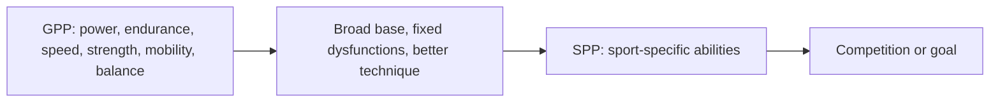

# GPP and SPP

## Summary

General physical preparedness (GPP) is broad fitness preparation that comes before sport-specific work. It develops power, endurance, speed, strength, mobility, body awareness and balance, restores movement function, corrects movement dysfunctions, improves technique and balances strength across the body. Specific physical preparedness (SPP) follows GPP and develops the qualities a particular sport or goal requires, limited to one or a few motor abilities.

## Prerequisites

- [Annual planning](annual-planning.md)

## Core concepts

### Definition

*GPP (general physical preparedness)* is the phase of training that builds general fitness and a broad base of motor abilities. *SPP (specific physical preparedness)* is the phase that develops the specific abilities needed in a given sport, as a planned, multi-stage effort toward success in that discipline.

### Analogy

GPP is like building a wide, solid foundation for a house, and SPP is building the specific rooms you need. A narrow foundation limits how high and how specialized the house can become. The analogy breaks because in training, the foundation must also be maintained while the rooms are built.

### Mechanism

**GPP** consists mainly of general preparatory and conditioning exercises that focus on motor abilities:

- power;
- endurance;
- speed;
- strength;
- mobility;
- body awareness and balance.

GPP also includes restoring function in the locomotor system, improving movement dysfunctions, perfecting the technique of movement patterns, and balancing tension and strength in the body.

**SPP** builds fitness for the specific sport. Techniques in SPP are limited to developing one or a few motor abilities needed in the discipline. For a sprinter, SPP emphasizes acceleration, maximal speed and power; for a powerlifter, the competition lifts at high intensity; for a physique athlete, details and weak points.

The diagram shows the transition from general to specific.

## Worked example

A soccer player's off-season GPP block lasts 6 weeks: general strength training (squats, rows, presses), aerobic conditioning, mobility work and core stability. The following SPP block emphasizes repeated sprints with changes of direction, plyometrics and soccer-specific conditioning games. GPP builds the capacity that makes the more intense SPP tolerable.

## Trade offs and when to use it

- More GPP builds resilience and long-term potential, especially in young athletes; too little SPP near competition limits performance.

## Common mistakes

- **Skipping GPP and specializing too early.** This narrows the base and raises injury risk.
- **Doing general work right before competition.** The last phase should be specific.

## Practice

1. List four motor abilities developed in GPP.
2. What does SPP focus on?
3. Why does GPP usually come before SPP?

### Answers

1. Power, endurance, speed, strength (also mobility and balance).
2. The specific abilities a given sport or goal requires.
3. It builds the base capacity and movement quality needed to tolerate specific, intense training.

## Further reading

- Haff, G. G., Triplett, N. T. (Eds.) (2016). *Essentials of Strength Training and Conditioning (4th ed.)*. Human Kinetics. Periodization phases.
- Issurin, V. B. (2010). New horizons for the methodology and physiology of training periodization. Sports Medicine, 40(3), 189-206. [DOI](https://doi.org/10.2165/11319770-000000000-00000). Periodization models.
