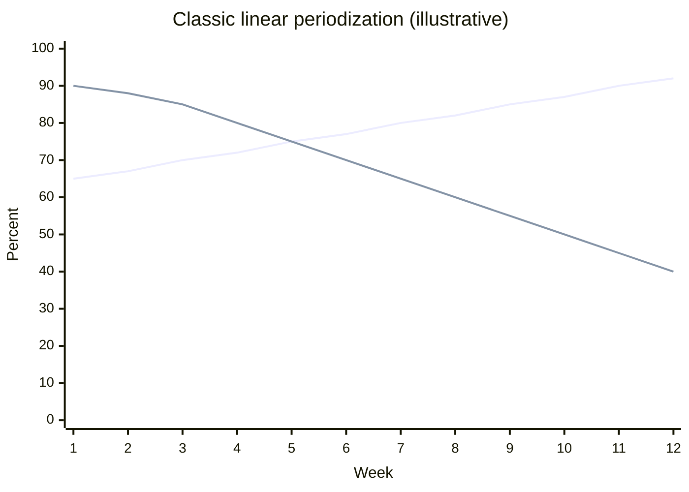

# Linear periodization

## Summary

In classic linear periodization, a training cycle starts with high volume and low intensity, and as weeks pass, volume falls while intensity (load) rises, reversing the emphasis by the middle or end of the cycle. A practical variant for beginners keeps the same repetitions and increases the load from week to week over a few weeks; the load is increased only when the trainee can do a few more repetitions than planned with the current weight.

## Prerequisites

- [Periodization](periodization.md)

## Core concepts

### Definition

*Linear (traditional) periodization* is a model in which volume decreases and intensity increases progressively across a macrocycle or mesocycle.

### Analogy

Linear periodization is like climbing a staircase where each step is a little higher but shorter: you start with many low steps (light loads, high volume) and end with few tall ones (heavy loads, low volume). The analogy breaks because, unlike a staircase, the body cannot climb forever; cycles must restart.

### Mechanism

Early phases build work capacity and muscle; later phases convert it into maximal strength with heavier loads. In the beginner variant, the load rises steadily while repetitions stay constant, so volume (load × repetitions) also rises.

The chart shows a classic linear model across 12 weeks (illustrative values).

The first line is intensity (%1RM); the second is relative volume (percent of the highest week).

The diagram shows the beginner variant.

## Worked example

A beginner squats 3 × 8 with 60 kg and could have done 10 repetitions in each set. The next week they use 62.5 kg. They continue adding 2.5 kg per week while all sets stay at 8 repetitions with at least one to two in reserve. When a week fails, they repeat the load or deload by 10 percent and build again. Over 8 weeks, the squat rises from 60 to about 77.5 kg.

## Trade offs and when to use it

- Simple and effective for beginners, but advanced lifters stall because they cannot add load every week, and qualities trained early (high volume) may fade by the end.

## Common mistakes

- **Adding load even when repetitions fail.** Increase only when there is a reserve.
- **Using linear progression for years.** Switch models when progress stalls.

## Practice

1. How do volume and intensity change in classic linear periodization?
2. When should load be increased in the beginner variant?
3. Why does linear periodization stop working for advanced lifters?

### Answers

1. Volume decreases and intensity increases over the cycle.
2. When the trainee can do a few more repetitions than planned with the current load.
3. They cannot add load every week, so progress stalls.

## Further reading

- Rhea, M. R., Ball, S. D., Phillips, W. T. et al. (2002). A comparison of linear and daily undulating periodized programs with equated volume and intensity for strength. Journal of Strength and Conditioning Research, 16(2), 250-255. [DOI](https://doi.org/10.1519/00124278-200205000-00004). Linear versus undulating periodization.
- Haff, G. G., Triplett, N. T. (Eds.) (2016). *Essentials of Strength Training and Conditioning (4th ed.)*. Human Kinetics. Periodization models.
