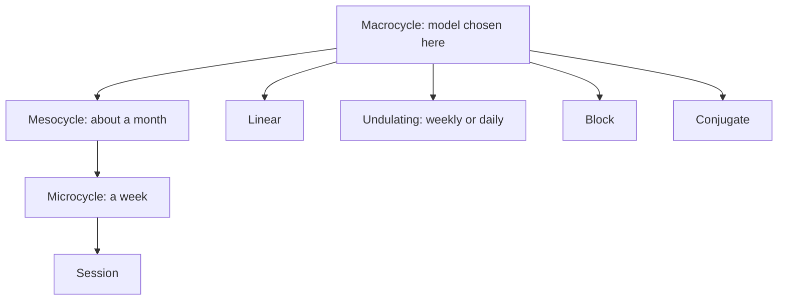

# Periodization

## Summary

Periodization is the planned variation of training over short and long periods to maximize the gains from training. It always connects macro actions (long-term goals) with micro actions (weeks and sessions). A plan must change from the level of the single session to cycles of several weeks or longer, and it must define intensity, volume, sets and repetitions. The main models are linear, undulating (weekly or daily), block and conjugate periodization. Meta-analyses show periodized programs produce somewhat more strength than non-periodized programs, while differences between models are small when volume is equal.

## Prerequisites

- [Training programming](training-programming.md)
- [General adaptation syndrome](general-adaptation-syndrome.md)

## Core concepts

### Definition

*Periodization* is the systematic, planned variation of training variables (mainly volume and intensity) across time units: macrocycle (where the periodization model is chosen), mesocycle (about a month), microcycle (a week) and training session.

### Analogy

Periodization is like a teacher's syllabus for a school year. Topics are ordered so that each builds on the last, tests come at planned points, and there are holidays for rest. Without a syllabus, a class might cover random topics and arrive at the exam unprepared. The analogy breaks because athletes, unlike classes, respond very differently to the same plan.

### Mechanism

Periodization manages fatigue and directs adaptation by changing stimuli before the body fully adapts to one. It organizes:

- the order of training qualities (for example hypertrophy before maximal strength);
- the progression of load and volume;
- recovery periods and peaks.

The diagram shows the time units and the main models.

### Models

| Model | Idea | Best for |
| --- | --- | --- |
| [Linear](linear-periodization.md) | Volume falls and intensity rises across weeks | Beginners |
| [Undulating](undulating-periodization.md) | Volume and intensity vary often (weekly or daily) | Intermediate lifters |
| [Block](block-periodization.md) | Each block focuses on one quality | Intermediate and advanced athletes |
| [Conjugate](conjugate-periodization.md) | Several qualities trained in parallel within the week | Strength, endurance and hypertrophy together |

## Worked example

A meta-analysis (Moesgaard and colleagues, 2022) of volume-equated studies found periodized programs increased 1RM strength slightly more than non-periodized programs, with undulating periodization slightly better than linear in trained individuals, and no clear difference for hypertrophy. In practice, choosing any sensible periodization and adhering to it matters more than choosing the "perfect" model.

## Trade offs and when to use it

- Periodization adds structure and manages fatigue but requires planning and monitoring; beginners progress well with simple linear progression.

## Common mistakes

- **Over-planning a year in rigid detail.** Plans must adapt.
- **Changing models constantly.** Give a model enough time to work.

## Practice

1. Name the four main periodization models.
2. In which time unit is the periodization model chosen?
3. What did a 2022 meta-analysis find about periodization and strength?

### Answers

1. Linear, undulating, block and conjugate.
2. The macrocycle.
3. Periodized programs produced slightly more strength than non-periodized ones, with undulating slightly better in trained people.

## Further reading

- Moesgaard, L., Beck, M. M., Christiansen, L. et al. (2022). Effects of periodization on strength and muscle hypertrophy in volume-equated resistance training programs: a systematic review and meta-analysis. Sports Medicine, 52(7), 1647-1666. [DOI](https://doi.org/10.1007/s40279-021-01636-1). Meta-analysis of periodized versus non-periodized training.
- Issurin, V. B. (2010). New horizons for the methodology and physiology of training periodization. Sports Medicine, 40(3), 189-206. [DOI](https://doi.org/10.2165/11319770-000000000-00000). Review of periodization models.
- Rhea, M. R., Ball, S. D., Phillips, W. T. et al. (2002). A comparison of linear and daily undulating periodized programs with equated volume and intensity for strength. Journal of Strength and Conditioning Research, 16(2), 250-255. [DOI](https://doi.org/10.1519/00124278-200205000-00004). Comparison of linear and daily undulating periodization.
