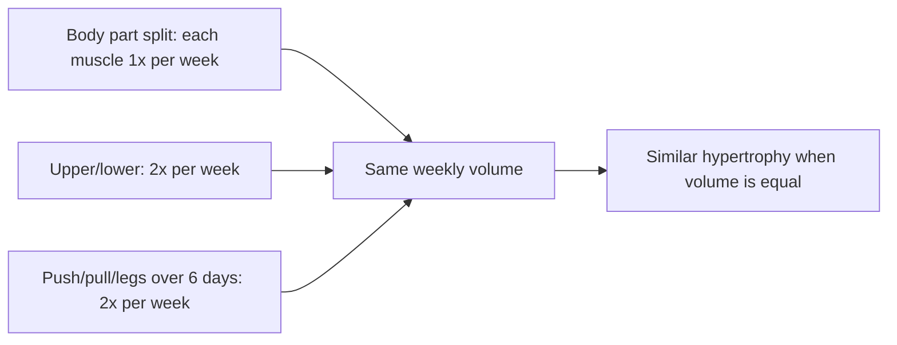

# Split training

## Summary

Split training divides muscle groups across separate sessions, so each day trains only selected body parts. It is popular among bodybuilders and people focused on physique, and allows training 3 to 6 times a week. Each muscle receives a large dose in one session followed by a long rest. Research suggests that when weekly volume is equal, splitting the body in this way is about as effective as full body training; very high volume once a week for each muscle may be less efficient than spreading it over two sessions.

## Prerequisites

- [Training programming](training-programming.md)

## Core concepts

### Definition

A *split* is a training structure in which different muscle groups are trained on different days. Common variants are the body part split ("bro split"), the upper/lower split and push/pull/legs.

### Analogy

A body part split is like cleaning one room of the house thoroughly each day instead of tidying the whole house daily. Each room gets deep attention, then is left alone for a week. The analogy breaks because muscles, unlike rooms, may "lose" some of the benefit if left too long between sessions.

### Mechanism

**Rationale.** Concentrating on one body part allows more exercises and sets for it in one session and long recovery between sessions. Splits are chosen mostly for hypertrophy and physique work.

**Evidence.** The idea that very hard training of a muscle once a week, often to failure, is better than training it more often with less volume per session is not supported. Several reviews suggest training each muscle at least twice a week is at least as good, and frequency matters little when weekly volume is the same (Schoenfeld and colleagues, 2019). Body part splits are often not recommended for beginners, who benefit from practicing movements frequently.

**Ways to divide muscle groups.**

1. Combining large muscle groups with the smaller muscles that assist them, for example 3 times a week:
   - chest and triceps;
   - back and biceps;
   - legs, abdominals and shoulders.
2. Combining antagonistic groups, those acting in opposition, usually over 4 days ([Functional muscle groups](../biomechanics/functional-muscle-groups.md)):
   - chest and back;
   - legs: hamstrings, calves, glutes and quadriceps;
   - arms: biceps and triceps;
   - shoulders (front, middle and rear deltoids) and abdominals.

The diagram compares common splits by how often each muscle is trained.

## Worked example

An intermediate lifter trains 4 days a week. Option A: chest and back, legs, arms, shoulders and abdominals, each once a week with 12 to 16 sets per muscle. Option B: upper, lower, upper, lower, each muscle twice a week with 6 to 8 sets per session. Weekly volume is similar, but option B spreads it, which reduces fatigue per session and gives two opportunities a week to practice each lift.

## Trade offs and when to use it

- Splits allow focus and variety and suit people who enjoy long sessions on one body part, but missing a session means a muscle goes untrained for two weeks.

## Common mistakes

- **Doing 20+ sets for one muscle in one session.** Returns diminish; spread volume.
- **Starting beginners on body part splits.** Frequent practice of main lifts helps beginners more.

## Practice

1. Give two ways to divide muscle groups in a split.
2. When weekly volume is equal, how do splits compare with full body training for hypertrophy?
3. What is a disadvantage of a body part split?

### Answers

1. Large muscles with their assisting smaller muscles (chest and triceps), or antagonistic groups (chest and back).
2. About equally effective.
3. Each muscle is trained only once a week, so a missed session leaves a long gap.

## Further reading

- Schoenfeld, B. J., Grgic, J., Krieger, J. (2019). Resistance training frequency and skeletal muscle hypertrophy: a review of available evidence. Journal of Science and Medicine in Sport, 22(3), 361-370. [DOI](https://doi.org/10.1016/j.jsams.2018.09.223). Review of training frequency and hypertrophy.
