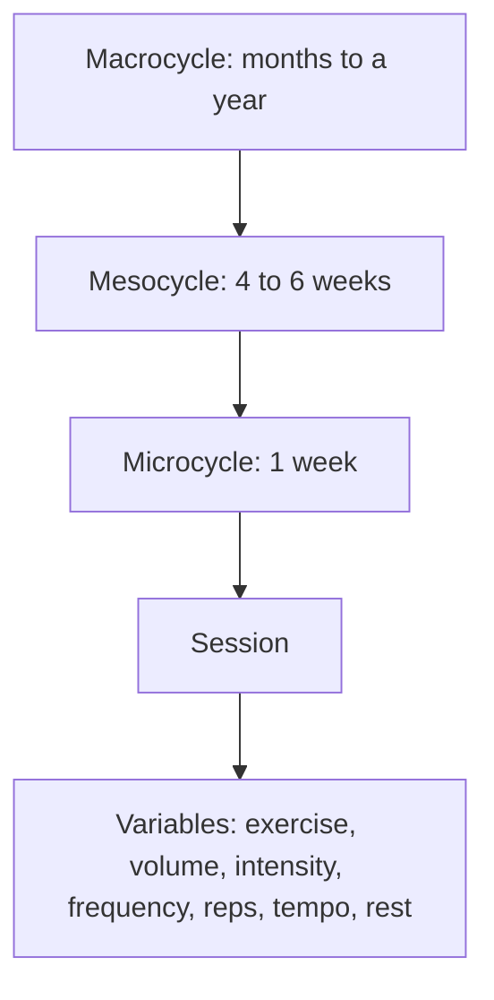

# Training programming

## Summary

Training programming is planning training over the long term. A single planned workout is a training session (training unit); all sessions in one week form a microcycle; several weeks (often 4 to 6) form a mesocycle, and the whole plan, often months to a year, a macrocycle. A well-designed program specifies exercise selection, volume, intensity, frequency, repetition ranges, tempo and rest intervals, and includes periodization, because adaptation slows progress unless training changes over time.

## Prerequisites

- [Repetition ranges and load](../training-variables/rep-ranges-and-load.md)

## Core concepts

### Definition

*Training programming* is the systematic planning of training variables over time to reach a goal. The *training session* is one workout; the *microcycle* is usually one week; the *mesocycle* a block of several weeks; the *macrocycle* the full plan. Sources differ: some call a 4 to 6 week block a macrocycle; this library uses the common sports science convention above.

### Analogy

Programming is like planning a long journey by car. The destination is the goal, the route is the periodization, each day's driving is a session, each week a stage, and the settings (speed, rest stops, fuel) are the training variables. Driving without a plan gets you somewhere, but rarely where you wanted, and wastes fuel (energy, motivation). The analogy breaks because the body is a vehicle that changes during the trip, so the plan must adapt.

### Mechanism

**Training parameters.**

- **Exercise selection (movement patterns)**: exercises and their regressions or progressions (simpler or more advanced versions), matched to goals and the trainee's ability.
- **Volume**: total work done, calculated from sets, repetitions and load, taking into account whether the effort was hard enough for the goal. Hard sets per muscle per week is the most practical measure.
- **Intensity**: the load used for each exercise, set by goal and current strength ([Repetition maximum](../training-variables/repetition-maximum.md)).
- **Frequency**: number of sessions per week, or sessions per muscle per week.
- **Repetition ranges**: repetitions per set and number of sets, matched to the goal ([Repetition ranges and load](../training-variables/rep-ranges-and-load.md)).
- **Tempo**: the duration of each phase of a repetition, written as numbers ([Tempo](../training-variables/tempo.md)).
- **Rest intervals (metabolic recovery time)**: pauses between sets, set by the goal; shorter as the goal moves from strength to hypertrophy to endurance ([Rest intervals](../training-variables/rest-intervals.md)).

**Adaptation and change.** After a period of training according to the same plan, the body adapts and progress slows, so training variables must change. Periodization ([Periodization](periodization.md)) organizes these changes.

The diagram shows the time units of a program and its variables.

## Worked example

A beginner aiming for general strength writes a 12-week macrocycle in three mesocycles of 4 weeks. Each microcycle has 3 full-body sessions. Each session includes a squat or hinge, a horizontal and vertical push and pull, and accessories, with 2 to 4 sets of 6 to 12 repetitions at RIR 2 to 3, rests of 2 to 3 minutes and tempo 2-0-1-0. In weeks 4, 8 and 12, volume is reduced by about a third (deload). Loads rise by double progression.

## Trade offs and when to use it

- Detailed plans give structure and measurable progress, but must be adjusted for illness, life stress and individual response.
- Beginners progress with simple plans; advanced lifters need more variation to keep progressing.

## Common mistakes

- **Changing the program every week.** Too much variation prevents measurable progress.
- **Never changing anything.** Progress stalls without progressive overload.

## Practice

1. What is a microcycle?
2. Name five training parameters.
3. Why must programs change over time?

### Answers

1. Usually one week of training sessions.
2. Exercise selection, volume, intensity, frequency, repetition ranges (also tempo and rest).
3. The body adapts, and progress slows without new stimuli.

## Further reading

- Haff, G. G., Triplett, N. T. (Eds.) (2016). *Essentials of Strength Training and Conditioning (4th ed.)*. Human Kinetics. Program design chapter.
- American College of Sports Medicine (2009). Progression models in resistance training for healthy adults. Medicine and Science in Sports and Exercise, 41(3), 687-708. [DOI](https://doi.org/10.1249/MSS.0b013e3181915670). Progression models in resistance training.
