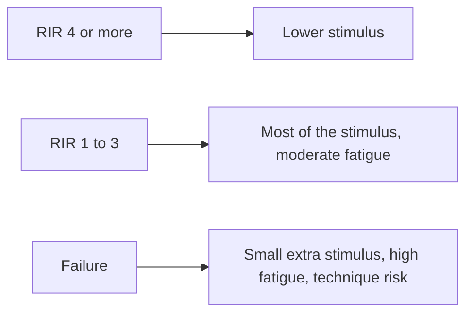

# Training to failure

## Summary

Training to muscle failure means continuing a set in a controlled way until not a single further repetition can be completed with good technique. Research supports training close to failure to trigger adaptation, but going all the way to failure on every set adds little extra benefit and increases fatigue. It is not suitable for beginners as a default, because technique matters greatly, and it is riskier on heavy compound lifts than on machines and isolation exercises.

## Prerequisites

- [Repetitions in reserve (RIR)](../training-variables/rir.md)

## Core concepts

### Definition

*Momentary muscle failure* is the point in a set at which the trainee cannot complete another concentric repetition despite maximal effort. *Training close to failure* means ending sets with a few repetitions in reserve ([Repetitions in reserve (RIR)](../training-variables/rir.md)).

### Analogy

Training to failure is like driving until the fuel tank is empty. You learn exactly how far the car goes, but you may end up stranded (high fatigue, poor technique) and need longer to refuel. Stopping with a little fuel left gets you almost as far with far less trouble. The analogy breaks because touching failure occasionally on safe exercises helps calibrate effort.

### Mechanism

Near failure, all available motor units, including high-threshold ones, are recruited (see [Motor units and neural control of force](../../physiology/muscle/motor-units.md)). Beyond this point, extra repetitions add fatigue (central and peripheral) and muscle damage more than stimulus. A 2023 meta-analysis (Refalo and colleagues) found hypertrophy rises as sets get closer to failure, with a small extra benefit from actual failure; a related analysis found no clear strength benefit of failure.

The diagram shows the balance of stimulus and fatigue.

### Guidelines

- Beginners: mostly RIR 2 to 3 while learning technique.
- Compound lifts (squat, deadlift, bench press): mostly RIR 1 to 3.
- Machines, isolation and the last set of an exercise: failure is acceptable occasionally.
- Use failure sparingly to calibrate RIR estimates.

## Worked example

Two lifters do 3 sets of leg presses with the same load. Lifter A goes to failure on every set: 12, 9 and 7 repetitions. Lifter B stops at RIR 2: 10, 10 and 9. Lifter B accumulates more total repetitions with less fatigue and may recover faster for the next session, while lifter A's extra fatigue does little to increase the stimulus per session.

## Trade offs and when to use it

- Failure guarantees a hard set and helps calibrate effort, but raises fatigue, soreness and injury risk on complex lifts.

## Common mistakes

- **Using failure as the default for every set.**
- **Grinding repetitions with poor technique on heavy compound lifts.**

## Practice

1. What is momentary muscle failure?
2. Why is failure training not ideal for beginners?
3. On which exercises is failure safer?

### Answers

1. The point at which another repetition cannot be completed despite maximal effort.
2. Technique is still developing and fatigue makes form break down.
3. Machine and isolation exercises.

## Further reading

- Refalo, M. C., Helms, E. R., Trexler, E. T. et al. (2023). Influence of resistance training proximity-to-failure on skeletal muscle hypertrophy: a systematic review with meta-analysis. Sports Medicine, 53(3), 649-665. [DOI](https://doi.org/10.1007/s40279-022-01784-y). Meta-analysis of proximity to failure.
- Zourdos, M. C., Klemp, A., Dolan, C. et al. (2016). Novel resistance training-specific rating of perceived exertion scale measuring repetitions in reserve. Journal of Strength and Conditioning Research, 30(1), 267-275. [DOI](https://doi.org/10.1519/JSC.0000000000001049). RIR-based effort scale.
