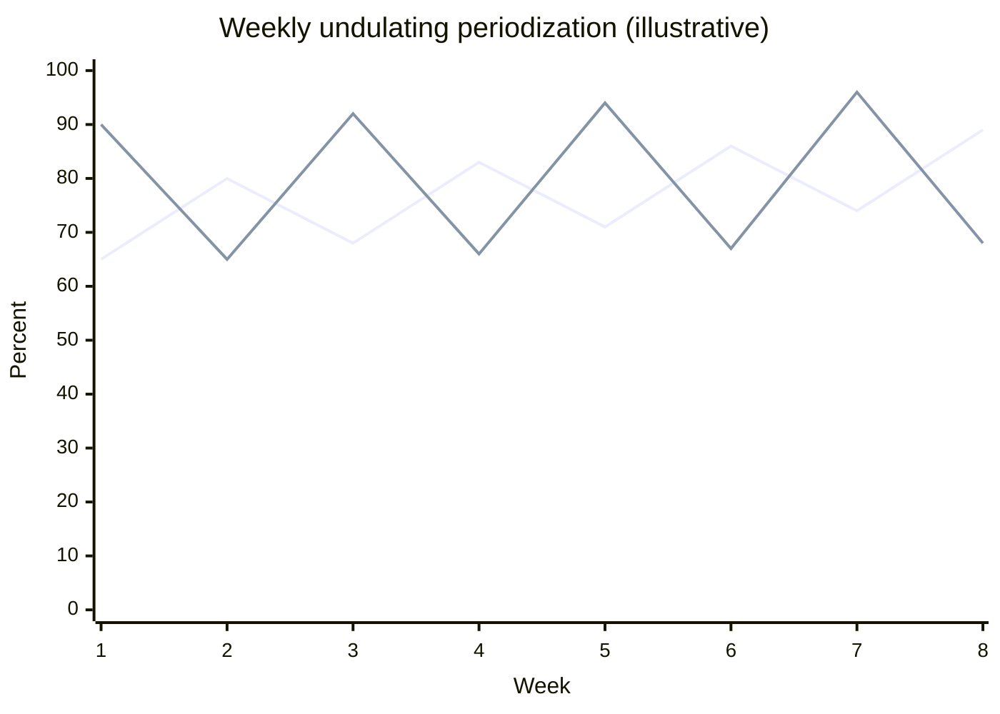

# Undulating periodization

## Summary

Undulating (wave) periodization varies volume and intensity frequently, for example from week to week (weekly undulating) or from session to session (daily undulating). Volume and intensity alternately rise and fall: one week might be high volume and low intensity, the next lower volume and higher intensity, both higher than before. Meta-analyses suggest undulating models produce slightly more strength than linear models in trained people.

## Prerequisites

- [Periodization](periodization.md)

## Core concepts

### Definition

*Undulating (non-linear) periodization* varies training variables in short waves. *Daily undulating periodization* (DUP) changes repetition ranges and loads between sessions in the same week; *weekly undulating periodization* changes them between weeks.

### Analogy

Undulating periodization is like the tide: it rises and falls regularly, but each high tide can reach a bit higher than the last. The body is exposed to different stimuli often enough that it does not settle into one pattern. The analogy breaks because tides are perfectly predictable, while training waves adapt to how the athlete responds.

### Mechanism

Frequent variation exposes the muscle to several stimuli (heavy, moderate, light) within a short time and may reduce staleness. Total volume and intensity still increase over the macrocycle.

The chart shows an example of weekly undulation over 8 weeks (illustrative values).

The first line is intensity (%1RM), the second relative volume.

The diagram shows a daily undulating week.

## Worked example

A trained lifter follows DUP for the bench press: Monday 4 × 10 at 70 percent, Wednesday 5 × 5 at 82 percent, Friday 6 × 3 at 87 percent. Every 3 weeks the loads rise by about 2.5 percent. In a 2002 study (Rhea and colleagues), a daily undulating program increased bench press and leg press strength more than a linear program with equal volume and intensity over 12 weeks.

## Trade offs and when to use it

- Variety and frequent heavy exposure help intermediate and advanced lifters; the plan is more complex and harder to track.

## Common mistakes

- **Making every session maximally hard.** Light days must be lighter.
- **Changing exercises every session as well as loads.** Keep core lifts stable to measure progress.

## Practice

1. What is daily undulating periodization?
2. How does weekly undulation differ from daily?
3. Which group benefits most from undulating models?

### Answers

1. Varying repetitions and loads between sessions within the same week.
2. Weekly undulation changes variables between weeks rather than between sessions.
3. Intermediate and advanced, trained lifters.

## Further reading

- Rhea, M. R., Ball, S. D., Phillips, W. T. et al. (2002). A comparison of linear and daily undulating periodized programs with equated volume and intensity for strength. Journal of Strength and Conditioning Research, 16(2), 250-255. [DOI](https://doi.org/10.1519/00124278-200205000-00004). Daily undulating versus linear periodization.
- Moesgaard, L., Beck, M. M., Christiansen, L. et al. (2022). Effects of periodization on strength and muscle hypertrophy in volume-equated resistance training programs: a systematic review and meta-analysis. Sports Medicine, 52(7), 1647-1666. [DOI](https://doi.org/10.1007/s40279-021-01636-1). Meta-analysis of periodization.
