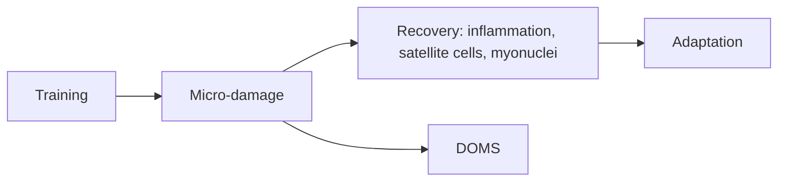

# Recovery

Recovery is the process through which the body repairs and adapts after training. These notes explain what happens inside a muscle after training, how satellite cells and myonuclei support growth and "muscle memory", and what delayed onset muscle soreness (DOMS) is and is not. Sleep is covered in [sleep](../../physiology/sleep/README.md) and deloads in [Deloads](../programming/deloads.md).

## Map

## Reading order

1. [Recovery and regeneration](recovery.md)
2. [Delayed onset muscle soreness (DOMS)](doms.md)
