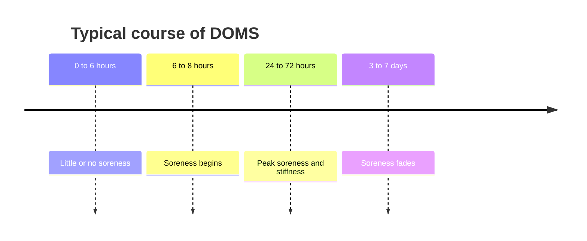

# Delayed onset muscle soreness (DOMS)

## Summary

Delayed onset muscle soreness (DOMS) is muscle pain that appears about 6 to 8 hours after intense or unfamiliar exercise, peaks at 24 to 72 hours and fades over several days. It is not caused by lactic acid, which is cleared within about an hour after exercise. DOMS is caused by micro-damage of muscle fibers and connective tissue followed by inflammation, and it is worst after eccentric exercise. Soreness is not a good measure of training effectiveness. Stretching does not reduce it; massage may reduce it a little.

## Prerequisites

- [Muscle actions: concentric, eccentric and isometric](../biomechanics/muscle-actions.md)

## Core concepts

### Definition

*Delayed onset muscle soreness* is a temporary, delayed pain and stiffness in muscles after unaccustomed or eccentric exercise, linked to microtrauma and inflammation. The common name "lactic acid soreness" is a misconception.

### Analogy

DOMS is like the ache after moving furniture for the first time in years. The next day, everything hurts, but after a few weeks of regular moving, the same work leaves no soreness. The analogy breaks because soreness is not a reliable sign of how much "work" the muscle has done.

### Mechanism

**Lactic acid is not the cause.** The body produces lactate all the time, even at rest. After intense exercise, blood flow clears lactate from muscle within about 1 to 2 hours (most within an hour), and the liver and other tissues use it ([Lactate and fermentation](../../../../natural-sciences/chemistry/biochemistry/lactate-and-fermentation.md)). Lactate does not stay in muscles and does not cause DOMS.

**Micro-damage and inflammation.** Research shows that the main cause is structural micro-damage of muscle fibers and their surrounding connective tissue, which leads to inflammation and sensitization of nerve endings.

**Eccentric exercise.** DOMS depends on the type of exercise. When a muscle under load is stretched instead of shortening (an eccentric action), more damage occurs. The stretch results from an external force greater than the muscle's force, as the muscle brakes movement and protects the joints.

**Repeated bout effect.** As the body adapts to the exercise, soreness decreases, partly because the load is distributed better across muscle fibers.

**Genetics.** Individual sensitivity to pain and soreness differs. People can be "high responders", "low responders" or "non-responders", experiencing DOMS often or not at all, with greater or lesser intensity. A high responder will feel more soreness than a low or non-responder with the same training load. It is important to know your own response and to listen to your body.

**Soreness and effectiveness.** Many people believe a workout is effective only if they feel a solid "muscle hangover" the next day. This is incorrect: soreness is not a good indicator of training effectiveness. Mild soreness after new training is normal; the micro-damage it reflects is part of the stimulus that leads to repair and growth, but growth also occurs without soreness. Pain should be felt from about 24 hours to 3 days after training. If it does not disappear after that time, the cause may be more serious (for example a strain or, rarely, rhabdomyolysis).

The timeline shows the typical course of DOMS.

### Claimed effects and evidence

Each entry states the claimed effect and how strong the evidence is, using the grades defined in the [Evidence grades](../../nutrition/evidence-grades.md) note.

- **Stretching before or after exercise reduces DOMS.** A Cochrane review found no meaningful effect; static stretching before training may reduce power and strength slightly. Evidence: not supported.
- **Massage reduces DOMS.** Massage improves circulation and is among the more effective recovery methods for perceived soreness. Evidence: moderate.
- **Lactic acid causes DOMS.** Lactate is cleared within hours. Evidence: not supported.
- **Soreness indicates an effective workout.** Soreness is a poor marker of effectiveness. Evidence: not supported.

## Worked example

Two people do the same new workout with 5 sets of slow, heavy eccentric squats. Person A (a high responder) has strong soreness for 3 days; person B feels only mild stiffness. A week later, they repeat the workout and both feel much less soreness (repeated bout effect). Their muscle growth over the following months is similar.

## Trade offs and when to use it

**Managing DOMS.**

- Sports massage is one of the more effective methods; it stimulates circulation, which may support recovery through better oxygen and nutrient delivery.
- Light activity (walking, easy cycling) relieves stiffness temporarily.
- Progressing new exercises gradually prevents strong soreness.
- Stretching is not effective for DOMS.

## Common mistakes

- **Chasing soreness as proof of a good workout.** Track performance and progress instead.
- **Stretching to cure DOMS.** Stretching does not reduce soreness.
- **Ignoring pain that lasts beyond a few days.** Seek advice if pain persists or urine darkens.

## Practice

1. When does DOMS begin and peak?
2. Why is lactic acid not the cause of DOMS?
3. Which type of muscle action causes the most DOMS?
4. What did a Cochrane review find about stretching?

### Answers

1. It begins about 6 to 8 hours after exercise and peaks at 24 to 72 hours.
2. Lactate is cleared from muscle within about 1 to 2 hours.
3. Eccentric actions.
4. Stretching before or after exercise does not reduce soreness in healthy people.

## Further reading

- Herbert, R. D., de Noronha, M., Kamper, S. J. (2011). Stretching to prevent or reduce muscle soreness after exercise. Cochrane Database of Systematic Reviews, CD004577. [DOI](https://doi.org/10.1002/14651858.CD004577.pub3). Cochrane review of stretching and muscle soreness.
- Cheung, K., Hume, P., Maxwell, L. (2003). Delayed onset muscle soreness: treatment strategies and performance factors. Sports Medicine, 33(2), 145-164. [DOI](https://doi.org/10.2165/00007256-200333020-00005). Review of DOMS treatment strategies.
- Dupuy, O., Douzi, W., Theurot, D. et al. (2018). An evidence-based approach for choosing post-exercise recovery techniques to reduce markers of muscle damage, soreness, fatigue, and inflammation: a systematic review with meta-analysis. Frontiers in Physiology, 9, 403. [DOI](https://doi.org/10.3389/fphys.2018.00403). Meta-analysis of recovery techniques, including massage.
