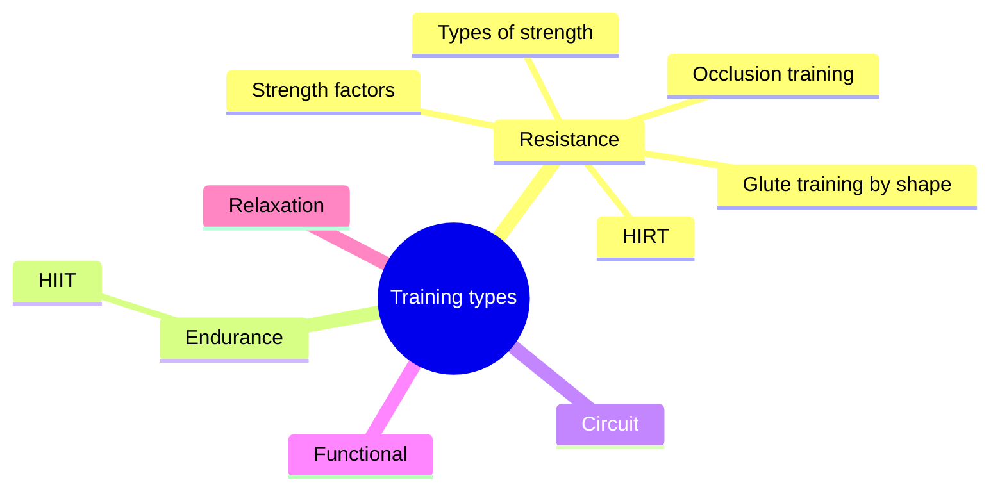

# Training types

Training can be classified by its main goal and structure. The main types are resistance (strength) training, endurance (conditioning) training, circuit training (resistance and endurance combined), functional training and relaxation training. These notes cover strength and the factors that determine it, high-intensity repeat training (HIRT), high-intensity interval training (HIIT), functional and circuit training, occlusion training and glute training by shape. Relaxation training belongs to [physiotherapy](../../physiotherapy/README.md), in particular [Progressive muscle relaxation (Jacobson)](../../physiotherapy/progressive-muscle-relaxation.md).

## Map

## Reading order

1. [Types of strength](strength-types.md)
2. [Factors that determine strength](strength-factors.md)
3. [High-intensity repeat training (HIRT)](hirt.md)
4. [High-intensity interval training (HIIT)](hiit.md)
5. [Circuit training](circuit-training.md)
6. [Functional training](functional-training.md)
7. [Occlusion training (blood flow restriction)](occlusion-training.md)
8. [Glute training by shape](glute-training-by-shape.md)
