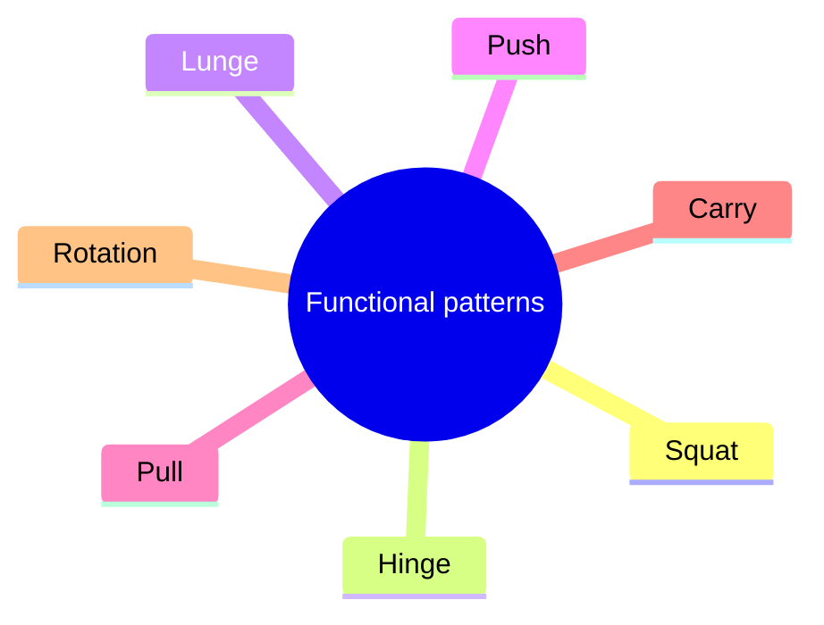

# Functional training

## Summary

Functional training aims to improve the ability to perform everyday and sport movements, rather than to develop single muscles. It uses multi-joint movement patterns (squat, hinge, push, pull, carry, rotation), works in several planes and often uses free weights, kettlebells, bands and unstable surfaces. The term is used loosely, and evidence shows benefits for functional fitness in older adults, but it is not clearly superior to well-designed traditional training for most goals.

## Prerequisites

- [Axes and planes of the body](../../anatomy/anatomical-terminology/axes-and-planes.md)

## Core concepts

### Definition

*Functional training* is training organized around movement patterns that transfer to daily life or sport, emphasizing coordination, stability and multi-joint movement over isolated muscle work.

### Analogy

Functional training is like learning to cook complete meals rather than practicing only knife skills. Each skill matters, but the goal is to put them together into something useful. The analogy breaks because "functional" depends on the person: what is functional for a firefighter differs from what is functional for a grandparent.

### Mechanism

Training transfers best to tasks that resemble it (the principle of specificity). Functional training therefore uses:

- basic movement patterns: squat, hinge, lunge, push, pull, carry and rotation;
- movements in all three planes ([Axes and planes of the body](../../anatomy/anatomical-terminology/axes-and-planes.md));
- core stability under load ([Core stability](../mobility/core.md));
- unilateral work and balance.

The mindmap shows the basic movement patterns.

### Claimed effects and evidence

Each entry states the claimed effect and how strong the evidence is, using the grades defined in the [Evidence grades](../../nutrition/evidence-grades.md) note.

- **Improved functional fitness in older adults.** Several trials show improvements in balance, gait and daily tasks. Evidence: moderate.
- **Superior to traditional strength training.** Not shown for most outcomes. Evidence: limited.

## Worked example

A 65-year-old trains twice a week with goblet squats to a box, kettlebell deadlifts, farmer carries, step-ups and band rows. After 12 weeks, they rise from a chair and climb stairs more easily, and their balance improves.

## Trade offs and when to use it

Functional training builds useful, coordinated strength, but very unstable exercises reduce the load and the strength stimulus. Combine it with progressive strength training.

## Common mistakes

- **Equating "functional" with balancing on unstable surfaces.** Functional means transferable, not unstable.
- **Neglecting progressive overload.** Functional exercises must also progress.

## Practice

1. What is functional training?
2. Name five basic movement patterns.
3. Is functional training superior to traditional strength training?

### Answers

1. Training based on movement patterns that transfer to daily life or sport.
2. Squat, hinge, lunge, push, pull (also carry and rotation).
3. Not clearly; it is useful especially for functional fitness in older adults.

## Further reading

- Haff, G. G., Triplett, N. T. (Eds.) (2016). *Essentials of Strength Training and Conditioning (4th ed.)*. Human Kinetics. Exercise selection and specificity.
- American College of Sports Medicine (2009). Progression models in resistance training for healthy adults. Medicine and Science in Sports and Exercise, 41(3), 687-708. [DOI](https://doi.org/10.1249/MSS.0b013e3181915670). Resistance training guidelines including older adults.
