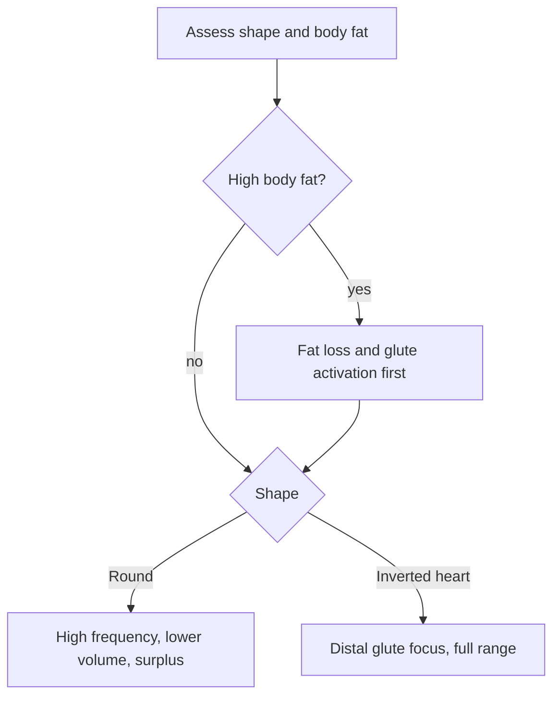

# Glute training by shape

## Summary

A popular approach in physique training classifies buttocks into four shapes (square, round, inverted heart or "A", and inverted triangle or "V") and adjusts training to each. Shape depends largely on genetics: the width and position of the hip bones, the length of the femoral necks, the size of the trochanters, the tilt of the sacrum, and the amount and distribution of body fat. The classification is a coaching heuristic without scientific validation, but the anatomy behind it is real, and so are the large differences in glute muscle volume between people.

## Prerequisites

- [Gluteus maximus](../../anatomy/muscular-system/lower-limb/gluteus-maximus.md)
- [Hip bone and pelvis](../../anatomy/skeletal-system/lower-limb/hip-bone.md)

## Core concepts

### Definition

The *glute shape typology* is a classification of buttock appearance into four shapes used to individualize training:

- *square*;
- *round*;
- *inverted heart* (letter A);
- *inverted triangle* (letter V).

### Analogy

The shape classification is like sorting faces into round, square and oval for choosing glasses. It helps with practical choices, but the categories are rough and many people fall between them. The analogy breaks because muscle, unlike facial bones, can change a lot with training.

### Mechanism

**Why one plan does not fit everyone.** Many factors determine the effect of glute training, including the shape of the buttocks. Shape depends largely on genetics, mainly on anatomical aspects: the arrangement of the hip bones, femurs and pelvis, and the angle of the sacrum ([Hip bone and pelvis](../../anatomy/skeletal-system/lower-limb/hip-bone.md), [Femur](../../anatomy/skeletal-system/lower-limb/femur.md)). Practitioner literature reports that the volume of the gluteal muscles in physically inactive people can differ between individuals by up to 384 percent; I could not locate the primary study behind this figure, so treat the exact number as unverified, although large individual differences in muscle volume are well documented.

**Square.** Wide hip bones and long femoral necks. Square buttocks occur most often in people with overweight or obesity. When body fat is high, fat loss comes before muscle building; otherwise even the best training plan gives little visible result, because the muscles are hidden under fat.

**Round.** The same bone arrangement as the square shape, but seen more often in taller and lean people. Training recommendations: high frequency with lower volume per session, a calorie surplus, and treating the glutes as a priority ([Muscle priority](../intensification-methods/muscle-priority.md)). The glutes respond well to variety in training, changing ranges of motion and heavy loads.

**Inverted heart (letter A).** Medium-width hip bones, a narrow waist and long femoral necks. This arrangement gives the optical impression of larger buttocks, although measured muscle volume need not be larger. The A shape can also give a sagging appearance. Training should focus mainly on the lower (distal) part of the gluteus maximus, with full ranges of motion: the conventional deadlift rather than the Romanian deadlift, and the hip thrust with the back on a bench rather than the glute bridge from the floor.

**Inverted triangle (letter V).** Most often seen with obesity, including severe obesity. Wide hip bones, short femoral necks and small trochanters. The buttocks look sagging and converge downward and inward. Usually the gluteal muscles are inactive. First reduce body fat and activate the muscles; only then plan training aimed at shaping the glutes.

The table summarizes the four shapes.

| Shape | Anatomy | Common context | Training emphasis |
| --- | --- | --- | --- |
| Square | Wide hip bones, long femoral necks | Overweight or obesity | Fat loss first, then muscle building |
| Round | Same bones as square | Taller, lean people | High frequency, lower volume, calorie surplus, priority, variety and heavy loads |
| Inverted heart (A) | Medium hip width, narrow waist, long femoral necks | Optically larger, may sag | Distal gluteus maximus, full range: conventional deadlift, hip thrust |
| Inverted triangle (V) | Wide hip bones, short femoral necks, small trochanters | Obesity, inactive glutes | Fat loss and activation first, then shaping |

The flowchart shows the decision process.

### Claimed effects and evidence

Each entry states the claimed effect and how strong the evidence is, using the grades defined in the [Evidence grades](../../nutrition/evidence-grades.md) note.

- **Shape-specific training changes glute shape.** No controlled studies; a coaching heuristic. Evidence: very limited.
- **Glute muscle volume differs greatly between people.** Large individual differences are well documented; the 384 percent figure is unverified. Evidence: limited.
- **Fat loss reveals muscle shape.** Established body composition principle. Evidence: established physiology.

## Worked example

A lean, tall woman with a round shape trains glutes three times a week with 6 to 8 hard sets per session: hip thrusts heavy on Monday, Bulgarian split squats on Wednesday and cable kickbacks plus 45-degree back extensions on Friday. She eats about 200 to 300 kcal above maintenance. Over 16 weeks, she tracks hip thrust strength and hip circumference.

## Trade offs and when to use it

The typology can make plans more personal, but all shapes respond to the same basic principles: progressive overload, enough volume, varied exercises (hip extension, abduction) and appropriate body composition.

## Common mistakes

- **Treating the shape typology as science.** It is a heuristic; follow general hypertrophy principles.
- **Building muscle while body fat hides it.** Address body composition first if fat is high.

## Practice

1. Name the four glute shapes.
2. What anatomical factors determine glute shape?
3. What training is suggested for the inverted heart shape?

### Answers

1. Square, round, inverted heart (A) and inverted triangle (V).
2. Hip bone width, femoral neck length, trochanter size, sacral tilt and fat distribution.
3. Focus on the distal gluteus maximus with full-range movements: conventional deadlift and hip thrust.

## Further reading

- Contreras, B., Cordoza, G. (2019). *Glute Lab: The Art and Science of Strength and Physique Training*. Victory Belt Publishing. Practitioner book on glute training and individual differences.
- Schoenfeld, B. J., Ogborn, D., Krieger, J. W. (2017). Dose-response relationship between weekly resistance training volume and increases in muscle mass: a systematic review and meta-analysis. Journal of Sports Sciences, 35(11), 1073-1082. [DOI](https://doi.org/10.1080/02640414.2016.1210197). Volume and hypertrophy meta-analysis.
