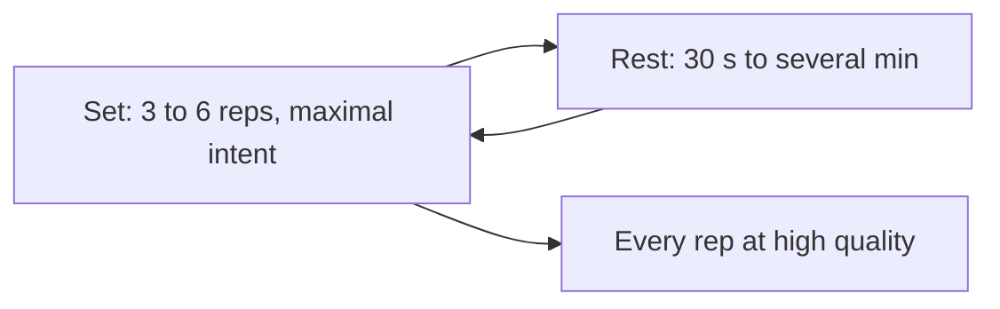

# High-intensity repeat training (HIRT)

## Summary

High-intensity repeat training (HIRT) is a form of high-intensity strength training that uses short sets of 3 to 6 repetitions with submaximal loads and long enough rests to keep every repetition high in quality. The goal is to increase power, strength and muscular endurance while minimizing metabolic fatigue. The term is also used in research for "high-intensity interval resistance training" with very short rests, which is a different protocol. Direct evidence for the claimed benefits is limited.

## Prerequisites

- [Factors that determine strength](strength-factors.md)

## Core concepts

### Definition

*High-intensity repeat training* is a resistance training approach based on short sets with submaximal loads and full recovery, so that each repetition is done with maximal intent and full range of motion.

Two different methods share the acronym HIRT:

- the approach described here, with long rests and high-quality repetitions;
- *high-intensity interval resistance training* used in some studies (for example Paoli and colleagues, 2012), with very short rests (20 seconds) between mini-sets to failure.

### Analogy

HIRT is like practicing free throws in basketball with a short walk between each shot instead of shooting quickly while tired. Each attempt is of high quality, so you practice good technique rather than fatigue. The analogy breaks because in the gym, the load itself is the stimulus, not only accuracy.

### Mechanism

**Key principles.**

- **High-intensity repetitions.** Every repetition is done with maximal intent and full range of motion.
- **Longer rests.** Recovery between sets is key, usually 30 seconds to several minutes, to keep the quality of each repetition.
- **Fewer repetitions.** Usually 3 to 6 repetitions per set.
- **Compound exercises.** Squats, deadlifts, pull-ups and presses.
- **Minimal metabolic fatigue.** Avoiding "burning out" the muscles by optimizing rest.

Keeping fatigue low preserves bar speed and power output, which favors neural adaptations and strength.

The flowchart shows a HIRT session.

### Claimed effects and evidence

Each entry states the claimed effect and how strong the evidence is, using the grades defined in the [Evidence grades](../../nutrition/evidence-grades.md) note.

- **Better recovery than typical HIIT.** The body is less exhausted after the session; plausible due to low metabolic fatigue. Evidence: limited.
- **Improved power and strength.** Focus on intense repetitions supports functional hypertrophy and performance; consistent with strength training principles. Evidence: moderate.
- **Lower oxidative stress.** Less fatigue may mean lower risk of overtraining; no direct studies. Evidence: very limited.
- **Time efficiency.** Sessions are short but demanding. Evidence: limited.
- **Greater nervous system activation.** Better muscle control and coordination; consistent with neural adaptation research. Evidence: limited.

## Worked example

A lifter uses 75 percent of 1RM on the trap bar deadlift for 6 sets of 4 repetitions with 2 minutes rest, focusing on moving the bar as fast as possible. If bar speed drops noticeably, they stop the exercise. The session takes about 35 minutes including pull-ups and presses done the same way.

## Trade offs and when to use it

HIRT suits athletes who need power and strength without high fatigue. It is less efficient for hypertrophy than sets closer to failure.

## Common mistakes

- **Confusing HIRT with HIIT.** HIRT uses resistance with full rests; HIIT uses intervals of high-intensity effort, usually cardio.
- **Shortening rests until quality drops.** Rest long enough to keep each repetition high quality.

## Practice

1. How many repetitions per set does HIRT use?
2. What is the main aim of HIRT?
3. Which other protocol shares the acronym HIRT?

### Answers

1. Usually 3 to 6.
2. To develop power, strength and endurance while minimizing metabolic fatigue.
3. High-intensity interval resistance training with very short rests.

## Further reading

- Paoli, A., Moro, T., Marcolin, G. et al. (2012). High-Intensity Interval Resistance Training (HIRT) influences resting energy expenditure and respiratory ratio in non-dieting individuals. Journal of Translational Medicine, 10, 237. [DOI](https://doi.org/10.1186/1479-5876-10-237). Study of high-intensity interval resistance training (the other meaning of HIRT).
- Haff, G. G., Triplett, N. T. (Eds.) (2016). *Essentials of Strength Training and Conditioning (4th ed.)*. Human Kinetics. Strength and power training principles.
