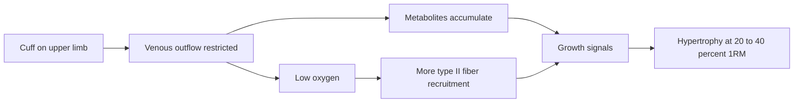

# Occlusion training (blood flow restriction)

## Summary

Blood flow restriction (BFR) training, also called occlusion training, restricts blood flow to working muscles with cuffs or bands during exercise. It stimulates muscle growth and strength with much lighter loads (20 to 40 percent of 1RM) than traditional strength training. BFR is used in rehabilitation after injuries and operations, by older adults, and by athletes looking for a new stimulus. It is generally safe when applied correctly, but it has contraindications.

*This note is educational. It is not medical advice and does not replace a doctor, dietitian or pharmacist, especially during pregnancy, illness or when taking medicines.*

## Prerequisites

- [Muscle hypertrophy](../../physiology/muscle/hypertrophy.md)

## Core concepts

### Definition

*Blood flow restriction training* is exercise performed with a cuff or band around the upper part of a limb, inflated or tightened enough to restrict venous outflow while preserving arterial inflow.

### Analogy

BFR is like partly blocking the drain of a sink while the tap runs: water (blood) flows in but leaves slowly, so the basin (muscle) fills with water and everything in it. The analogy breaks because the "water" also carries metabolites and hormones that trigger adaptation.

### Mechanism

BFR partially restricts venous blood outflow while maintaining arterial inflow. This causes:

- accumulation of metabolites (for example lactate), which stimulates muscle growth;
- increased activation of type II (fast) fibers, responsible for strength and hypertrophy, because slow fibers fatigue sooner in a low-oxygen environment;
- higher production of growth hormone (GH) and other anabolic factors (the role of these acute hormonal changes in growth is debated);
- greater muscle fatigue at low loads, which reduces mechanical stress on joints and tendons;
- cell swelling, which is thought to signal growth.

The flowchart shows the mechanism.

### Claimed effects and evidence

Each entry states the claimed effect and how strong the evidence is, using the grades defined in the [Evidence grades](../../nutrition/evidence-grades.md) note.

- **Hypertrophy and strength gains with light loads.** Possible with 20 to 30 percent of 1RM; strength gains smaller than with heavy loads. Evidence: strong.
- **Protecting joints and tendons in rehabilitation.** A meta-analysis found BFR more effective than low-load training alone in rehabilitation. Evidence: moderate.
- **Increased growth hormone improves recovery and adaptation.** GH rises acutely, but its role in hypertrophy is doubtful. Evidence: limited.
- **Better muscular endurance.** Improves the effectiveness of endurance training in some studies. Evidence: limited.
- **Lower load on the nervous system reduces risk of overtraining.** Plausible, not directly studied. Evidence: very limited.

## Worked example

**How to apply BFR (as practiced).**

- **Cuffs or bands.** Width 5 to 10 cm (the wider, the lower the risk of excessive pressure).
- **Placement.** Upper limbs: the upper arm, close to the shoulder. Lower limbs: the upper thigh, close to the groin.
- **Pressure.** Upper limbs: 40 to 50 percent of the pressure that fully stops arterial flow (limb occlusion pressure). Lower limbs: 50 to 80 percent. The pressure must not block arterial inflow completely; a light pulse should be felt.
- **Load.** 20 to 40 percent of 1RM.
- **Repetitions.** First set 30 repetitions, sets 2 to 4: 15 to 20 repetitions (the common 30-15-15-15 scheme).
- **Rest.** 30 seconds between sets, with the cuffs kept on.
- **Exercises.** Upper body: barbell or dumbbell presses, biceps curls, triceps pushdowns. Lower body: squats, leg presses, leg extensions and curls. Rehabilitation: light isolation exercises for weakened muscles.

**Who it is for.** Athletes looking for an alternative to classic strength training; people after injuries and operations (for example anterior cruciate ligament reconstruction or shoulder injuries); bodybuilders and fitness enthusiasts seeking a new stimulus; older adults or beginners who cannot train with heavy loads.

**Example.** After knee surgery, a patient who cannot load the leg heavily does leg extensions with 25 percent of 1RM, a thigh cuff at 60 percent of limb occlusion pressure, and the 30-15-15-15 scheme with 30-second rests, supervised by a physiotherapist. Over 8 weeks, quadriceps strength recovers faster than with light exercise alone.

## Trade offs and when to use it

BFR allows hypertrophy with light loads and spares the joints, but it is uncomfortable and needs correct equipment and pressure. It complements heavy training rather than replacing it for maximal strength.

**Safety.** BFR is generally safe with precautions:

- not for people with cardiovascular problems, a history of thrombosis, uncontrolled hypertension or poor circulation, without medical clearance;
- do not tighten bands too much (risk of fully cutting off blood flow);
- do not use BFR on the whole body at once;
- do not use it too long: a single session should not exceed 20 to 30 minutes of cuff time.

## Common mistakes

- **Tightening the cuffs as hard as possible.** Use measured pressure that preserves arterial flow.
- **Using heavy loads with BFR.** The method is designed for 20 to 40 percent of 1RM.

## Practice

1. What is the typical load in BFR training?
2. Describe the common repetition scheme.
3. Who should not use BFR without medical clearance?

### Answers

1. 20 to 40 percent of 1RM.
2. 30 repetitions, then 3 sets of 15 to 20, with 30 seconds of rest.
3. People with cardiovascular problems, a history of thrombosis or poor circulation.

## Further reading

- Patterson, S. D., Hughes, L., Warmington, S. et al. (2019). Blood flow restriction exercise: considerations of methodology, application, and safety. Frontiers in Physiology, 10, 533. [DOI](https://doi.org/10.3389/fphys.2019.00533). Position stand on BFR methodology, application and safety.
- Hughes, L., Paton, B., Rosenblatt, B. et al. (2017). Blood flow restriction training in clinical musculoskeletal rehabilitation: a systematic review and meta-analysis. British Journal of Sports Medicine, 51(13), 1003-1011. [DOI](https://doi.org/10.1136/bjsports-2016-097071). Meta-analysis of BFR in musculoskeletal rehabilitation.
