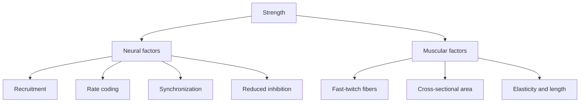

# Factors that determine strength

## Summary

Muscular strength depends on neural and muscular factors. Neural factors are motor unit recruitment, rate coding (firing frequency), motor unit synchronization and reduced neuromuscular inhibition. Muscular factors are the proportion and activation of fast-twitch fibers, the size of the muscle (its physiological cross-section) and the muscle's elasticity. Early strength gains in training come mostly from neural adaptations; later gains come increasingly from muscle growth.

## Prerequisites

- [Motor units and neural control of force](../../physiology/muscle/motor-units.md)
- [Types of strength](strength-types.md)

## Core concepts

### Definition

*Strength factors* are the physiological properties of the nervous system and muscle that determine how much force a muscle can produce.

### Analogy

The factors of strength are like an orchestra. The number of musicians playing is recruitment, how fast they play is rate coding, how well they play together is synchronization, the conductor holding them back is inhibition, the instruments are the fibers, and the size of the orchestra is muscle size. The analogy breaks because muscle size can grow, while an orchestra hires new players.

### Mechanism

**Motor unit recruitment.** The number of motor units activated in a muscle or region. The more motor units are engaged, the greater the force. High-intensity exercise (maximal sprints, Olympic lifts) produces high recruitment ([Motor units and neural control of force](../../physiology/muscle/motor-units.md)).

**Rate coding.** A single nerve impulse causes a brief, weak twitch followed by relaxation. If a second impulse arrives before full relaxation, the twitches summate and produce more force. The strongest activation comes from a rapid series of impulses. The higher the firing frequency, the greater the force, up to the muscle's maximum.

**Synchronization of motor units.** Motor units can fire at different times. The better the timing of their activation, the more force the muscle produces, and the faster.

**Neuromuscular inhibition.** Receptors, mainly the Golgi tendon organs, reduce force output to protect tissues. Reducing this inhibition increases force. Long periods of heavy training are thought to reduce it; this is plausible but hard to measure directly.

**Fiber activation and type.** The body has fast-twitch and slow-twitch fibers ([Muscle fiber types](../../physiology/muscle/muscle-fiber-types.md)). Activating more fast-twitch fibers gives larger gains in strength and power. The fiber proportion of a muscle and of the whole body matters: a person with mostly slow-twitch fibers will not reach the same levels of strength and power.

**Muscle size.** The larger the physiological cross-sectional area of a muscle, the more force it can produce ([Muscle hypertrophy](../../physiology/muscle/hypertrophy.md)).

**Muscle elasticity.** A stiff or shortened muscle produces less force in a given exercise. A claim often repeated in training texts is that about one fifth of strength is linked to muscle elasticity; I could not find a primary source for this number, so treat it as unverified. What is established is that the length of a muscle affects its force ([Force, length and velocity of muscle](../../physiology/muscle/force-length-velocity.md)), and that tendon and muscle stiffness affect the rate of force development.

The flowchart groups the factors.

### Claimed effects and evidence

Each entry states the claimed effect and how strong the evidence is, using the grades defined in the [Evidence grades](../../nutrition/evidence-grades.md) note.

- **Early strength gains are mainly neural.** Strength rises faster than muscle size in the first weeks of training. Evidence: strong.
- **Larger muscles produce more force.** Cross-sectional area is a major determinant of force. Evidence: established physiology.
- **Heavy training reduces Golgi tendon organ inhibition.** Plausible mechanism; direct evidence is limited. Evidence: limited.
- **One fifth of strength is linked to muscle elasticity.** No primary source found. Evidence: very limited.

## Worked example

A beginner increases their squat from 60 to 90 kg in 8 weeks while thigh circumference barely changes. Most of this gain is neural: more motor units recruited, higher firing rates and better coordination. Over the following year, their squat rises to 130 kg as the quadriceps and glutes grow.

## Trade offs and when to use it

Training for strength combines heavy loads (neural factors), hypertrophy work (muscle size) and speed work (rate of force development). Genetics (fiber proportion) sets individual limits.

## Common mistakes

- **Expecting strength gains only from muscle growth.** Early gains are mostly neural.
- **Neglecting heavy loads.** High recruitment and rate coding require heavy or explosive efforts.

## Practice

1. Name four neural factors of strength.
2. Why do beginners gain strength quickly without visible muscle growth?
3. What is rate coding?

### Answers

1. Recruitment, rate coding, synchronization and reduced inhibition.
2. Neural adaptations come first.
3. Increasing the firing frequency of motor units, so twitches summate into more force.

## Further reading

- Sale, D. G. (1988). Neural adaptation to resistance training. Medicine and Science in Sports and Exercise, 20(5 Suppl), S135-S145. [DOI](https://doi.org/10.1249/00005768-198810001-00009). Review of neural adaptations to resistance training.
- Suchomel, T. J., Nimphius, S., Bellon, C. R. et al. (2018). The importance of muscular strength: training considerations. Sports Medicine, 48(4), 765-785. [DOI](https://doi.org/10.1007/s40279-018-0862-z). Training considerations for strength.
