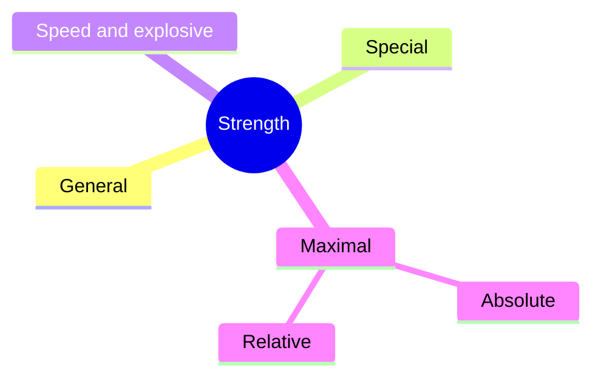

# Types of strength

## Summary

Muscular strength is the ability of the neuromuscular system to overcome or resist an external resistance through muscle contraction. It is measured as the maximal load a person can lift in a single movement. Coaches distinguish general, special, speed (explosive), maximal, absolute and relative strength. Each type matters in different sports and in different phases of the training year.

## Prerequisites

- [Repetition maximum](../training-variables/repetition-maximum.md)

## Core concepts

### Definition

*Muscular strength* is the ability of the neuromuscular system to produce force against an external resistance or to resist it. The force of the contraction differs between people. Its standard measure is the one-repetition maximum ([Repetition maximum](../training-variables/repetition-maximum.md)).

The main types:

- *General strength*: the strength of the whole muscular system, the base of any strength program.
- *Special strength*: strength in the movement patterns specific to a sport.
- *Speed (explosive) strength*: the ability to develop force quickly at high movement velocities.
- *Maximal strength*: the highest force that can be produced in a maximal voluntary contraction, measured by the load lifted once.
- *Absolute strength*: the force a person can produce regardless of body mass.
- *Relative strength*: maximal strength divided by body mass.

### Analogy

Types of strength are like the qualities of a car engine. Maximal strength is the engine's top torque, speed strength is how fast it reaches that torque, relative strength is torque per kilogram of car, and general strength is the overall condition of the engine. A heavy truck and a light sports car can both be "strong" in different ways. The analogy breaks because, unlike an engine, the body's qualities train each other: maximal strength supports speed strength.

### Mechanism

**General strength** is the base. In the preparatory phase of the annual program and among young athletes beginning their careers, general strength deserves the most attention. If it is neglected, the athlete may not reach their full potential.

**Special strength** is developed in movement patterns important for a specific sport. Athletes usually work on it at the end of the preparatory phase ([GPP and SPP](../programming/gpp-and-spp.md)).

**Speed (explosive) strength** is the ability to develop maximal force in the shortest possible time. It allows dynamic movements: jumping, sprinting from a standstill, changing direction suddenly and stopping. It matters in most sports, especially team sports such as soccer. The best time to develop it is the specific preparation phase and the competition season.

**Maximal strength** is measured by the load lifted once. It is linked to muscular endurance, explosive strength and speed.

**Absolute strength** matters where the result does not depend directly on body mass, for example in the shot put, where only the resistance overcome counts. It is measured in a way suited to the sport, with a resistance that allows only one full repetition.

**Relative strength** is the ratio of maximal strength to body mass. It matters in sports where performance correlates negatively with body mass (gymnastics, climbing, weight-class sports).

The mindmap groups the types of strength.

## Worked example

Two athletes squat 150 kg. Athlete A weighs 75 kg, athlete B 100 kg. Their absolute strength is the same, but A's relative strength is 2.0 (150 / 75) and B's is 1.5 (150 / 100). In a sport where body mass must be moved, such as climbing, A has the advantage; in the shot put, the difference in body mass matters less.

## Trade offs and when to use it

Every type of strength rests on general and maximal strength, but sport-specific success needs the right balance. Focusing only on maximal strength may neglect speed strength needed in sports.

## Common mistakes

- **Equating strength with maximal strength only.** Speed and relative strength matter in many sports.
- **Skipping general strength in young athletes.** It is the base for later specialization.

## Practice

1. Define relative strength.
2. When is speed strength best developed?
3. Which type of strength should young athletes focus on first?

### Answers

1. Maximal strength divided by body mass.
2. In the specific preparation phase and in the competition season.
3. General strength.

## Further reading

- Suchomel, T. J., Nimphius, S., Bellon, C. R. et al. (2018). The importance of muscular strength: training considerations. Sports Medicine, 48(4), 765-785. [DOI](https://doi.org/10.1007/s40279-018-0862-z). Review of the importance of muscular strength and training considerations.
- Haff, G. G., Triplett, N. T. (Eds.) (2016). *Essentials of Strength Training and Conditioning (4th ed.)*. Human Kinetics. Definitions of strength qualities.
