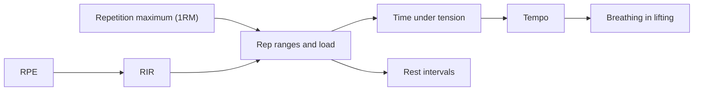

# Training variables

Training variables are the measurable settings of a training program: how heavy the load is, how hard each set is, how many repetitions, how fast each repetition is performed, how long the rests are and how the lifter breathes. These notes explain each variable and how it is measured.

## Map

## Reading order

1. [Repetition maximum](repetition-maximum.md)
2. [Rating of perceived exertion (RPE)](rpe.md)
3. [Repetitions in reserve (RIR)](rir.md)
4. [Repetition ranges and load](rep-ranges-and-load.md)
5. [Rest intervals](rest-intervals.md)
6. [Time under tension (TUT)](time-under-tension.md)
7. [Tempo](tempo.md)
8. [Breathing pattern in lifting](breathing-pattern-in-lifting.md)
