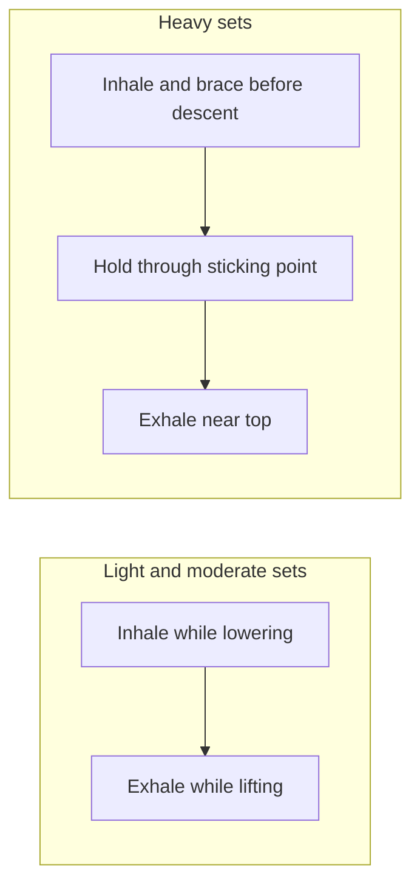

# Breathing pattern in lifting

## Summary

The basic breathing rule in strength training is to inhale during the eccentric (lowering) phase and exhale during the concentric (lifting) phase. For heavy sets, lifters instead take a breath before the repetition, brace and hold it through the hardest part (the Valsalva maneuver) and exhale near the end of the lift. Holding the breath raises intra-abdominal pressure and stabilizes the spine but also raises blood pressure briefly.

## Prerequisites

- [Breathing techniques in training](../../physiology/respiration/breathing-techniques.md)

## Core concepts

### Definition

A *breathing pattern* in lifting is the timing of inhalation, breath holding and exhalation relative to the phases of a repetition. *Bracing* is co-contraction of the trunk muscles against a held breath to stiffen the trunk.

### Analogy

Breathing in lifting is like inflating a car tire before carrying a load: an inflated tire (pressurized trunk) carries weight without buckling, while a flat one collapses. Releasing a little air at the end of the lift is like easing pressure once the load is safely in place. The analogy breaks because in the body the pressure also affects blood flow and blood pressure.

### Mechanism

- **Light and moderate sets:** inhale while lowering, exhale while lifting. This keeps blood pressure lower and is suitable for most people.
- **Heavy sets:** inhale deeply into the belly and lower ribs before the descent, brace the abdominal wall, hold through the sticking point, exhale near the top or between repetitions.
- **Physiology:** the diaphragm, abdominal muscles and pelvic floor form a pressurized cylinder ([Core stability](../mobility/core.md)); see [Breathing techniques in training](../../physiology/respiration/breathing-techniques.md) for details and cautions.

The diagram shows the two patterns.

## Worked example

On a 5-repetition set of deadlifts near maximum, the lifter takes a breath and braces at the bottom before each repetition, pulls the bar while holding the breath, exhales at lockout, and takes a new breath at the bottom. Holding the breath for the whole set of 5 would raise blood pressure for too long and risk dizziness.

## Trade offs and when to use it

- Bracing improves performance and stability under heavy loads. People with uncontrolled hypertension, cardiovascular disease, recent eye surgery or hernias should avoid maximal breath holding and use lighter loads with continuous breathing, after medical advice.

## Common mistakes

- **Holding the breath for several repetitions.** Breathe between repetitions.
- **Breathing into the upper chest only.** Breathe into the belly and lower ribs for a better brace.

## Practice

1. What is the basic breathing rule for moderate sets?
2. How do lifters breathe on heavy sets?
3. Who should avoid maximal breath holding?

### Answers

1. Inhale while lowering, exhale while lifting.
2. Inhale and brace before the repetition, hold through the hardest part, exhale near the top.
3. People with uncontrolled hypertension, cardiovascular disease, recent eye surgery or hernias, among others.

## Further reading

- Haff, G. G., Triplett, N. T. (Eds.) (2016). *Essentials of Strength Training and Conditioning (4th ed.)*. Human Kinetics. Breathing guidance in resistance training.
