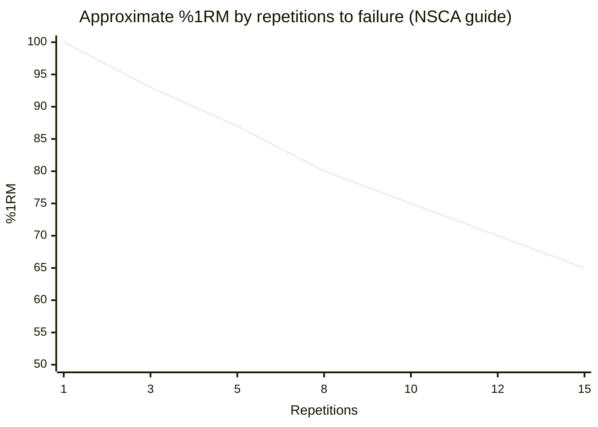
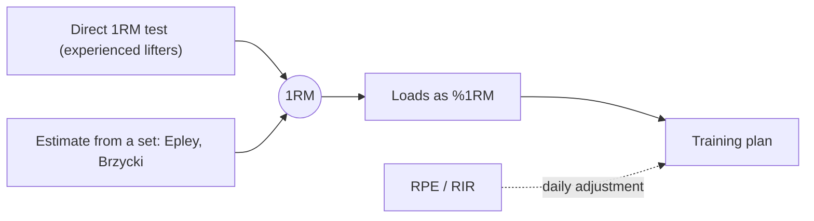

# Repetition maximum

## Summary

A repetition maximum (RM) is the heaviest load a person can lift a given number of times with good technique. The one-repetition maximum (1RM), also called maximal weight or personal record (PR), is the most common reference for setting training loads as a percentage. Testing a true 1RM requires good technique and experience, so for beginners it is of limited use; estimates from submaximal sets are safer.

## Prerequisites

- [Muscle actions: concentric, eccentric and isometric](../biomechanics/muscle-actions.md)

## Core concepts

### Definition

The *n-repetition maximum* (nRM) is the greatest load that can be lifted exactly n times before failure with proper form. *1RM* is the load for one repetition. Loads are often prescribed as a percentage of 1RM (%1RM).

### Analogy

1RM is like a car's top speed: a single reference point used to set other speeds ("drive at 70 percent of top speed"). You do not need to drive at top speed to know roughly where it is; you can estimate it from how the car behaves at lower speeds. The analogy breaks because a person's 1RM changes daily with fatigue, sleep and motivation.

### Mechanism

**Direct testing.** After a warm-up, the lifter attempts heavier single repetitions with rests of 3 to 5 minutes until failure, ideally reaching the 1RM within 3 to 5 attempts.

**Estimation.** Formulas estimate 1RM from a set of several repetitions to failure:

- Epley: 1RM = w × (1 + reps ÷ 30)
- Brzycki: 1RM = w × 36 ÷ (37 − reps)

Estimates are reasonably accurate up to about 10 repetitions and worsen with higher repetitions.

**Relation of repetitions to %1RM (typical guide).**

| Repetitions to failure | Approximate %1RM |
| --- | --- |
| 1 | 100 |
| 3 | 93 |
| 5 | 87 |
| 8 | 80 |
| 10 | 75 |
| 12 | 70 |
| 15 | 65 |

The table follows the NSCA guide; individuals and exercises differ, and trained lifters can often do more repetitions at a given %1RM in lower-body exercises.

The chart shows the same relationship.

The diagram shows how 1RM is used.

## Worked example

A lifter bench presses 80 kg for 6 repetitions to failure. Epley: 80 × (1 + 6 ÷ 30) = 96 kg. Brzycki: 80 × 36 ÷ 31 ≈ 92.9 kg. The estimated 1RM is about 93 to 96 kg. A program prescribing 4 sets at 75 percent would use about 70 to 72 kg.

## Trade offs and when to use it

- Percentages give structure but ignore daily readiness. Combining %1RM with RPE or RIR adjusts loads to the day.
- Maximal testing has a small injury risk and causes fatigue; it is unnecessary for most recreational lifters.

## Common mistakes

- **Testing 1RM with poor technique.** Learn the movement first.
- **Treating estimated 1RM from 20 repetitions as accurate.** Estimates are poor beyond about 10 repetitions.

## Practice

1. What does 5RM mean?
2. Estimate 1RM from 100 kg for 5 repetitions with the Epley formula.
3. Why is a 1RM test not recommended for beginners?

### Answers

1. The heaviest load that can be lifted exactly 5 times with good form.
2. 100 × (1 + 5 ÷ 30) ≈ 116.7 kg.
3. They lack the technique to lift maximal loads safely, and their 1RM changes quickly.

## Further reading

- Haff, G. G., Triplett, N. T. (Eds.) (2016). *Essentials of Strength Training and Conditioning (4th ed.)*. Human Kinetics. NSCA table of %1RM and repetitions and 1RM testing protocols.
- Brzycki, M. (1993). Strength testing: predicting a one-rep max from reps-to-fatigue. Journal of Physical Education, Recreation and Dance, 64(1), 88-90. [DOI](https://doi.org/10.1080/07303084.1993.10606684). The Brzycki prediction formula.
