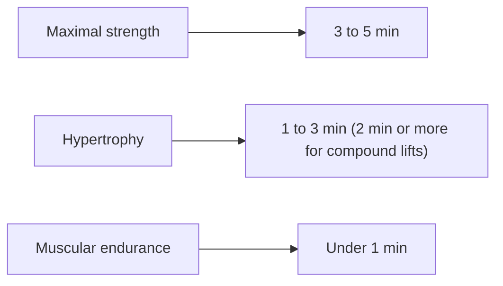

# Rest intervals

## Summary

Rest intervals, also called metabolic recovery time, are the pauses between sets. They are chosen according to the goal: longer rests (about 3 to 5 minutes) for maximal strength, moderate rests (about 1 to 3 minutes) for hypertrophy, and short rests (under a minute) for muscular endurance. Longer rests allow more repetitions and more total volume in later sets, which is why recent research favors at least about 2 minutes between hard sets of compound exercises, even for hypertrophy.

## Prerequisites

- [Repetition ranges and load](rep-ranges-and-load.md)

## Core concepts

### Definition

A *rest interval* is the time between the end of one set and the start of the next. It determines how much phosphocreatine is restored and how much fatigue clears before the next set.

### Analogy

Rest intervals are like letting a phone charge between calls. A short charge allows only a short next call; a longer charge allows a full call. If calls (sets) need full power (heavy loads), the charge must be longer. The analogy breaks because fatigue also includes the nervous system and metabolites, which recover at different speeds.

### Mechanism

- Phosphocreatine recovers about half in 30 seconds and nearly fully in 3 to 5 minutes ([Energy systems](../../physiology/energy-systems.md)).
- Metabolites (hydrogen ions, inorganic phosphate) clear over minutes.
- Short rests increase metabolic stress but reduce load and repetitions in subsequent sets.
- A systematic review (Grgic and colleagues, 2018) found that rests of more than 2 minutes favor strength in trained lifters.

The diagram matches rest to goal.

## Worked example

A lifter does 4 sets of 10 squats at 80 kg. With 60 seconds rest, repetitions fall to 10, 8, 6 and 5 (29 total). With 3 minutes rest, they are 10, 10, 9 and 9 (38 total). The longer rest gives about 30 percent more volume at the same load, which likely means more stimulus.

## Trade offs and when to use it

- Longer rests mean longer sessions. Supersets of opposing muscles or alternating upper and lower body exercises save time while keeping recovery for each muscle.

## Common mistakes

- **Using very short rests for heavy compound lifts.** Performance drops sharply.
- **Resting by habit rather than readiness.** Rest until able to repeat the target performance, within reason.

## Practice

1. What rest interval suits maximal strength?
2. Why can short rests reduce hypertrophy?
3. How does phosphocreatine recovery influence rest choices?

### Answers

1. About 3 to 5 minutes.
2. They lower the load or repetitions in later sets, reducing total volume.
3. It needs about 3 to 5 minutes for near-complete recovery, so heavy sets need long rests.

## Further reading

- Grgic, J., Schoenfeld, B. J., Skrepnik, M. et al. (2018). Effects of rest interval duration in resistance training on measures of muscular strength: a systematic review. Sports Medicine, 48(1), 137-151. [DOI](https://doi.org/10.1007/s40279-017-0788-x). Systematic review of rest intervals and strength.
- Haff, G. G., Triplett, N. T. (Eds.) (2016). *Essentials of Strength Training and Conditioning (4th ed.)*. Human Kinetics. Guidelines for rest by goal.
