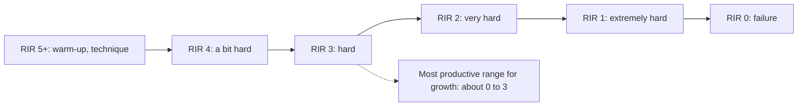

# Repetitions in reserve (RIR)

## Summary

Repetitions in reserve (RIR) is the number of additional repetitions a lifter could have completed with the same load at the end of a set. It is the basis of the strength training RPE scale (RPE = 10 − RIR). For hypertrophy, the meaningful range is about 0 to 4 RIR; sets ending with 5 or more repetitions in reserve give little stimulus. RIR 0 is muscle failure.

## Prerequisites

- [Rating of perceived exertion (RPE)](rpe.md)

## Core concepts

### Definition

*Repetitions in reserve* is an estimate, made at the end of a set, of how many more repetitions could have been done with good technique before failure. *Muscle failure* (RIR 0) is the point at which another repetition cannot be completed.

### Analogy

RIR is like the number of steps left before reaching the edge of a cliff. Most training stops a few steps from the edge, close enough to gain the view (the training stimulus) without falling (excessive fatigue and injury risk). The analogy breaks because, unlike a cliff, the edge (failure) is safe to touch on some exercises.

### Mechanism

As a set approaches failure, more high-threshold motor units are recruited and bar speed slows (see [Motor units and neural control of force](../../physiology/muscle/motor-units.md)). Stopping within a few repetitions of failure captures most of the stimulus while limiting fatigue. A 2023 meta-analysis (Refalo and colleagues) found that hypertrophy increases as sets get closer to failure, but training all the way to failure gives only a small additional benefit compared with stopping a few repetitions short.

**Interpretation on a 0 to 4 scale.**

| RIR | Feeling |
| --- | --- |
| 4 | A bit hard |
| 3 | Hard |
| 2 | Very hard |
| 1 | Extremely hard |
| 0 | Muscle failure |

RIR values of 5 and above (on a 1 to 10 counting) are not important for hypertrophy.

The diagram shows where training typically falls.

## Worked example

A lifter performs 12 repetitions of dumbbell rows and judges that 2 more were possible (RIR 2, RPE 8). On the last set, to calibrate, the lifter continues to failure and reaches 15 repetitions. The real RIR on the earlier set was probably 3, not 2. Calibration sets like this improve future estimates.

## Trade offs and when to use it

- Training near failure maximizes the stimulus per set but increases fatigue and recovery time; heavy compound lifts are usually kept at 1 to 3 RIR, while isolation exercises can be taken closer to failure.

## Common mistakes

- **Overestimating reserves at high repetitions.** People tend to stop too early in long sets.
- **Training every set to failure.** It adds fatigue for little extra benefit.

## Practice

1. What does RIR 0 mean?
2. Which RIR range is most useful for hypertrophy?
3. What did a 2023 meta-analysis find about training to failure?

### Answers

1. Muscle failure: no further repetition was possible.
2. About 0 to 3 (up to 4).
3. Growth increases closer to failure, but going all the way to failure adds only a small benefit.

## Further reading

- Zourdos, M. C., Klemp, A., Dolan, C. et al. (2016). Novel resistance training-specific rating of perceived exertion scale measuring repetitions in reserve. Journal of Strength and Conditioning Research, 30(1), 267-275. [DOI](https://doi.org/10.1519/JSC.0000000000001049). RIR-based RPE scale.
- Refalo, M. C., Helms, E. R., Trexler, E. T. et al. (2023). Influence of resistance training proximity-to-failure on skeletal muscle hypertrophy: a systematic review with meta-analysis. Sports Medicine, 53(3), 649-665. [DOI](https://doi.org/10.1007/s40279-022-01784-y). Meta-analysis of proximity to failure and hypertrophy.
