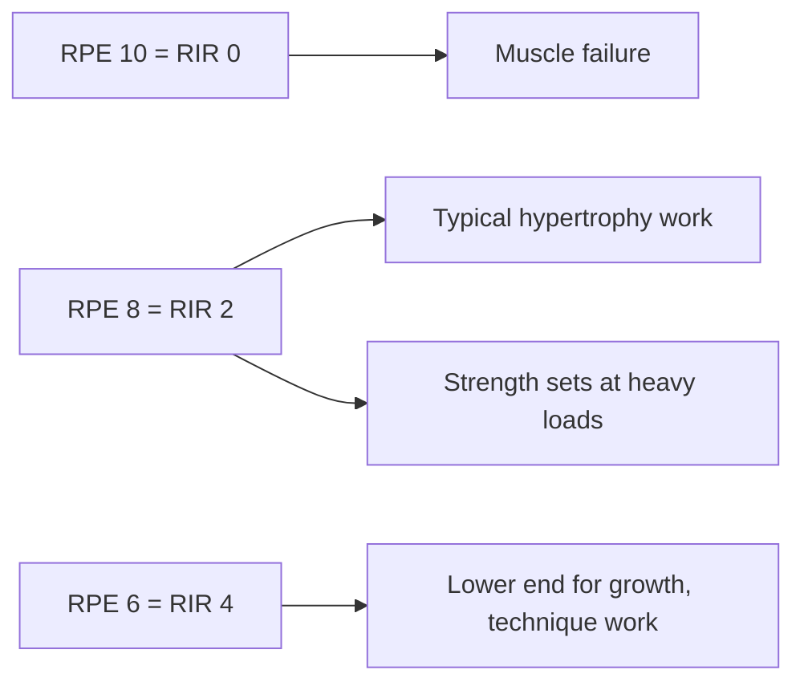

# Rating of perceived exertion (RPE)

## Summary

The rating of perceived exertion (RPE) is a subjective rating of how hard an effort feels, used to set and monitor training intensity. Gunnar Borg created the first scale, from 6 to 20, for endurance exercise and cardiology. In strength training, a 1 to 10 scale based on repetitions in reserve, developed by Mike Tuchscherer and validated by Zourdos and colleagues, is more common: RPE 10 means no more repetitions were possible, RPE 9 one more, RPE 8 two more. For muscle building, most work falls around RPE 6 to 8 (4 to 2 repetitions in reserve) or higher.

## Prerequisites

- [Repetition maximum](repetition-maximum.md)

## Core concepts

### Definition

*Perceived exertion* is the subjective intensity of effort. The *Borg RPE scale* (6 to 20) roughly tracks heart rate divided by 10 in young adults. The *Borg CR10 scale* runs from 0 to 10. The *RIR-based RPE scale* for resistance training rates a set by how many repetitions were left in reserve (RIR): RPE = 10 − RIR.

### Analogy

RPE is like a fuel gauge for a single set: it tells you how close you came to empty. A set at RPE 10 ran the tank dry; RPE 7 left three repetitions' worth in the tank. The analogy breaks because the gauge is read by the driver, so it depends on experience and honesty.

### Mechanism

**RIR-based RPE scale for strength training.**

| RPE | Description | RIR |
| --- | --- | --- |
| 10 | Maximal effort, no repetition left | 0 |
| 9.5 | No more repetitions, but slightly more load possible | 0 to 1 |
| 9 | One repetition left | 1 |
| 8.5 | One or two left | 1 to 2 |
| 8 | Two repetitions left | 2 |
| 7 | Three left; bar speed fast with effort | 3 |
| 5 to 6 | Four to six left | 4 to 6 |
| 1 to 4 | Very light to light | Many |

The larger the reserve, the lower the intensity.

**Targets by goal.** For muscle building, loads of about 60 to 85 percent of 1RM at about RPE 6 to 8 (4 to 2 RIR) are a common recommendation. If intensity is too low, the stimulus is not enough for growth. If the load is too high while staying in hypertrophy repetition ranges (about 6 to 20), workload (sets × repetitions × load) rises unnecessarily, fatigue of the central nervous system increases, recovery slows and injury risk grows. For strength, loads of about 85 percent of 1RM and above are typical; for muscular endurance, about 45 to 60 percent.

| Goal | %1RM | RPE | RIR |
| --- | --- | --- | --- |
| Muscle building | 60 to 85 | 6 to 8 (up to 10 on some sets) | 4 to 0 |
| Strength | 85 and above | 7 to 9 | 3 to 1 |
| Muscular endurance | 45 to 60 | Variable; sets often taken close to failure | Variable |

These are common guidelines; research shows hypertrophy over a wider load range when sets are taken close to failure ([Repetition ranges and load](rep-ranges-and-load.md)).

The diagram shows the link between RPE, RIR and goal.

### Accuracy

Lifters underestimate how many repetitions they have left, especially at high repetitions and far from failure; accuracy improves near failure and with experience (Helms and colleagues, 2016). Beginners can train to failure occasionally on safe exercises to calibrate.

## Worked example

A program prescribes "squat 3 × 5 at RPE 8". On a good day, the lifter reaches RPE 8 with 110 kg; on a day after poor sleep, the same RPE comes at 102.5 kg. Using RPE, the training load adapts to readiness, while a fixed 85 percent of an outdated 1RM could have been too heavy or too light.

## Trade offs and when to use it

- RPE adapts to daily form and requires no testing, but depends on the lifter's experience and honesty.
- Combining RPE with load and repetition records gives the best picture of progress.

## Common mistakes

- **Confusing Borg's 6 to 20 scale with the 1 to 10 RIR scale.** They measure different things.
- **Always stopping far from failure while rating sets as RPE 8.** Calibrate occasionally.

## Practice

1. What does RPE 7 mean on the RIR-based scale?
2. Who created the 6 to 20 RPE scale, and for what?
3. Why might RPE work better than %1RM on a bad day?

### Answers

1. Three repetitions were left in reserve.
2. Gunnar Borg, for endurance exercise and cardiology.
3. It adjusts the load to the lifter's actual readiness that day.

## Further reading

- Borg, G. A. (1982). Psychophysical bases of perceived exertion. Medicine and Science in Sports and Exercise, 14(5), 377-381. [DOI](https://doi.org/10.1249/00005768-198205000-00012). Original basis of perceived exertion scales.
- Zourdos, M. C., Klemp, A., Dolan, C. et al. (2016). Novel resistance training-specific rating of perceived exertion scale measuring repetitions in reserve. Journal of Strength and Conditioning Research, 30(1), 267-275. [DOI](https://doi.org/10.1519/JSC.0000000000001049). Validation of the RIR-based RPE scale.
- Helms, E. R., Cronin, J., Storey, A. et al. (2016). Application of the repetitions in reserve-based rating of perceived exertion scale for resistance training. Strength and Conditioning Journal, 38(4), 42-49. [DOI](https://doi.org/10.1519/SSC.0000000000000218). Application of the scale in training.
- Tuchscherer, M. (2008). *The Reactive Training Manual*. Reactive Training Systems. The RIR-based 1 to 10 scale.
