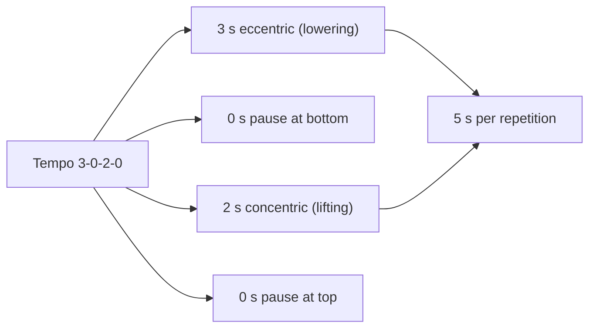

# Tempo

## Summary

Tempo describes how long each phase of a repetition takes, written as four numbers. In the example 3-0-2-0, the first number is the lowering (eccentric) phase of 3 seconds, the second the pause at the bottom (none), the third the lifting (concentric) phase of 2 seconds and the fourth the pause at the top (none). Many coaches state that time under tension matters more than the total number of repetitions. Tempo makes sets reproducible and controls time under tension.

## Prerequisites

- [Time under tension (TUT)](time-under-tension.md)

## Core concepts

### Definition

*Tempo* is the prescribed duration of each phase of a repetition in seconds, written eccentric-pause-concentric-pause. An "X" in the concentric position means "as fast as possible" (explosive intent).

### Analogy

Tempo is like the beat in music. The same melody (exercise) played at a different beat feels and works differently. A drummer (metronome) keeps the beat consistent from session to session. The analogy breaks because in lifting the beat also changes the load you can handle.

### Mechanism

For a tempo of 3-0-2-0, you train as follows:

- 3 seconds of eccentric movement;
- 0 seconds of pause after the eccentric movement;
- 2 seconds of concentric movement;
- 0 seconds of pause after the concentric movement.

The order of numbers follows the order of phases in exercises that start with lowering (squat, bench press). For exercises starting with lifting (pull-up, row), some coaches still write the eccentric first; reading the program's convention matters.

The diagram decodes a tempo prescription.

### Common tempos

| Tempo | Use |
| --- | --- |
| 2-0-X-0 | Strength and power: controlled lowering, explosive lifting |
| 3-0-1-0 | General hypertrophy |
| 3-1-2-0 | Hypertrophy with a pause at the stretched position |
| 4-0-1-0 or 5-0-1-0 | Eccentric emphasis, technique, tendon work |
| 2-2-1-0 | Pause squats or bench press for strength at the bottom |

## Worked example

A program prescribes "squat 4 × 8 at 3-1-X-0". The lifter lowers for 3 seconds, pauses 1 second at the bottom without relaxing, rises as fast as possible (about 1 second) and continues immediately. Each repetition takes about 5 seconds, and each set about 40 seconds. The pause removes the stretch-shortening "bounce", so the load is lower than in normal squats, but strength out of the bottom improves.

## Trade offs and when to use it

- A prescribed tempo improves consistency and control; explosive concentric intent (X) is preferred for strength and power.

## Common mistakes

- **Counting too fast.** Use a metronome or count "one thousand, two thousand".
- **Misreading the order of numbers.** Check the program's convention.

## Practice

1. What does 4-0-1-0 mean?
2. What does an "X" mean in a tempo?
3. Calculate the duration of one repetition at 3-1-2-0.

### Answers

1. 4 seconds lowering, no pause, 1 second lifting, no pause.
2. Lift as fast as possible.
3. 6 seconds.

## Further reading

- Wilk, M., Zajac, A., Tufano, J. J. (2021). The influence of movement tempo during resistance training on muscular strength and hypertrophy responses: a review. Sports Medicine, 51(8), 1629-1650. [DOI](https://doi.org/10.1007/s40279-021-01465-2). Review of movement tempo.
- Schoenfeld, B. J., Ogborn, D. I., Krieger, J. W. (2015). Effect of repetition duration during resistance training on muscle hypertrophy: a systematic review and meta-analysis. Sports Medicine, 45(4), 577-585. [DOI](https://doi.org/10.1007/s40279-015-0304-0). Repetition duration and hypertrophy.
