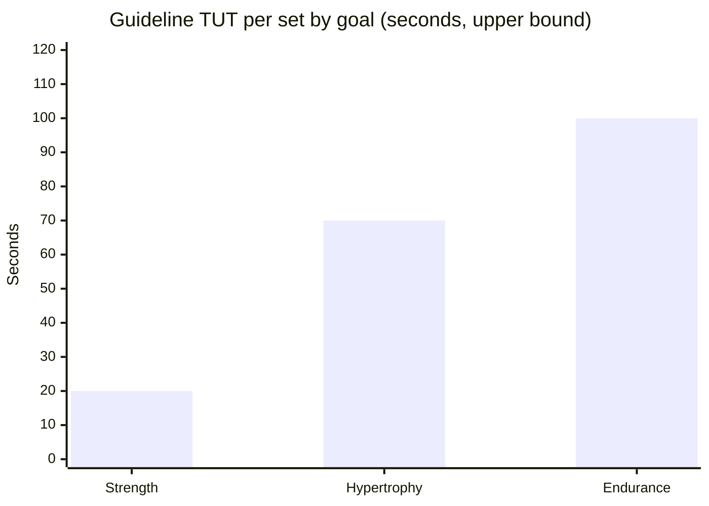
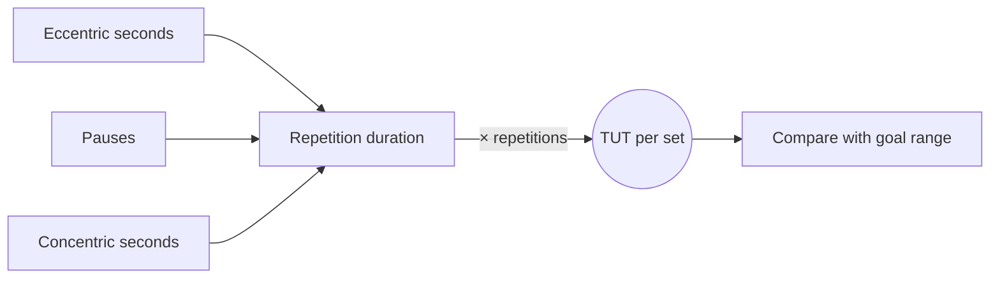

# Time under tension (TUT)

## Summary

Time under tension (TUT) is the total time a muscle is under load during a set, from the start of the first repetition to the end of the last, without full relaxation. It includes the eccentric, isometric and concentric phases. Guidelines often give 30 to 70 seconds per set for hypertrophy, under 20 seconds for maximal strength and over 70 seconds for muscular endurance. TUT is calculated from tempo and repetitions. Research shows that muscle growth is similar across a wide range of repetition durations, about 0.5 to 8 seconds per repetition, so TUT is a useful tool for control and consistency rather than a magic number.

## Prerequisites

- [Muscle actions: concentric, eccentric and isometric](../biomechanics/muscle-actions.md)

## Core concepts

### Definition

*Time under tension* is the total time a muscle or muscle group is under load in a set: TUT of a set = duration of one repetition × number of repetitions. It covers the eccentric phase (lowering), isometric pauses and the concentric phase (lifting).

### Analogy

TUT is like the total time a kettle is on the stove. A longer time on a low flame and a shorter time on a high flame can both bring water to the boil; what matters is reaching the boil (effort close to failure), not the exact time. The analogy breaks because muscles also respond to the load itself: a very light load for a long time is not the same as a heavy load.

### Mechanism

**Why TUT is considered important.**

1. *Hypertrophy*: a longer TUT increases metabolic stress, microdamage and motor unit recruitment.
2. *Control and technique*: a longer TUT requires better neuromuscular control and more precise execution.
3. *Type I fiber involvement*: with slower repetitions, the muscle works longer, which develops endurance and metabolic adaptations.

**Notation.** Tempo is written X-Y-Z-W: X eccentric (lowering), Y pause at the bottom, Z concentric (lifting), W pause at the top. Example 3-1-2-0: 3 seconds lowering, 1 second pause, 2 seconds lifting, no pause at the top. See [Tempo](tempo.md).

**TUT by goal (guidelines).**

| Goal | TUT per set | Example tempo | Comment |
| --- | --- | --- | --- |
| Maximal strength | 5 to 20 s | 1-0-1-0 | Mostly fast movement, short TUT |
| Hypertrophy | 30 to 70 s (often 40 to 70 s) | 3-1-2-0 | Moderate load, controlled tension |
| Muscular endurance | 70 s or more | 2-1-2-1 | Long work, lighter load |

For bodybuilding, TUT per set is generally given as 40 to 70 seconds; sets lasting less than 30 seconds tend to build speed, strength and power rather than maximal muscle mass, according to this guideline. Meta-analyses (Schoenfeld and colleagues, 2015) found similar hypertrophy for repetition durations from about 0.5 to 8 seconds, with very slow repetitions (over 10 seconds) possibly less effective.

The chart compares the guideline TUT ranges (upper ends shown).

**TUT in planning.** TUT is treated as a training variable alongside intensity (%1RM), volume (sets × repetitions) and rest. Writing the exact tempo in the plan prevents "cheating" a set. Progression options: lengthen the eccentric phase (for example 3 s to 5 s), add isometric pauses (2 s at the bottom), or add repetitions at the same tempo.

**Practical points.**

- Tempo control: count in your head or have a coach count, use a metronome, write the tempo in the plan.
- Not every exercise suits long TUT: in dynamic lifts such as the deadlift, changing TUT needs care; in isolation exercises such as curls, TUT matters more.
- Neural versus mechanical adaptation: shorter TUT with heavy loads favors fast-twitch recruitment, strength and power; longer TUT increases metabolic stress.

The diagram shows how TUT is built.

## Worked example

A lifter bench presses fast, lowering and lifting quickly, at a tempo of 1-0-1-0: 2 seconds per repetition. Twelve repetitions give 24 seconds of TUT, below the 40 second minimum often recommended for hypertrophy. Switching to 3-0-2-0 (5 seconds per repetition) at the same 12 repetitions gives 60 seconds; the load will need to drop. Both versions can build muscle if taken close to failure, but the slower tempo improves control and makes sets consistent across sessions.

## Trade offs and when to use it

- Longer TUT with lighter loads reduces joint stress and improves technique, but lowers the load and may limit strength gains.
- Very slow repetitions reduce the load so much that the stimulus may suffer.

## Common mistakes

- Moving too fast without control.
- Ignoring the eccentric phase, often called the most important for hypertrophy.
- Using a load too heavy to keep the tempo.
- Never varying tempo in the plan.

## Practice

1. Calculate the TUT of 10 repetitions at tempo 3-1-2-0.
2. What does the "W" in X-Y-Z-W mean?
3. What did meta-analyses find about repetition duration and hypertrophy?

### Answers

1. 6 seconds × 10 = 60 seconds.
2. The pause at the top of the movement.
3. Hypertrophy is similar from about 0.5 to 8 seconds per repetition; very slow repetitions may be less effective.

## Further reading

- Schoenfeld, B. J., Ogborn, D. I., Krieger, J. W. (2015). Effect of repetition duration during resistance training on muscle hypertrophy: a systematic review and meta-analysis. Sports Medicine, 45(4), 577-585. [DOI](https://doi.org/10.1007/s40279-015-0304-0). Meta-analysis of repetition duration and hypertrophy.
- Wilk, M., Zajac, A., Tufano, J. J. (2021). The influence of movement tempo during resistance training on muscular strength and hypertrophy responses: a review. Sports Medicine, 51(8), 1629-1650. [DOI](https://doi.org/10.1007/s40279-021-01465-2). Review of movement tempo in resistance training.
