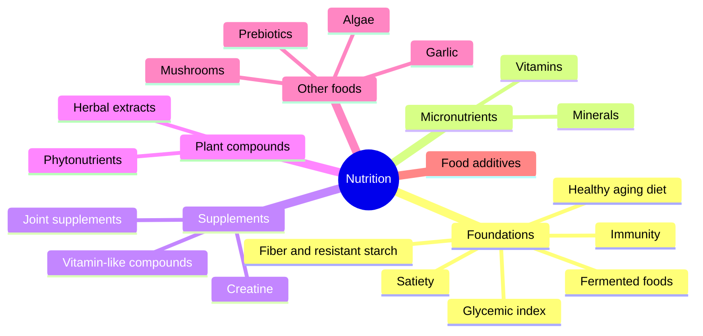

# Nutrition

Nutrition studies how food and its components affect the body. This field covers the foundations of a healthy diet, vitamins and minerals, vitamin-like compounds and other supplements, phytonutrients, prebiotics, algae, herbal extracts, medicinal mushrooms, selected foods and food additives. The chemistry of macronutrients lives in biochemistry: [amino acids](../../../natural-sciences/chemistry/biochemistry/amino-acids/README.md), [lipids](../../../natural-sciences/chemistry/biochemistry/lipids/README.md), [proteins](../../../natural-sciences/chemistry/biochemistry/proteins/README.md) and [carbohydrates](../../../natural-sciences/chemistry/biochemistry/carbohydrates/README.md).

Every claimed effect of a nutrient or supplement in these notes carries an evidence grade, defined in [Evidence grades](evidence-grades.md). Many popular claims are graded "limited" or "not supported". The notes are educational and are not medical or dietary advice.

## Map of the field

## Reading order

1. [Evidence grades](evidence-grades.md): how the strength of evidence is rated in these notes.
2. [Foundations](foundations/README.md): fiber, glycemic index, fermented foods and dietary patterns.
3. [Vitamins](vitamins/README.md): the 13 vitamins.
4. [Minerals](minerals/README.md): essential minerals and trace elements.
5. [Supplements](supplements/README.md): vitamin-like compounds, joint supplements and creatine.
6. [Phytonutrients](phytonutrients/README.md): polyphenols, carotenoids, glucosinolates and others.
7. [Prebiotics](prebiotics/README.md): inulin and fructooligosaccharides.
8. [Algae](algae/README.md): chlorella and spirulina.
9. [Herbal extracts](herbal-extracts/README.md): 15 plant extracts sold as supplements.
10. [Medicinal mushrooms](mushrooms/README.md): cordyceps, lion's mane, maitake, reishi, shiitake and oyster mushroom.
11. [Foods](foods/README.md): garlic and black garlic.
12. [Food additives and contaminants](food-additives/README.md): preservatives, colors, sweeteners, flavor enhancers and acrylamide.
