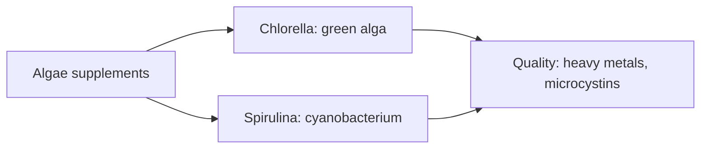

# Algae

Microalgae and cyanobacteria are sold as nutrient-dense supplements. Chlorella is a single-celled green alga; spirulina is a cyanobacterium (formerly called blue-green alga). Both are rich in protein, pigments and minerals. Claims of detoxification and many health benefits outrun the evidence, and both can be contaminated with heavy metals or toxins if poorly produced. Neither is a reliable vitamin B12 source.

## Map

## Reading order

1. [Chlorella](chlorella.md)
2. [Spirulina](spirulina.md)
