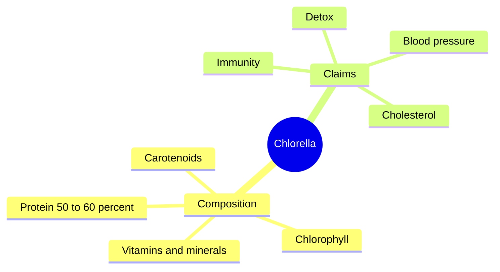

# Chlorella

## Summary

Chlorella is a single-celled freshwater green alga sold as tablets, powder or capsules. It contains about 50 to 60 percent protein by dry weight, chlorophyll, carotenoids, vitamins and minerals. It is marketed for detoxification, immunity, metabolism and skin. Small trials suggest modest improvements in blood pressure, cholesterol and some immune markers. Claims that it removes heavy metals from humans rest on animal studies. Some chlorella products contain active vitamin B12, but amounts vary.

*This note is educational. It is not medical advice and does not replace a doctor, dietitian or pharmacist, especially during pregnancy, illness or when taking medicines.*

## Prerequisites

No prior notes are needed.

## Core concepts

### Definition

*Chlorella* (mainly Chlorella vulgaris and Chlorella pyrenoidosa) is a genus of eukaryotic green microalgae. Its tough cell wall is often broken in processing to improve digestibility.

### Analogy

Chlorella is like a miniature vegetable garden in one cell: protein, pigments, vitamins and minerals packed together. Eating a spoonful is nutritionally similar to eating a small portion of leafy greens with extra protein. The analogy breaks because a contaminated pond (poor production) also delivers its contaminants.

### Mechanism

Its nutrients act like those from other foods. Chlorophyll and cell wall components may bind some compounds in the gut, the basis of detoxification claims. Polysaccharides may stimulate immune cells in laboratory studies.

The mindmap shows the composition and claims of chlorella.

### Proposed effects and evidence

Each entry states the proposed effect and how strong the human evidence is, using the grades defined in the [Evidence grades](../evidence-grades.md) note.

- **Detoxification of heavy metals such as mercury, cadmium and lead.** Animal studies; no good human evidence. Evidence: very limited.
- **Antioxidant action.** Contains antioxidants; effects in humans are small. Evidence: limited.
- **Immune support.** Small trials showed increased NK cell activity and antibody responses. Evidence: limited.
- **Gut health and less constipation.** Contains fiber; chlorella does not contain probiotics, despite claims. Evidence: very limited.
- **Metabolism, energy and fitness.** No meaningful evidence. Evidence: very limited.
- **Skin health and fewer wrinkles.** No meaningful evidence. Evidence: very limited.
- **Cardiovascular health: cholesterol and blood pressure.** Small trials show modest reductions. Evidence: limited.
- **Blood glucose regulation.** Small trials. Evidence: limited.
- **Weight loss.** No meaningful evidence. Evidence: very limited.
- **Liver function.** Small trials in fatty liver disease. Evidence: very limited.

## Worked example

A typical dose of 3 to 10 g chlorella provides about 2 to 6 g protein, carotenoids and iron, nutritionally similar to a portion of spinach and a few grams of protein. Some products contain biologically active vitamin B12, but content varies greatly, so vegans should not rely on chlorella for B12.

## Trade offs and when to use it

Generally safe, but it can cause digestive upset, photosensitivity and, because it contains vitamin K, can interact with warfarin. Quality varies.

## Common mistakes

- **Relying on chlorella for B12.** Content is inconsistent; use a supplement.
- **Believing detox claims.** Human evidence is lacking.

## Practice

1. What type of organism is chlorella?
2. Why may chlorella interact with warfarin?
3. Is chlorella a reliable B12 source?

### Answers

1. A single-celled green alga.
2. It contains vitamin K.
3. No, content varies.

## Further reading

- Bito, T., Okumura, E., Fujishima, M. et al. (2020). Potential of Chlorella as a dietary supplement to promote human health. Nutrients, 12(9), 2524. [DOI](https://doi.org/10.3390/nu12092524). Review of chlorella as a supplement.
- Watanabe, F. (2007). Vitamin B12 sources and bioavailability. Experimental Biology and Medicine, 232(10), 1266-1274. [DOI](https://doi.org/10.3181/0703-MR-67). Vitamin B12 sources, including algae.
