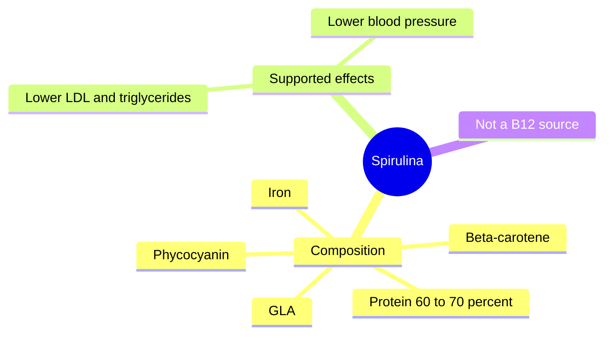

# Spirulina

## Summary

Spirulina (Arthrospira platensis) is a cyanobacterium, often called a blue-green alga, and one of the oldest photosynthetic organisms. It contains about 60 to 70 percent protein by dry weight with all essential amino acids, the blue pigment phycocyanin, beta-carotene, iron and gamma-linolenic acid. Meta-analyses show modest reductions in LDL cholesterol, triglycerides and blood pressure. It does not provide active vitamin B12: most of its B12 is an inactive pseudovitamin. Contamination with microcystin toxins and heavy metals is a quality risk.

*This note is educational. It is not medical advice and does not replace a doctor, dietitian or pharmacist, especially during pregnancy, illness or when taking medicines.*

## Prerequisites

No prior notes are needed.

## Core concepts

### Definition

*Spirulina* is the dried biomass of cyanobacteria of the genus Arthrospira. Cyanobacteria are prokaryotes, not true algae. *Phycocyanin* is its blue antioxidant pigment.

### Analogy

Spirulina is like a protein bar grown in a pond: it is dense in protein and pigments, but you eat it by the spoonful, so the amounts of nutrients per day are modest. The analogy breaks because a protein bar does not contain a pigment (phycocyanin) with its own biological effects.

### Mechanism

Phycocyanin is antioxidant and anti-inflammatory in the laboratory (it inhibits COX-2 and NADPH oxidase). Protein quality is high, though usual doses (1 to 8 g) give only a few grams of protein. Spirulina contains pseudovitamin B12, which binds B12 receptors but is inactive and may even interfere with B12 status measurements ([Vitamin B12](../vitamins/vitamin-b12.md)).

The mindmap shows the composition and supported effects.

### Proposed effects and evidence

Each entry states the proposed effect and how strong the human evidence is, using the grades defined in the [Evidence grades](../evidence-grades.md) note.

- **High protein content with all essential amino acids.** 60 to 70 percent protein by dry weight; daily doses add only a few grams. Evidence: established physiology.
- **Antioxidant action through phycocyanin, beta-carotene and vitamin E.** Shown in the laboratory; small human effects. Evidence: limited.
- **Immune support.** Small trials. Evidence: limited.
- **Cardiovascular health: lower cholesterol and blood pressure.** Meta-analysis: lower LDL and triglycerides, higher HDL; small blood pressure reduction. Evidence: moderate.
- **Anti-inflammatory action.** Laboratory and small human studies. Evidence: limited.
- **Detoxification of heavy metals.** Small studies on arsenic in Bangladesh; otherwise little evidence. Evidence: very limited.
- **Gut health.** Little human evidence. Evidence: very limited.
- **More energy and endurance.** Small, mixed trials. Evidence: limited.
- **Blood glucose regulation.** Small trials in type 2 diabetes. Evidence: limited.
- **Skin health.** No meaningful evidence. Evidence: very limited.
- **Source of vitamin B12.** Contains mostly inactive pseudovitamin B12. Evidence: not supported.

## Worked example

A meta-analysis (Serban and colleagues, 2016) of seven trials found that 1 to 10 g spirulina daily lowered LDL cholesterol by about 41 mg/dL and triglycerides by about 45 mg/dL, with large variation between trials of mostly small size. A vegan who uses spirulina for B12 will still become B12 deficient.

## Trade offs and when to use it

Choose tested products to avoid microcystins and heavy metals. People with phenylketonuria must avoid it (it contains phenylalanine), and people with autoimmune diseases should be cautious because it may stimulate immunity.

## Common mistakes

- **Using spirulina as a B12 source.** Its B12 is mostly inactive.
- **Buying untested products.** Contamination with microcystins can damage the liver.

## Practice

1. Is spirulina a true alga?
2. What is phycocyanin?
3. Why is spirulina not a B12 source?

### Answers

1. No, it is a cyanobacterium.
2. Its blue antioxidant pigment.
3. Most of its B12 is inactive pseudovitamin B12.

## Further reading

- Serban, M. C., Sahebkar, A., Dragan, S. et al. (2016). A systematic review and meta-analysis of the impact of Spirulina supplementation on plasma lipid concentrations. Clinical Nutrition, 35(4), 842-851. [DOI](https://doi.org/10.1016/j.clnu.2015.09.007). Meta-analysis of spirulina and lipids.
- Watanabe, F. (2007). Vitamin B12 sources and bioavailability. Experimental Biology and Medicine, 232(10), 1266-1274. [DOI](https://doi.org/10.3181/0703-MR-67). Vitamin B12 sources and pseudovitamin B12.
