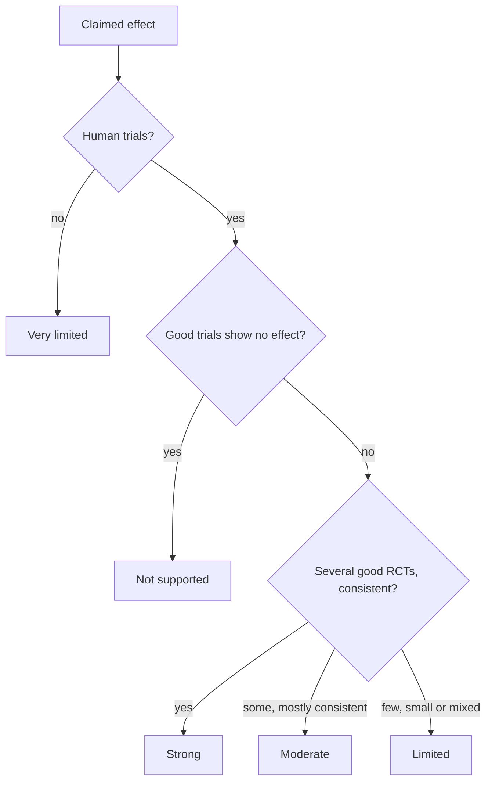

# Evidence grades

## Summary

Notes on nutrients, supplements and remedies in this library grade every claimed effect with one of six labels: established physiology, strong, moderate, limited, very limited and not supported. The grade reflects the type and consistency of human evidence for the specific claim, not how plausible the mechanism sounds. A plausible mechanism with no human trials is graded "very limited". The scale is a simplified version of the GRADE approach used in medical guidelines.

## Prerequisites

No prior notes are needed.

## Core concepts

### Definition

An *evidence grade* is a label that states how confident one can be that a claimed effect is real in humans. *Randomized controlled trials* (RCTs) assign people to an intervention or control by chance, which protects against confounding. *Observational studies* follow people without assigning interventions and can show associations, not causes. *Meta-analyses* pool results of several studies.

### Analogy

Evidence grades work like the levels of certainty in a court. "Beyond reasonable doubt" (strong) needs consistent testimony from several reliable witnesses (good RCTs). "Probable" (moderate) has good evidence with some doubts. "Suspicion" (limited) rests on a few or weak witnesses. "Rumor" (very limited) has no witnesses, only a story that sounds plausible. The analogy breaks because science, unlike a court, revises its verdicts when new evidence arrives.

### Mechanism

The grades used in this library:

| Grade | Meaning | Typical evidence |
| --- | --- | --- |
| Established physiology | A textbook fact about how the body works, not a claim about a supplement's benefit | Decades of basic and clinical research |
| Strong | The effect is real and consistent in humans | Several good RCTs or meta-analyses with consistent results |
| Moderate | The effect is probably real, with some doubts about size or consistency | Some RCTs with mostly consistent results, or strong observational data with a plausible mechanism |
| Limited | The effect may be real, but the evidence is weak | Small or short RCTs, mixed results, or mainly observational data |
| Very limited | Little or no human evidence | Animal, cell or test tube studies, traditional use, or theory |
| Not supported | Good evidence shows no meaningful effect, or the claim contradicts established knowledge | Well-designed RCTs or meta-analyses finding no effect |

The flowchart shows how a grade is chosen.

### Rules of thumb

- **Deficiency versus supplementation.** Correcting a deficiency often has strong effects, while extra intake in people who are not deficient usually has little effect. Notes say which situation a grade refers to.
- **Surrogate versus hard outcomes.** Lowering a blood marker (for example cholesterol) is not the same as preventing disease events. Niacin lowers lipoprotein(a) but did not prevent heart attacks ([Lipoprotein(a)](../../../natural-sciences/chemistry/biochemistry/lipids/lipoprotein-a.md)).
- **Dose and form.** Effects seen with a drug dose or a specific extract do not transfer to food amounts or other products.
- **Test tube antioxidant capacity** does not show a health effect in humans.

## Worked example

Take three claims about vitamin D:

1. "Vitamin D is needed for calcium absorption." This is a textbook fact: established physiology.
2. "Vitamin D supplements prevent fractures in people who are not deficient." Large RCTs (for example VITAL) found no effect: not supported for this population.
3. "Vitamin D supplements reduce the risk of acute respiratory infections." Meta-analyses found a small effect, mostly in deficient people with daily dosing: moderate to limited, depending on the population.

The same nutrient gets different grades for different claims and populations.

## Trade offs and when to use it

- A six-level scale is simple enough to read quickly, but it hides nuance; where needed, notes add a sentence on population, dose or effect size.
- Grades reflect the evidence the author could check at the time of writing (checked 2026-10). They can change as research appears.

## Common mistakes

- **Treating a plausible mechanism as evidence.** Mechanisms explain effects; they do not prove them.
- **Treating "not supported" as "harmful".** It means no meaningful benefit was found, not that the substance is dangerous.
- **Ignoring who was studied.** Results in deficient or sick people may not apply to healthy people.

## Practice

1. What grade does a claim based only on animal studies get?
2. What is the difference between "very limited" and "not supported"?
3. Why can the same nutrient have different grades for different claims?

### Answers

1. Very limited.
2. "Very limited" means little evidence either way; "not supported" means good evidence shows no meaningful effect.
3. Grades depend on the specific outcome, population and dose.

## Further reading

- Guyatt, G. H., Oxman, A. D., Vist, G. E. et al. (2008). GRADE: an emerging consensus on rating quality of evidence and strength of recommendations. BMJ, 336(7650), 924-926. [DOI](https://doi.org/10.1136/bmj.39489.470347.AD). The GRADE approach to rating quality of evidence.
