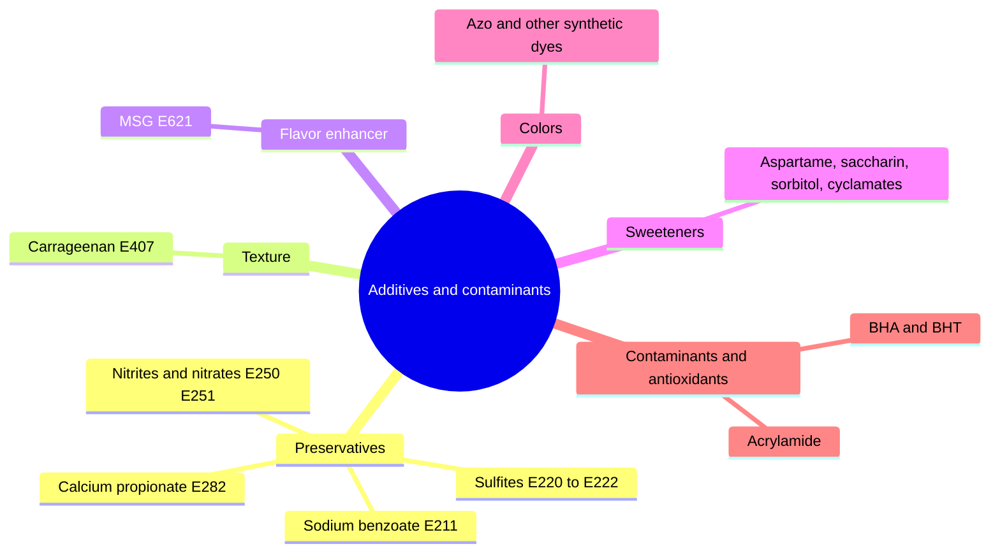

# Food additives and contaminants

Food additives are substances added to food for a technical purpose: preservation, color, sweetness, flavor or texture. In the EU, each approved additive has an E number and an acceptable daily intake (ADI) set by EFSA. These notes describe additives commonly listed as "dangerous ingredients", what the evidence shows, and two contaminants: acrylamide, which forms during cooking, and the antioxidants BHA and BHT.

## Map

## Reading order

1. [Food additives overview](overview.md)
2. [Sodium benzoate (E211)](sodium-benzoate.md)
3. [Sulfites (E220 to E222)](sulfites.md)
4. [Nitrites and nitrates (E250, E251)](nitrites-and-nitrates.md)
5. [Calcium propionate (E282)](calcium-propionate.md)
6. [Carrageenan (E407)](carrageenan.md)
7. [Monosodium glutamate (E621)](e621-monosodium-glutamate.md)
8. [Sweeteners](sweeteners.md)
9. [Synthetic food colors](synthetic-food-colors.md)
10. [Acrylamide](acrylamide.md)
11. [BHA and BHT (E320, E321)](bha-and-bht.md)
