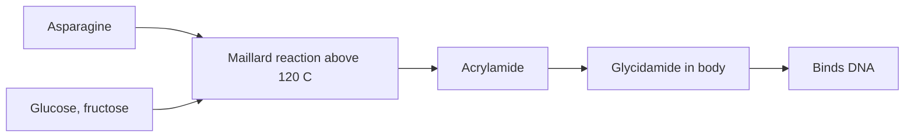

# Acrylamide

## Summary

Acrylamide is not an additive but a contaminant that forms when starchy foods are fried, baked or roasted above about 120 °C, through the Maillard reaction between the amino acid asparagine and reducing sugars. It is found in chips, French fries, crisps, toast, biscuits and coffee. It is neurotoxic at high exposures and causes cancer in animals; IARC classifies it as probably carcinogenic to humans (Group 2A). The EU sets benchmark levels and requires food businesses to reduce it.

*This note is educational. It is not medical advice and does not replace a doctor, dietitian or pharmacist, especially during pregnancy, illness or when taking medicines.*

## Prerequisites

- [Food additives overview](overview.md)

## Core concepts

### Definition

*Acrylamide* (CH2=CHCONH2) is a chemical used industrially to make polyacrylamide. In food, it forms from free *asparagine* and reducing sugars at high temperatures with low moisture. The notes mention "sodium aspartate" converting to acrylamide; the precursor is actually asparagine, not aspartate.

### Analogy

Acrylamide is like soot from a fire: it is not added on purpose but forms when food is heated hard. Turning down the heat or cooking less brown makes less soot. The analogy breaks because the browning that forms acrylamide is also what gives fried and baked foods their flavor.

### Mechanism

In the Maillard reaction, asparagine reacts with glucose or fructose, and part of it is converted to acrylamide ([Asparagine](../../../../natural-sciences/chemistry/biochemistry/amino-acids/asparagine.md)). In the body, acrylamide is converted to glycidamide, which binds DNA. High occupational exposure causes nerve damage (neuropathy). Dietary exposure is much lower; EFSA concluded in 2015 that dietary acrylamide raises concern for cancer, based on animal data. Human epidemiology is inconsistent.

**Reducing acrylamide at home.** Cook to golden yellow, not dark brown ("go for gold"); soak or blanch cut potatoes; store potatoes above 6 °C; toast bread lightly.

The flowchart shows how acrylamide forms.

### Claimed risks and evidence

Each entry states the claimed risk and how strong the evidence for it is, using the grades defined in the [Evidence grades](../evidence-grades.md) note. Here, "not supported" means the evidence does not show the claimed harm at permitted intakes.

- **Negative effects on the nervous system.** Neurotoxic at high occupational exposures. Evidence: strong.
- **Negative effects on the digestive system.** No specific evidence at dietary levels. Evidence: very limited.
- **Potential cancer risk.** Carcinogenic in animals; IARC Group 2A; human studies inconsistent. Evidence: limited.

## Worked example

The EU benchmark level for French fries is 500 µg per kg and for potato crisps 750 µg per kg (Regulation 2017/2158). Frying fries to golden yellow at 175 °C instead of dark brown at 190 °C can halve acrylamide. Coffee contributes significantly for adults; light roasts tend to have more acrylamide than very dark roasts.

## Trade offs and when to use it

Eliminating acrylamide is impossible; reducing intake by moderate cooking and a varied diet is reasonable.

## Common mistakes

- **Thinking acrylamide is an added chemical.** It forms during cooking.
- **Browning food dark for flavor every time.** Golden yellow forms less acrylamide.

## Practice

1. Which two components form acrylamide?
2. At what temperature does acrylamide form?
3. How does IARC classify acrylamide?

### Answers

1. Asparagine and reducing sugars.
2. Above about 120 °C.
3. Probably carcinogenic, Group 2A.

## Further reading

- EFSA CONTAM Panel (2015). Scientific Opinion on acrylamide in food. EFSA Journal, 13(6), 4104. [DOI](https://doi.org/10.2903/j.efsa.2015.4104). EFSA scientific opinion on acrylamide.
- European Commission (2017). Commission Regulation (EU) 2017/2158 establishing mitigation measures and benchmark levels for the reduction of the presence of acrylamide in food. [Link](https://eur-lex.europa.eu/eli/reg/2017/2158/oj). EU acrylamide benchmark regulation.
