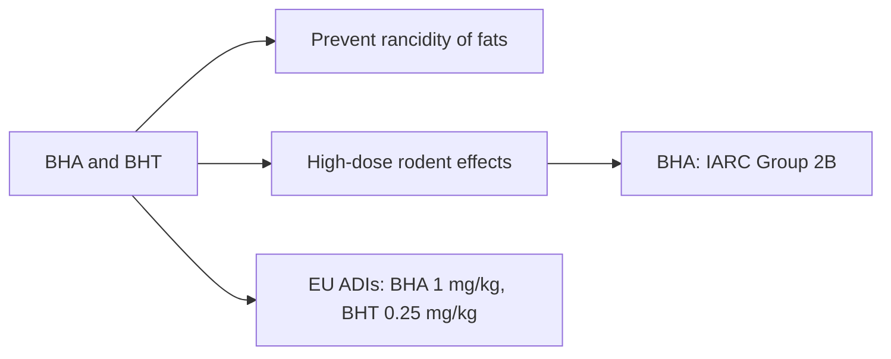

# BHA and BHT (E320, E321)

## Summary

Butylated hydroxyanisole (BHA, E320) and butylated hydroxytoluene (BHT, E321) are synthetic antioxidants that prevent fats from going rancid. They are used in fats, oils, cereals, chewing gum and cosmetics. BHA is classified by IARC as possibly carcinogenic to humans (Group 2B) based on forestomach tumors in rodents. Both are permitted in the EU with ADIs (BHA 1 mg/kg, BHT 0.25 mg/kg). Concerns about hormonal effects and liver and kidney toxicity come mainly from high-dose animal studies.

*This note is educational. It is not medical advice and does not replace a doctor, dietitian or pharmacist, especially during pregnancy, illness or when taking medicines.*

## Prerequisites

- [Food additives overview](overview.md)

## Core concepts

### Definition

*BHA* is a mixture of 2- and 3-tert-butyl-4-hydroxyanisole; *BHT* is 2,6-di-tert-butyl-4-methylphenol. Both are phenolic antioxidants that donate hydrogen to fat radicals.

### Analogy

BHA and BHT are like fire blankets for fats in food: they stop the chain reaction of rancidity. The question is whether the blanket material is harmful when eaten over a lifetime, and studies in rodents raised some concerns. The analogy breaks because, at high doses, these antioxidants have been reported in some studies to protect against cancer, not only to cause it.

### Mechanism

As chain-breaking antioxidants, BHA and BHT stop lipid peroxidation in food. In the body, they are metabolized in the liver. High doses caused forestomach tumors (BHA) and liver effects in rodents; humans have no forestomach. Some studies suggest weak estrogenic or anti-androgenic activity of BHA.

The flowchart summarizes uses and concerns.

### Claimed risks and evidence

Each entry states the claimed risk and how strong the evidence for it is, using the grades defined in the [Evidence grades](../evidence-grades.md) note. Here, "not supported" means the evidence does not show the claimed harm at permitted intakes.

- **Potential carcinogenicity.** BHA: IARC Group 2B based on rodent forestomach tumors. Evidence: limited.
- **Hormonal effects.** Weak effects in laboratory studies. Evidence: very limited.
- **Liver and kidney problems.** High-dose animal studies. Evidence: very limited.

## Worked example

A breakfast cereal lists BHT in its packaging liner. Typical intakes in Europe are well below the ADI. Choosing foods with tocopherols (E306 to E309, vitamin E) as antioxidants is an alternative for people who prefer to avoid BHA and BHT.

## Trade offs and when to use it

BHA and BHT extend shelf life; natural antioxidants (tocopherols, rosemary extract) can replace them in many products.

## Common mistakes

- **Equating Group 2B with proven risk.** Group 2B means limited evidence.
- **Assuming all antioxidant additives are synthetic.** Many are vitamin E or C.

## Practice

1. What do BHA and BHT do in food?
2. How does IARC classify BHA?
3. Name a natural alternative.

### Answers

1. They prevent fats from going rancid.
2. Possibly carcinogenic (Group 2B).
3. Tocopherols (vitamin E) or rosemary extract.

## Further reading

- European Parliament and Council (2008). Regulation (EC) No 1333/2008 on food additives. [Link](https://eur-lex.europa.eu/eli/reg/2008/1333/oj). EU additive regulation.
