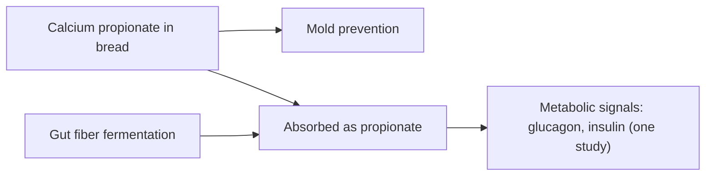

# Calcium propionate (E282)

## Summary

Calcium propionate (E282) is a preservative used mainly in bread and baked goods to prevent mold. Propionic acid is also produced naturally in the gut by bacteria fermenting fiber and is present in Swiss cheese. Some people report reactions; one small study linked it to irritability in children, and a 2019 study found it raised insulin and glucagon in humans. At permitted levels it is considered relatively safe.

*This note is educational. It is not medical advice and does not replace a doctor, dietitian or pharmacist, especially during pregnancy, illness or when taking medicines.*

## Prerequisites

- [Food additives overview](overview.md)

## Core concepts

### Definition

*Calcium propionate* is the calcium salt of propionic acid, a short-chain fatty acid.

### Analogy

Calcium propionate is like a mold-repellent spray for bread made from a molecule the gut already produces every day. The analogy breaks because adding it to food delivers it to a different place (the upper gut) and in larger single doses.

### Mechanism

Propionic acid inhibits molds by disrupting their metabolism. In humans, it is metabolized like other short-chain fatty acids. A trial (Tirosh and colleagues, 2019) found 1 g of propionate with a meal raised glucagon, norepinephrine and fatty acid binding protein 4, and mice fed propionate long-term gained weight and developed insulin resistance.

The flowchart shows propionate in food and in the body.

### Claimed risks and evidence

Each entry states the claimed risk and how strong the evidence for it is, using the grades defined in the [Evidence grades](../evidence-grades.md) note. Here, "not supported" means the evidence does not show the claimed harm at permitted intakes.

- **Allergic reactions.** Rare reports. Evidence: very limited.
- **Effects on gut health.** Little evidence of harm; propionate is a normal gut metabolite. Evidence: very limited.
- **Behavioral effects in children.** One small study reported irritability and sleep disturbance. Evidence: very limited.
- **Metabolic effects (insulin resistance).** One human study and mouse data. Evidence: limited.
- **Safe in small amounts.** Regulators consider it safe at permitted levels. Evidence: moderate.

## Worked example

A packaged sliced bread lists E282 and stays mold-free for a week; a bakery loaf without preservatives molds in 3 to 4 days. Freezing bread is an alternative for people who prefer to avoid propionate.

## Trade offs and when to use it

Calcium propionate reduces food waste from moldy bread; the possible metabolic effects need more research.

## Common mistakes

- **Assuming propionate is foreign to the body.** Gut bacteria produce it from fiber.

## Practice

1. What is E282 used for?
2. Where else does propionic acid occur naturally?
3. What did a 2019 study find?

### Answers

1. Preventing mold in bread and baked goods.
2. In the gut from fiber fermentation and in Swiss cheese.
3. Propionate raised glucagon and other metabolic hormones.

## Further reading

- European Parliament and Council (2008). Regulation (EC) No 1333/2008 on food additives. [Link](https://eur-lex.europa.eu/eli/reg/2008/1333/oj). EU additive regulation.
