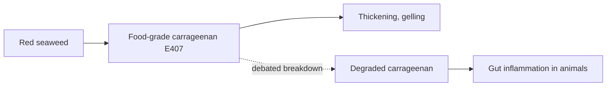

# Carrageenan (E407)

## Summary

Carrageenan (E407) is a thickener and stabilizer extracted from red seaweed, used in dairy products, plant milks, desserts and processed meats. It is not a classic preservative. Animal and cell studies suggested it may cause gut inflammation, and degraded carrageenan (poligeenan, not permitted in food) causes tumors in animals. EFSA in 2018 kept it authorized but called for more data and set a temporary ADI of 75 mg per kg. Human evidence of harm from food-grade carrageenan is limited.

*This note is educational. It is not medical advice and does not replace a doctor, dietitian or pharmacist, especially during pregnancy, illness or when taking medicines.*

## Prerequisites

- [Food additives overview](overview.md)

## Core concepts

### Definition

*Carrageenan* is a family of sulfated galactose polysaccharides (kappa, iota, lambda) from red algae. *Poligeenan* (degraded carrageenan) has a much lower molecular weight and is not allowed in food.

### Analogy

Carrageenan is like a gelling agent from the sea, similar to agar. The concern is that small broken pieces might irritate the gut lining. The analogy breaks because food-grade carrageenan has large molecules, and the evidence of breakdown in the human gut is debated.

### Mechanism

Carrageenan forms gels with milk proteins and potassium. In animals, high doses of degraded carrageenan caused ulceration and inflammation. Some cell studies show activation of inflammatory pathways (TLR4, NF-kB). A small trial in ulcerative colitis found that patients on a carrageenan-free diet relapsed less often, but it was very small.

The flowchart separates food-grade and degraded carrageenan.

### Claimed risks and evidence

Each entry states the claimed risk and how strong the evidence for it is, using the grades defined in the [Evidence grades](../evidence-grades.md) note. Here, "not supported" means the evidence does not show the claimed harm at permitted intakes.

- **Digestive problems and gut inflammation.** Animal and cell studies; small human trial in ulcerative colitis. Evidence: limited.
- **Increased risk of some cancers.** Seen with degraded carrageenan in animals, not food-grade carrageenan. Evidence: very limited.
- **Safe at permitted intakes.** EFSA kept the authorization with a temporary ADI and requested data. Evidence: moderate.

## Worked example

A person with ulcerative colitis reads that carrageenan may worsen inflammation. Avoiding it is easy (choose plain dairy, check plant milk labels) and harmless, though evidence that it changes the disease course is limited to a small trial.

## Trade offs and when to use it

Carrageenan improves texture in many foods. People with inflammatory bowel disease may choose to avoid it.

## Common mistakes

- **Confusing food-grade and degraded carrageenan.** Only food-grade carrageenan is permitted.
- **Calling carrageenan a preservative.** It is a thickener and stabilizer.

## Practice

1. What is carrageenan made from?
2. What is poligeenan?
3. What did EFSA decide in 2018?

### Answers

1. Red seaweed.
2. Degraded carrageenan, not permitted in food.
3. It kept carrageenan authorized with a temporary ADI and requested more data.

## Further reading

- EFSA ANS Panel (2018). Re-evaluation of carrageenan (E 407) and processed Eucheuma seaweed (E 407a) as food additives. EFSA Journal, 16(4), 5238. [DOI](https://doi.org/10.2903/j.efsa.2018.5238). EFSA re-evaluation of carrageenan.
