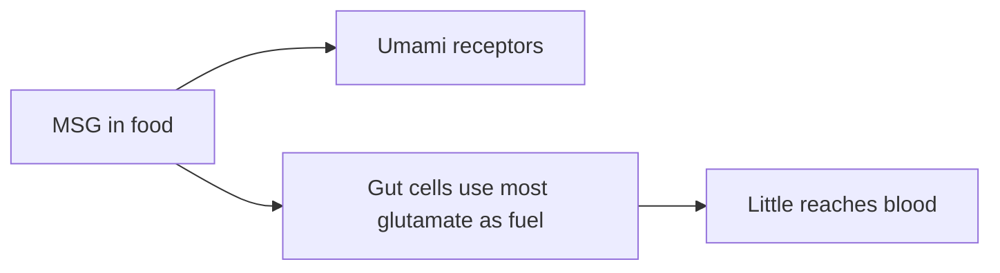

# Monosodium glutamate (E621)

## Summary

Monosodium glutamate (MSG, E621) is a flavor enhancer that gives the savory umami taste. It is common in instant dishes, snacks and seasonings. It has been blamed for "Chinese restaurant syndrome" (headache, nausea, dizziness), and for effects on fertility and the nervous, digestive and cardiovascular systems. Double-blind studies have not reproduced consistent reactions at normal intakes. EFSA set an ADI of 30 mg per kg body weight in 2017, below the intake of some high consumers. Glutamate is also naturally present in tomatoes, cheese and human milk.

*This note is educational. It is not medical advice and does not replace a doctor, dietitian or pharmacist, especially during pregnancy, illness or when taking medicines.*

## Prerequisites

- [Food additives overview](overview.md)

## Core concepts

### Definition

*Monosodium glutamate* is the sodium salt of glutamic acid ([Glutamic acid](../../../../natural-sciences/chemistry/biochemistry/amino-acids/glutamic-acid.md)). *Umami* is one of the five basic tastes, detected by T1R1 and T1R3 receptors.

### Analogy

MSG is like concentrated tomato or parmesan flavor in a shaker: the glutamate is chemically identical to that in those foods. The analogy breaks because MSG adds sodium (about 12 percent by weight) and is used in processed foods that may also be high in salt and fat.

### Mechanism

Free glutamate activates umami receptors on the tongue. In the gut, most dietary glutamate is used by intestinal cells as fuel, and little reaches the blood. Very high doses in animals (injected or by stomach tube in newborns) damaged the hypothalamus; these doses and routes do not apply to food. Double-blind challenge studies show no consistent symptoms with MSG in food, though large doses without food caused mild, transient symptoms in some people.

The flowchart shows the fate of dietary glutamate.

### Claimed risks and evidence

Each entry states the claimed risk and how strong the evidence for it is, using the grades defined in the [Evidence grades](../evidence-grades.md) note. Here, "not supported" means the evidence does not show the claimed harm at permitted intakes.

- **Headache, nausea and dizziness ("Chinese restaurant syndrome").** Double-blind studies show no consistent reactions with MSG in food. Evidence: not supported.
- **Negative effects on fertility and the nervous, digestive and cardiovascular systems.** Based on high-dose animal studies with non-food routes. Evidence: very limited.
- **High intakes exceed the ADI.** EFSA estimated that some high consumers exceed 30 mg per kg. Evidence: limited.

## Worked example

In a double-blind, multiple-challenge study (Geha and colleagues, 2000), 130 people who believed they reacted to MSG were given 5 g MSG or placebo without food. Some reported symptoms with both; reactions were not consistent on repeated challenges, and none occurred when MSG was given with food.

## Trade offs and when to use it

MSG can reduce total sodium in a dish if it partly replaces salt, because it has a third of the sodium of table salt. Foods high in MSG are often highly processed and salty.

## Common mistakes

- **Believing MSG is a dangerous chemical.** It is the same glutamate found in tomatoes and cheese.
- **Ignoring the overall quality of processed foods.** The bigger issue is salt and processing.

## Practice

1. What taste does MSG produce?
2. What is EFSA's ADI for glutamates?
3. What did double-blind studies find about "Chinese restaurant syndrome"?

### Answers

1. Umami.
2. 30 mg per kg body weight per day.
3. No consistent reactions with MSG in food.

## Further reading

- EFSA ANS Panel (2017). Re-evaluation of glutamic acid (E 620), sodium glutamate (E 621), potassium glutamate (E 622), calcium glutamate (E 623), ammonium glutamate (E 624) and magnesium glutamate (E 625) as food additives. EFSA Journal, 15(7), 4910. [DOI](https://doi.org/10.2903/j.efsa.2017.4910). EFSA re-evaluation of glutamates.
- Geha, R. S., Beiser, A., Ren, C. et al. (2000). Multicenter, double-blind, placebo-controlled, multiple-challenge evaluation of reported reactions to monosodium glutamate. Journal of Nutrition, 130(4S Suppl), 1058S-1062S. [DOI](https://doi.org/10.1093/jn/130.4.1058S). Double-blind challenge study of MSG.
