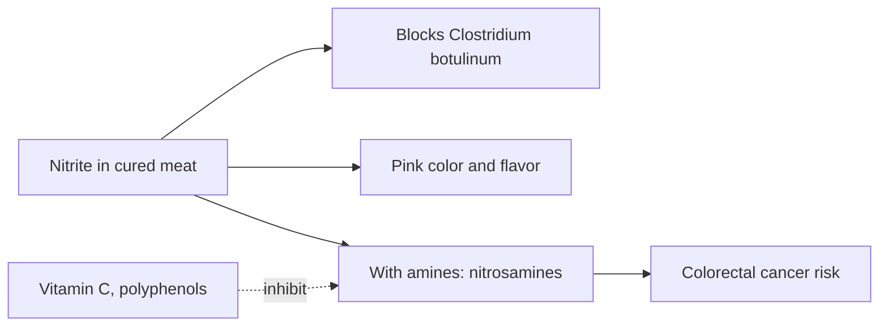

# Nitrites and nitrates (E250, E251)

## Summary

Sodium nitrite (E250) and sodium nitrate (E251) are used mainly in cured meats (ham, sausages, bacon). They prevent growth of Clostridium botulinum and give cured meat its pink color and flavor. In meat and in the stomach, nitrite can react with amines to form N-nitroso compounds (nitrosamines), many of which are carcinogenic. The International Agency for Research on Cancer classifies processed meat as carcinogenic to humans (Group 1), mainly for colorectal cancer. Nitrate from vegetables behaves differently and is linked to benefits such as lower blood pressure.

*This note is educational. It is not medical advice and does not replace a doctor, dietitian or pharmacist, especially during pregnancy, illness or when taking medicines.*

## Prerequisites

- [Food additives overview](overview.md)

## Core concepts

### Definition

*Sodium nitrite* (NaNO2) and *sodium nitrate* (NaNO3) are curing salts. Nitrate is converted to nitrite by bacteria. *N-nitroso compounds* (nitrosamines and nitrosamides) form from nitrite and secondary amines, especially at high heat (frying bacon) and in the acidic stomach.

### Analogy

Nitrite in cured meat is a double-edged sword: it blocks a deadly bacterium (botulism), but it can also forge carcinogens when it meets amines from meat. Vitamin C and polyphenols in vegetables act like a shield that stops this forging. The analogy breaks because the cancer risk of processed meat is not caused by nitrite alone; heme iron and cooking products also contribute.

### Mechanism

Nitrite forms nitric oxide, which binds myoglobin (pink nitrosomyoglobin) and inhibits bacteria. With secondary amines, nitrite forms nitrosamines; ascorbate or erythorbate added to cured meat reduces this. Heme iron in red meat also promotes endogenous nitrosation in the gut. In vegetables, nitrate comes with vitamin C and polyphenols, which inhibit nitrosation; vegetable nitrate is the basis of beetroot's blood pressure effect ([Beetroot (Beta vulgaris)](../herbal-extracts/beetroot.md)).

The flowchart shows the two faces of nitrite.

### Claimed risks and evidence

Each entry states the claimed risk and how strong the evidence for it is, using the grades defined in the [Evidence grades](../evidence-grades.md) note. Here, "not supported" means the evidence does not show the claimed harm at permitted intakes.

- **Formation of carcinogenic nitrosamines.** Nitrite plus amines form nitrosamines; IARC rates ingested nitrite under nitrosating conditions as probably carcinogenic (Group 2A). Evidence: strong.
- **Processed meat increases colorectal cancer risk.** IARC Group 1; about 18 percent higher risk per 50 g daily. Evidence: strong.
- **Vegetable nitrate is harmful.** Vegetable nitrate is associated with benefits, not harm. Evidence: not supported.

## Worked example

Eating 50 g of processed meat daily (two slices of ham) is associated with about 18 percent higher risk of colorectal cancer. If a person's lifetime risk is 5 percent, this raises it to about 6 percent. Frying bacon at high heat forms more nitrosamines than gently cooking ham.

## Trade offs and when to use it

Nitrites prevent botulism in cured meats; nitrite-free products must rely on other controls. Limiting processed meat, rather than avoiding nitrite alone, is the main public health advice.

## Common mistakes

- **Believing "nitrite-free" cured meat is safe.** Many use celery powder, which supplies nitrite naturally.
- **Fearing nitrate in vegetables.** It is associated with benefits.

## Practice

1. Why are nitrites added to cured meat?
2. What carcinogens can nitrite form?
3. How does IARC classify processed meat?

### Answers

1. To prevent botulism and give color and flavor.
2. N-nitroso compounds (nitrosamines).
3. Group 1, carcinogenic to humans.

## Further reading

- Bouvard, V., Loomis, D., Guyton, K. Z. et al. (2015). Carcinogenicity of consumption of red and processed meat. The Lancet Oncology, 16(16), 1599-1600. [DOI](https://doi.org/10.1016/S1470-2045(15)00444-1). IARC classification of processed meat.
- International Agency for Research on Cancer (2010). *Ingested nitrate and nitrite, and cyanobacterial peptide toxins. IARC Monographs, Volume 94*. [Link](https://publications.iarc.who.int/112). IARC monograph on ingested nitrate and nitrite.
