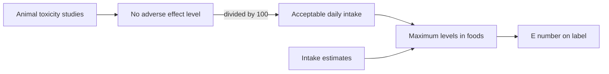

# Food additives overview

## Summary

Food additives are substances intentionally added to food for a technical function. In the European Union, every additive must be authorized, listed with an E number on the label and used within limits. EFSA assesses safety and sets an acceptable daily intake (ADI), the amount a person can eat daily over a lifetime without appreciable risk. Lists of "dangerous E numbers" often mix additives with real concerns (nitrites in processed meat, some colors in sensitive children, sulfites in asthma) with ones that are safe at permitted levels.

*This note is educational. It is not medical advice and does not replace a doctor, dietitian or pharmacist, especially during pregnancy, illness or when taking medicines.*

## Prerequisites

No prior notes are needed.

## Core concepts

### Definition

A *food additive* is a substance not normally eaten as food that is added for a technological purpose (EU Regulation 1333/2008). The *E number* identifies authorized additives (E1xx colors, E2xx preservatives, E3xx antioxidants, E4xx thickeners and emulsifiers, E6xx flavor enhancers, E9xx sweeteners and others). The *acceptable daily intake* (ADI) is usually set at one hundredth of the highest dose with no adverse effect in animal studies.

### Analogy

The ADI is like a speed limit set far below the speed at which cars crash in tests: it builds in a 100-fold safety margin. Exceeding it occasionally is not dangerous, but the limit tells regulators how much to allow in foods. The analogy breaks because, unlike cars, some people are much more sensitive (allergies, asthma) than average, and the ADI does not protect against allergy.

### Mechanism

Regulators assess additives using animal toxicity studies, human data where available and intake estimates. Additives are periodically re-evaluated; some have been banned (Red 2G, E128, in 2007; titanium dioxide, E171, in 2022) or had limits lowered. Specific sensitivities (sulfite asthma, benzoate and azo dye intolerance) are separate from long-term toxicity.

The flowchart shows how an additive is assessed.

### Claims and evidence

Each entry states the claimed risk and how strong the evidence for it is, using the grades defined in the [Evidence grades](../evidence-grades.md) note. Here, "not supported" means the evidence does not show the claimed harm at permitted intakes.

- **All E numbers are harmful.** Many E numbers are natural substances (E300 vitamin C, E330 citric acid). Evidence: not supported.
- **Some additives cause reactions in sensitive people.** Sulfites in asthma, some colors and benzoate in sensitive children. Evidence: strong.

## Worked example

A soft drink label lists E211 (sodium benzoate), E330 (citric acid) and E300 (ascorbic acid, vitamin C). E330 and E300 are natural compounds; E211 is a preservative with an ADI of 5 mg per kg body weight. A 70 kg adult would need to drink many liters a day to exceed it; however, benzoate with vitamin C can form small amounts of benzene, which is why manufacturers reformulated drinks.

## Trade offs and when to use it

Additives make food safer (preservatives prevent botulism and molds) and more convenient. Diets based on minimally processed foods naturally contain fewer additives; avoiding all E numbers is unnecessary.

## Common mistakes

- **Treating E numbers as a sign of danger.** Many are vitamins or natural acids.
- **Ignoring individual sensitivity.** People with asthma or allergies should check specific additives.

## Practice

1. What is an ADI?
2. How is an ADI usually set?
3. Give two E numbers that are natural compounds.

### Answers

1. The amount that can be eaten daily over a lifetime without appreciable risk.
2. By dividing the no adverse effect level from animal studies by 100.
3. E300 (vitamin C) and E330 (citric acid).

## Further reading

- European Parliament and Council (2008). Regulation (EC) No 1333/2008 on food additives. [Link](https://eur-lex.europa.eu/eli/reg/2008/1333/oj). EU regulation on food additives.
