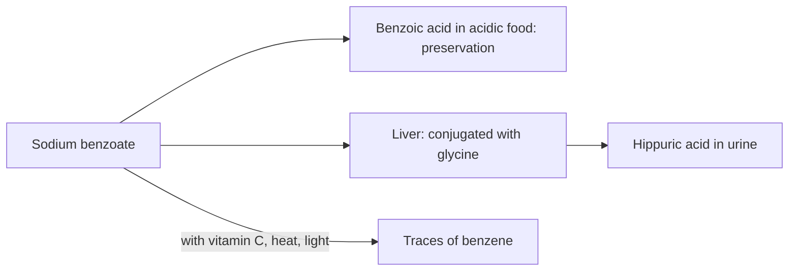

# Sodium benzoate (E211)

## Summary

Sodium benzoate (E211) is a preservative that prevents growth of yeasts, molds and some bacteria in acidic foods: soft drinks, canned foods, marinades, fruit and vegetable preserves. It can cause allergy-like reactions (hives, asthma) in sensitive people, and in the presence of vitamin C it can form small amounts of benzene, a carcinogen. In the Southampton study, a mix of colors with sodium benzoate increased hyperactivity in some children. EFSA considers it safe at its ADI of 5 mg per kg body weight.

*This note is educational. It is not medical advice and does not replace a doctor, dietitian or pharmacist, especially during pregnancy, illness or when taking medicines.*

## Prerequisites

- [Food additives overview](overview.md)

## Core concepts

### Definition

*Sodium benzoate* is the sodium salt of benzoic acid. It works in acidic conditions (pH below about 4.5), where undissociated benzoic acid enters microbial cells. It occurs naturally in small amounts in cranberries, cinnamon and fermented dairy.

### Analogy

Benzoate is like a guard that only works at night (in acidic foods): in neutral foods it is mostly inactive. The analogy breaks because the "guard" can occasionally react with vitamin C to form benzene, a different, harmful substance.

### Mechanism

Benzoic acid enters microbial cells, acidifies the inside and blocks enzymes. In humans, it is conjugated with glycine in the liver to hippuric acid and excreted in urine. Benzoate plus ascorbic acid, especially with heat and light, can form benzene in drinks; the US FDA found levels above drinking water limits in a few products in 2006, leading to reformulation.

The flowchart shows benzoate's fate in the body and the benzene issue.

### Claimed risks and evidence

Each entry states the claimed risk and how strong the evidence for it is, using the grades defined in the [Evidence grades](../evidence-grades.md) note. Here, "not supported" means the evidence does not show the claimed harm at permitted intakes.

- **Allergic reactions, skin and mucous membrane irritation, asthma.** Pseudoallergic reactions (hives, asthma) occur in a small number of sensitive people. Evidence: moderate.
- **Formation of carcinogens with vitamin C.** Benzene can form in drinks; levels are usually very low after reformulation. Evidence: moderate.
- **Stomach irritation, hives and nervous hyperactivity.** The Southampton trial found that mixtures of colors with benzoate increased hyperactivity in some children; effect of benzoate alone unclear. Evidence: limited.
- **Harm at permitted intakes in the general population.** EFSA found no safety concern at the ADI. Evidence: not supported.

## Worked example

A 30 kg child drinks 1 liter of soda with 150 mg/L sodium benzoate. Intake is 150 mg, exactly the ADI of 5 mg per kg. Regular high soda intake can push children above the ADI, one reason (besides sugar) to limit soft drinks.

## Trade offs and when to use it

Benzoate prevents spoilage of acidic foods. People with hives or aspirin-sensitive asthma may react to it.

## Common mistakes

- **Assuming benzoate causes cancer.** Risk is about benzene traces in some drinks.
- **Ignoring children's intake from drinks.** Children can exceed the ADI with high soda intake.

## Practice

1. In what kind of food does sodium benzoate work?
2. What can form when benzoate meets vitamin C?
3. What is the ADI of benzoates?

### Answers

1. Acidic foods.
2. Traces of benzene.
3. 5 mg per kg body weight per day.

## Further reading

- EFSA ANS Panel (2016). Scientific Opinion on the re-evaluation of benzoic acid (E 210), sodium benzoate (E 211), potassium benzoate (E 212) and calcium benzoate (E 213) as food additives. EFSA Journal, 14(3), 4433. [DOI](https://doi.org/10.2903/j.efsa.2016.4433). EFSA re-evaluation of benzoates.
- McCann, D., Barrett, A., Cooper, A. et al. (2007). Food additives and hyperactive behaviour in 3-year-old and 8/9-year-old children in the community: a randomised, double-blinded, placebo-controlled trial. The Lancet, 370(9598), 1560-1567. [DOI](https://doi.org/10.1016/S0140-6736(07)61306-3). Southampton trial of additives and hyperactivity.
