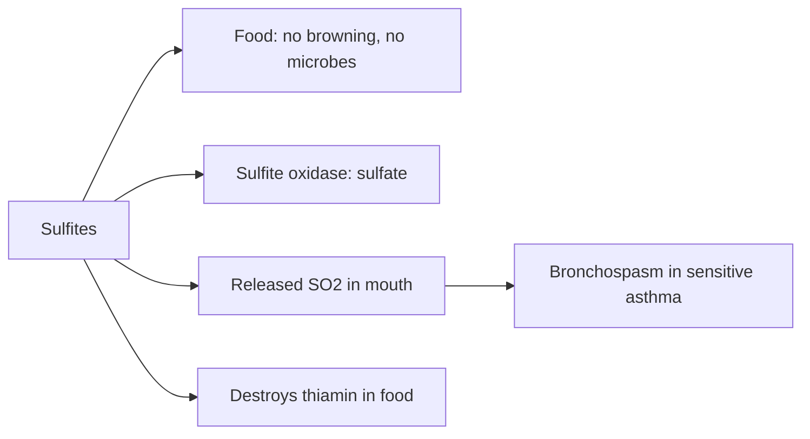

# Sulfites (E220 to E222)

## Summary

Sulfites are preservatives and antioxidants: sulfur dioxide (E220), sodium sulfite (E221) and sodium bisulfite (E222), with related salts E223 to E228. They are used in wine, dried fruit, potato products and some juices. They can trigger asthma attacks and other reactions in sensitive people, especially people with asthma (an estimated 3 to 10 percent of them), and must be labeled when above 10 mg per kg. In 2022 EFSA could not confirm the previous ADI and noted that high consumers may exceed safe margins.

*This note is educational. It is not medical advice and does not replace a doctor, dietitian or pharmacist, especially during pregnancy, illness or when taking medicines.*

## Prerequisites

- [Food additives overview](overview.md)

## Core concepts

### Definition

*Sulfites* are sulfur dioxide and its salts that release sulfur dioxide in food. Note: E221 is sodium sulfite (not sulfate) and E222 is sodium bisulfite (sodium hydrogen sulfite). They are preservatives and antioxidants that prevent browning.

### Analogy

Sulfites are like a cleaning crew that stops apples and wine from turning brown and stops microbes growing. For most people the crew goes unnoticed; for some people with asthma, the fumes they release (sulfur dioxide) are like an irritant gas in the airways. The analogy breaks because the body normally detoxifies sulfites with the enzyme sulfite oxidase.

### Mechanism

Sulfites inhibit enzymatic browning (polyphenol oxidase), microbial growth and oxidation. In the body, sulfite oxidase (a molybdenum enzyme) converts sulfite to sulfate. In sensitive people, inhaled sulfur dioxide released from food in the mouth may trigger bronchoconstriction; mechanisms also include mast cell activation. Sulfites destroy vitamin B1 (thiamin) in foods.

The notes mention possible kidney damage from long-term intake of sulfur dioxide; this comes from animal studies at high doses, and EFSA identified kidney effects and neurotoxicity as areas needing data.

The flowchart shows sulfite actions in food and in the body.

### Claimed risks and evidence

Each entry states the claimed risk and how strong the evidence for it is, using the grades defined in the [Evidence grades](../evidence-grades.md) note. Here, "not supported" means the evidence does not show the claimed harm at permitted intakes.

- **Allergic reactions, especially in asthma.** Sulfite sensitivity is documented in a minority of people with asthma. Evidence: strong.
- **Kidney damage with long-term intake.** Animal data at high doses; EFSA flagged data gaps. Evidence: very limited.
- **Concerns for high consumers.** EFSA 2022: margins of exposure may be insufficient for high consumers. Evidence: limited.

## Worked example

A person with asthma drinks a glass of white wine (sulfite content up to 200 mg/L in the EU) and develops wheezing within minutes. Their doctor suggests avoiding sulfited foods and reading labels for "contains sulfites". Dried apricots (up to 2,000 mg/kg) are another common trigger.

## Trade offs and when to use it

Sulfites help preserve wine and dried fruit, but people with asthma or sulfite sensitivity must avoid them.

## Common mistakes

- **Assuming "organic" wine is sulfite-free.** It usually contains sulfites, often at lower levels.
- **Confusing sulfites and sulfates.** Sulfates are different, harmless salts.

## Practice

1. Name three sulfite E numbers.
2. Who is most at risk from sulfites?
3. Which enzyme detoxifies sulfites?

### Answers

1. E220, E221 and E222.
2. People with asthma who are sulfite sensitive.
3. Sulfite oxidase.

## Further reading

- EFSA FAF Panel (2022). Follow-up of the re-evaluation of sulfur dioxide (E 220), sodium sulfite (E 221), sodium bisulfite (E 222), sodium metabisulfite (E 223), potassium metabisulfite (E 224), calcium sulfite (E 226), calcium bisulfite (E 227) and potassium bisulfite (E 228). EFSA Journal, 20(11), 7594. [DOI](https://doi.org/10.2903/j.efsa.2022.7594). EFSA follow-up re-evaluation of sulfites.
