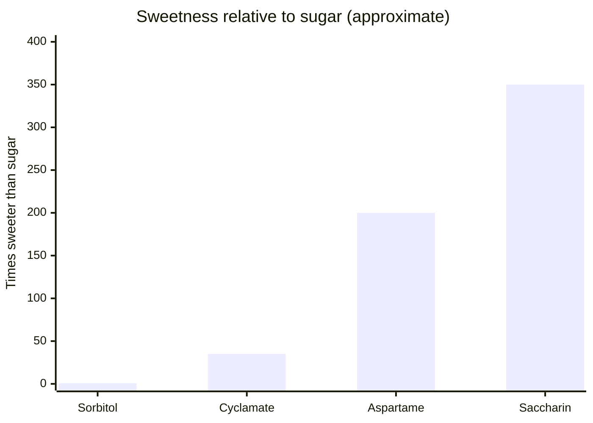

# Sweeteners

## Summary

Sweeteners replace sugar. Intense sweeteners such as aspartame (E951), saccharin (E954) and cyclamates (E952) are hundreds of times sweeter than sugar and add almost no energy. Polyols such as sorbitol (E420) are less sweet and can cause bloating and diarrhea in large amounts. In 2023, the International Agency for Research on Cancer classified aspartame as possibly carcinogenic (Group 2B), while the JECFA expert committee kept its ADI of 40 mg per kg. Cyclamates are banned in the US but permitted in the EU. In 2023 the WHO advised against using non-sugar sweeteners for weight control.

*This note is educational. It is not medical advice and does not replace a doctor, dietitian or pharmacist, especially during pregnancy, illness or when taking medicines.*

## Prerequisites

- [Food additives overview](overview.md)

## Core concepts

### Definition

*Intense sweeteners* provide sweetness at tiny amounts. *Polyols* (sugar alcohols) are partly absorbed carbohydrates with fewer calories.

| Sweetener | E number | Sweetness vs sugar | Notes |
| --- | --- | --- | --- |
| Sorbitol | E420 | About 0.6 times | Polyol; large amounts cause bloating and diarrhea |
| Aspartame | E951 | About 200 times | Contains phenylalanine; IARC Group 2B (2023); ADI 40 mg/kg (EU and JECFA) |
| Cyclamates | E952 | About 30 to 40 times | Banned in the US since 1969 after rat bladder cancer studies; permitted in the EU with ADI 7 mg/kg |
| Saccharin | E954 | About 300 to 400 times | Rat bladder tumors were not relevant to humans; removed from US carcinogen list in 2000 |

### Analogy

Intense sweeteners are like a recording of sweetness: the tongue hears the music, but no sugar (energy) arrives. The analogy breaks because the brain and gut may respond partly to the "recording", and research on appetite and metabolism is mixed.

### Mechanism

Sweeteners activate the sweet receptor (T1R2 and T1R3). Aspartame is digested into phenylalanine, aspartic acid and methanol (amounts similar to those from fruit juice); people with phenylketonuria must avoid it. Polyols are poorly absorbed and fermented in the colon, drawing water in. Some sweeteners alter gut bacteria in animal and small human studies.

The chart compares relative sweetness from the table.

### Claimed risks and evidence

Each entry states the claimed risk and how strong the evidence for it is, using the grades defined in the [Evidence grades](../evidence-grades.md) note. Here, "not supported" means the evidence does not show the claimed harm at permitted intakes.

- **Aspartame causes headaches, mood disorders and cancer.** IARC: limited evidence, Group 2B; JECFA and EFSA found no reason to change the ADI. Evidence: limited.
- **Saccharin increases cancer risk.** Rat bladder tumors arise through a mechanism not relevant to humans; regulators consider it safe. Evidence: not supported.
- **Sorbitol causes gastrointestinal problems in large amounts.** Bloating and diarrhea above about 10 to 20 g. Evidence: strong.
- **Cyclamates increase cancer risk.** Early rat studies led to a US ban; later studies did not confirm carcinogenicity. Evidence: limited.
- **Sweeteners help long-term weight control.** WHO 2023 guideline advises against their use for weight control. Evidence: limited.

## Worked example

A 70 kg adult would need about 2,800 mg of aspartame daily to reach the ADI, roughly 9 to 14 cans of diet soda (200 to 300 mg per can). Typical intakes are far lower. A person who eats a bag of sugar-free sweets (about 30 g sorbitol) may get diarrhea within hours.

## Trade offs and when to use it

Sweeteners reduce sugar intake and dental caries, but WHO does not recommend them for weight control. People with phenylketonuria must avoid aspartame.

## Common mistakes

- **Eating large amounts of sugar-free sweets.** Polyols cause diarrhea.
- **Replacing sugar with sweeteners and expecting weight loss.** Long-term effects on weight are not clearly beneficial.

## Practice

1. Which sweetener must people with phenylketonuria avoid?
2. How did IARC classify aspartame in 2023?
3. What is the main side effect of sorbitol?

### Answers

1. Aspartame.
2. Possibly carcinogenic (Group 2B).
3. Bloating and diarrhea in large amounts.

## Further reading

- Riboli, E., Beland, F. A., Lachenmeier, D. W. et al. (2023). Carcinogenicity of aspartame, methyleugenol, and isoeugenol. The Lancet Oncology, 24(8), 848-850. [DOI](https://doi.org/10.1016/S1470-2045(23)00341-8). IARC evaluation of aspartame.
- European Parliament and Council (2008). Regulation (EC) No 1333/2008 on food additives. [Link](https://eur-lex.europa.eu/eli/reg/2008/1333/oj). EU additive regulation.
