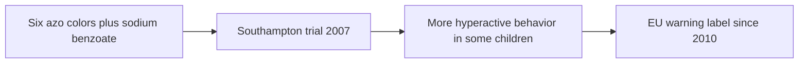

# Synthetic food colors

## Summary

Synthetic food colors give foods and drinks bright, stable colors. Many are azo dyes. The 2007 Southampton study found that mixtures of six colors (E102, E104, E110, E122, E124, E129) with sodium benzoate increased hyperactive behavior in some children; since 2010, EU products containing them must carry the warning "may have an adverse effect on activity and attention in children". Some colors are banned in some countries: Red 2G (E128) in the EU since 2007; erythrosine (Red No. 3, E127) is being removed from US foods from 2027.

*This note is educational. It is not medical advice and does not replace a doctor, dietitian or pharmacist, especially during pregnancy, illness or when taking medicines.*

## Prerequisites

- [Food additives overview](overview.md)

## Core concepts

### Definition

*Synthetic food colors* are manufactured dyes; *azo dyes* contain an N=N group. Some colors listed with them are natural (cochineal or carmine, E120, from insects).

### Analogy

Food colors are like paint for food. For most people they are harmless decoration; for some sensitive children, certain paints seem to act like a mild stimulant. The analogy breaks because the size of the effect varies a lot between children.

### Mechanism

Azo dyes are metabolized by gut bacteria into aromatic amines. Proposed mechanisms of behavioral effects include histamine release and effects on neurotransmitters. Tartrazine can cause hives and asthma in a small number of people, especially those sensitive to aspirin.

**Colors listed as concerns in the notes, with current status.**

| E number | Name | Reported concern | Status and evidence |
| --- | --- | --- | --- |
| E102 | Tartrazine | Allergic reactions, headaches, hyperactivity | Southampton color; warning label in EU |
| E104 | Quinoline yellow | Similar to tartrazine | Southampton color; warning label |
| E105 | Fast yellow AB | Similar to tartrazine | Not permitted in the EU |
| E107 | Yellow 2G | Similar to tartrazine | Not permitted in the EU |
| E110 | Sunset yellow | Allergy, asthma, link to ADHD | Southampton color; warning label |
| E111 | Orange GGN | Allergic reactions and skin problems | Not permitted in the EU |
| E120 | Cochineal, carmine | Allergic reactions; made from dried insects; also in lipstick | Natural color; rare but documented allergy |
| E122 | Azorubine | Asthma, skin allergy | Southampton color; warning label |
| E123 | Amaranth | Allergy, asthma, long-term concerns | Restricted in the EU (aperitif wines, fish roe); banned in the US |
| E124 | Ponceau 4R | Allergic reactions in asthma | Southampton color; warning label |
| E125 | Scarlet GN | Allergy and skin irritation | Not permitted in the EU |
| E127 | Erythrosine | Allergy; long-term thyroid problems | Restricted in the EU (cocktail cherries); US authorization revoked in 2025, effective 2027 |
| E128 | Red 2G | Allergy, skin problems, possible carcinogenicity | Banned in the EU since 2007 |
| E129 | Allura red AC | Hyperactivity in children | Southampton color; warning label |
| E131 | Patent blue V (brilliant blue) | Hyperactivity in some studies | Permitted |
| E132 | Indigotine | Allergy and skin problems | Permitted |
| E151 | Brilliant black PN | Allergy | Permitted |
| E155 | Brown HT | Allergy, long-term concerns | Permitted |

The notes list E131 as "brilliant blue FCF"; in the EU, E131 is patent blue V and brilliant blue FCF is E133.

The flowchart summarizes the Southampton finding.

### Claimed risks and evidence

Each entry states the claimed risk and how strong the evidence for it is, using the grades defined in the [Evidence grades](../evidence-grades.md) note. Here, "not supported" means the evidence does not show the claimed harm at permitted intakes.

- **Hyperactivity in children.** The Southampton trial found small average increases; individual sensitivity varies. Evidence: moderate.
- **Allergic reactions, hives and asthma.** Documented in a small number of sensitive people, especially for tartrazine and carmine. Evidence: moderate.
- **Cancer risk at permitted levels.** Not shown for permitted colors; Red 2G was banned after concerns. Evidence: limited.

## Worked example

In the Southampton trial (McCann and colleagues, 2007), 153 three-year-olds and 144 eight-to-nine-year-olds drank juice with a mix of colors and sodium benzoate or a placebo juice for one-week periods. Hyperactivity scores rose slightly with the additive mixes. Parents of a child with attention problems may try avoiding these colors; a food diary helps judge the effect.

## Trade offs and when to use it

Colors serve only appearance. Many manufacturers replaced the Southampton colors with natural ones (beet red, paprika extract, curcumin) after the EU warning.

## Common mistakes

- **Assuming natural colors are always safer.** Carmine (natural) causes allergies in some people.
- **Overstating the effect for all children.** Average effects are small; some children are more sensitive.

## Practice

1. Name three of the six Southampton colors.
2. What warning must EU products with these colors carry?
3. Which color is made from insects?

### Answers

1. Tartrazine (E102), sunset yellow (E110), allura red (E129) (also E104, E122, E124).
2. May have an adverse effect on activity and attention in children.
3. Cochineal or carmine, E120.

## Further reading

- McCann, D., Barrett, A., Cooper, A. et al. (2007). Food additives and hyperactive behaviour in 3-year-old and 8/9-year-old children in the community: a randomised, double-blinded, placebo-controlled trial. The Lancet, 370(9598), 1560-1567. [DOI](https://doi.org/10.1016/S0140-6736(07)61306-3). Southampton trial of colors and hyperactivity.
- US Food and Drug Administration (2025). FDA to revoke authorization for the use of Red No. 3 in food and ingested drugs. [Link](https://www.fda.gov/food/hfp-constituent-updates/fda-revoke-authorization-use-red-no-3-food-and-ingested-drugs). FDA revocation of Red No. 3 in food.
- European Parliament and Council (2008). Regulation (EC) No 1333/2008 on food additives. [Link](https://eur-lex.europa.eu/eli/reg/2008/1333/oj). EU additive regulation.
