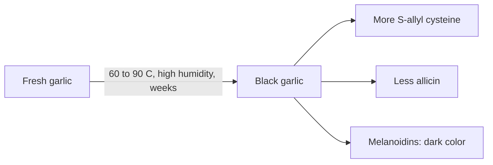

# Black garlic

## Summary

Black garlic is whole garlic aged for several weeks at controlled heat (about 60 to 90 °C) and high humidity. Despite often being called fermented, the change is mainly non-enzymatic browning (Maillard reaction), not microbial fermentation. Cloves turn black, soft and sweet, allicin falls and the stable compound S-allyl cysteine rises. Black garlic extracts are sold as supplements. Antioxidant effects are higher in test tube assays; human evidence for health effects is limited to small trials.

*This note is educational. It is not medical advice and does not replace a doctor, dietitian or pharmacist, especially during pregnancy, illness or when taking medicines.*

## Prerequisites

- [Garlic](garlic.md)

## Core concepts

### Definition

*Black garlic* is heat-aged garlic. *S-allyl cysteine* (SAC) is a water-soluble sulfur compound formed from gamma-glutamyl-S-allyl cysteine during aging; it is more stable and better absorbed than allicin.

### Analogy

Black garlic is to fresh garlic what a roasted coffee bean is to a green bean: slow heat transforms the color, taste and chemistry. The analogy breaks because coffee roasting takes minutes, while black garlic takes weeks at lower temperatures.

### Mechanism

During aging, sugars and amino acids undergo Maillard reactions, producing dark melanoidins and changing the sulfur compounds. Allicin and its pungent products decrease; SAC and polyphenols increase. The result is milder and sweeter.

The flowchart shows the changes during aging.

### Proposed effects and evidence

Each entry states the proposed effect and how strong the human evidence is, using the grades defined in the [Evidence grades](../evidence-grades.md) note.

- **Antioxidant action.** Higher antioxidant capacity in assays; human relevance unclear. Evidence: limited.
- **Heart health: lower LDL, triglycerides and blood pressure.** Small human trials with mixed results. Evidence: limited.
- **Immune support.** Animal studies. Evidence: very limited.
- **Anti-inflammatory action.** Laboratory and animal studies. Evidence: very limited.
- **Metabolic health, glucose and insulin sensitivity, liver support.** Animal studies. Evidence: very limited.
- **Prebiotic effect.** Laboratory studies. Evidence: very limited.
- **Skin health.** No meaningful evidence. Evidence: very limited.
- **Protection from oxidative stress and aging.** Laboratory evidence. Evidence: very limited.
- **Cardiovascular health and circulation.** Small trials. Evidence: limited.
- **Less fatigue.** Animal studies. Evidence: very limited.

## Worked example

A cook replaces raw garlic with black garlic in a dressing: the flavor is sweet and balsamic-like, without pungency, and it does not cause garlic breath to the same extent. Nutritionally, it supplies SAC instead of allicin; claims of far greater health benefits than fresh garlic are not established.

## Trade offs and when to use it

Black garlic is safe and well tolerated by people who find raw garlic irritating. Its health effects are less studied than those of aged garlic extract or fresh garlic.

## Common mistakes

- **Calling black garlic fermented.** It is mainly heat-aged through the Maillard reaction.
- **Expecting allicin effects.** Most allicin is lost during aging.

## Practice

1. How is black garlic made?
2. Which compound increases during aging?
3. Is black garlic a product of microbial fermentation?

### Answers

1. By aging whole garlic for weeks at controlled heat and humidity.
2. S-allyl cysteine.
3. No, mainly the Maillard reaction.

## Further reading

- Kimura, S., Tung, Y. C., Pan, M. H. et al. (2017). Black garlic: a critical review of its production, bioactivity, and application. Journal of Food and Drug Analysis, 25(1), 62-70. [DOI](https://doi.org/10.1016/j.jfda.2016.11.003). Review of black garlic production and bioactivity.
