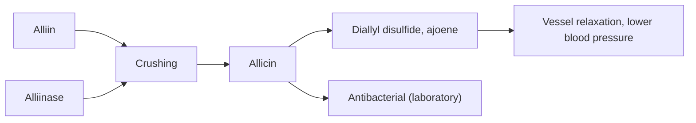

# Garlic

## Summary

Garlic (Allium sativum) contains sulfur compounds, mainly allicin, formed when cloves are crushed. Garlic and garlic oil, a vegetable oil infused with garlic extract, are used in cooking and as supplements (capsules and liquids). Meta-analyses show garlic supplements lower blood pressure by about 8 to 10 mmHg in people with hypertension and modestly lower total and LDL cholesterol. Antibacterial effects are clear in the laboratory; evidence that garlic prevents colds is weak.

*This note is educational. It is not medical advice and does not replace a doctor, dietitian or pharmacist, especially during pregnancy, illness or when taking medicines.*

## Prerequisites

No prior notes are needed.

## Core concepts

### Definition

*Garlic* is a bulb of the onion family. Intact cloves contain alliin and the enzyme alliinase in separate compartments. Crushing mixes them and forms *allicin*, which quickly converts into other sulfur compounds (diallyl disulfide, ajoene). *Garlic oil* products include oil macerates (garlic infused in vegetable oil) and steam-distilled oils with different compound profiles. *Aged garlic extract* contains stable S-allyl cysteine.

### Analogy

Garlic's defense is like a two-part spray stored in separate chambers: only when an animal bites (crushes) the clove do the chambers mix and release the pungent, antibacterial allicin. The analogy breaks because allicin is unstable; in cooking and storage it changes into other compounds.

### Mechanism

Allicin and its products release hydrogen sulfide and increase nitric oxide, relaxing blood vessels; they inhibit cholesterol synthesis enzymes and platelet aggregation. Allicin kills bacteria and fungi in the laboratory. Crushing garlic and waiting about 10 minutes before heating preserves more allicin formation.

The flowchart shows how allicin forms.

### Proposed effects and evidence

Each entry states the proposed effect and how strong the human evidence is, using the grades defined in the [Evidence grades](../evidence-grades.md) note.

- **Heart health: lower LDL and triglycerides, better endothelial function.** Small reductions in total and LDL cholesterol in meta-analyses; triglycerides unchanged. Evidence: moderate.
- **Antibacterial and antiviral action.** Shown in the laboratory. Evidence: limited.
- **Antioxidant action.** Laboratory evidence. Evidence: limited.
- **Immune support and fewer colds.** Cochrane: one small trial; insufficient evidence. Evidence: very limited.
- **Lower blood pressure.** About 8 to 10 mmHg systolic reduction in people with hypertension (meta-analysis). Evidence: moderate.
- **Liver detoxification.** No meaningful human evidence. Evidence: very limited.
- **Digestive support and gut flora.** Garlic contains fructans (prebiotic); can cause heartburn and bloating. Evidence: limited.
- **Anti-inflammatory action.** Small trials. Evidence: limited.
- **Skin health against infections and inflammation.** Topical garlic can cause chemical burns. Evidence: not supported.
- **Hair growth through scalp circulation.** One small trial of garlic gel with steroid in alopecia areata. Evidence: very limited.

## Worked example

A person with mild hypertension (148/92 mmHg) takes aged garlic extract (about 1.2 g daily) for 12 weeks, as in trials summarized by Ried (2016). An average reduction of about 8 mmHg systolic would be similar to a single blood pressure drug at low dose; the person still needs medical follow-up.

## Trade offs and when to use it

Garlic is safe as food. Supplements increase bleeding risk with anticoagulants and before surgery, and reduce levels of some HIV drugs. Homemade garlic-in-oil stored at room temperature can grow Clostridium botulinum; keep it refrigerated and use within a few days.

## Common mistakes

- **Storing homemade garlic oil at room temperature.** It risks botulism; refrigerate and use quickly.
- **Applying raw garlic to skin.** It can cause chemical burns.

## Practice

1. What forms allicin?
2. How much does garlic lower blood pressure in hypertension?
3. Why is homemade garlic oil risky?

### Answers

1. The enzyme alliinase acting on alliin when garlic is crushed.
2. About 8 to 10 mmHg systolic.
3. It can allow botulism bacteria to grow.

## Further reading

- Ried, K. (2016). Garlic lowers blood pressure in hypertensive individuals, regulates serum cholesterol, and stimulates immunity: an updated meta-analysis and review. Journal of Nutrition, 146(2), 389S-396S. [DOI](https://doi.org/10.3945/jn.114.202192). Meta-analysis of garlic and blood pressure.
- Lissiman, E., Bhasale, A. L., Cohen, M. (2014). Garlic for the common cold. Cochrane Database of Systematic Reviews, CD006206. [DOI](https://doi.org/10.1002/14651858.CD006206.pub4). Cochrane review of garlic for colds.
