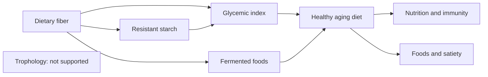

# Nutrition foundations

These notes cover the foundations of a healthy diet: dietary fiber and resistant starch, the glycemic index, fermented foods, the dietary pattern associated with healthy aging, nutrition and the immune system, foods and satiety, and the food combining theory (trophology), which is popular but not supported.

## Map

## Reading order

1. [Dietary fiber](dietary-fiber.md)
2. [Resistant starch](resistant-starch.md)
3. [Glycemic index](glycemic-index.md)
4. [Fermented foods](fermented-foods.md)
5. [Healthy aging diet](healthy-aging-diet.md)
6. [Nutrition and immunity](nutrition-and-immunity.md)
7. [Foods and satiety](foods-and-satiety.md)
8. [Trophology (food combining)](trophology.md)
