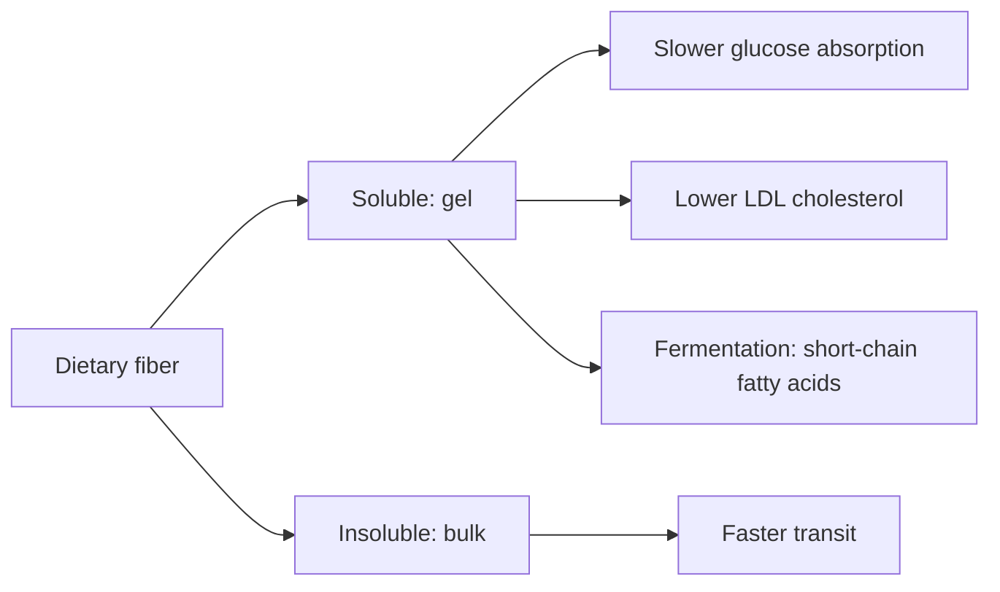

# Dietary fiber

## Summary

Dietary fiber is the part of plant foods that human enzymes cannot digest. A daily intake of about 30 to 35 g is recommended (EFSA sets 25 g as adequate; many guidelines suggest 30 g or more). Fiber slows glucose absorption, lowers the rise in blood glucose and insulin after meals, improves the blood lipid profile, feeds gut bacteria that produce short-chain fatty acids, and is associated with lower risk of colorectal cancer, heart disease and type 2 diabetes. It is especially important for people with disorders of carbohydrate metabolism: insulin resistance, reactive hypoglycemia, prediabetes and diabetes.

*This note is educational. It is not medical advice and does not replace a doctor, dietitian or pharmacist, especially during pregnancy, illness or when taking medicines.*

## Prerequisites

- [Carbohydrates](../../../../natural-sciences/chemistry/biochemistry/carbohydrates/carbohydrates.md)

## Core concepts

### Definition

*Dietary fiber* is carbohydrate polymers (and lignin) that are not digested or absorbed in the human small intestine. It is divided into:

- *soluble fiber* (beta-glucans in oats and barley, pectins in fruit, inulin), which forms gels, slows digestion and is fermented by gut bacteria;
- *insoluble fiber* (cellulose, hemicellulose, lignin in whole grains and vegetables), which adds bulk and speeds transit.

*Net carbohydrates* are total carbohydrates minus fiber.

### Analogy

Fiber is like a sponge and a broom in the gut. Soluble fiber is the sponge: it soaks up water and slows the flow of sugar into the blood. Insoluble fiber is the broom: it sweeps contents along. Some of the sponge is also food for the gut bacteria. The analogy breaks because fiber does not "sweep out toxins" in the way the image suggests; its main benefits come from slowing absorption and from bacterial fermentation.

### Mechanism

1. **Slower glucose absorption.** Viscous soluble fiber thickens the contents of the gut and slows the movement of glucose to the intestinal wall. The post-meal rise in blood glucose and insulin release by the pancreas are smaller. This is why fiber has a large role in preventing and supporting the treatment of carbohydrate metabolism disorders.
2. **Lipids.** Soluble fiber binds bile acids; the liver uses cholesterol to make new ones, lowering LDL cholesterol. This reduces cardiovascular risk, which is much higher in people with diabetes.
3. **Fermentation.** Gut bacteria ferment soluble fiber and resistant starch into short-chain fatty acids such as butyrate, which feed colon cells and regulate inflammation ([Butyric acid and sodium butyrate](../../../../natural-sciences/chemistry/biochemistry/lipids/butyric-acid.md)).
4. **Bulk and transit.** Insoluble fiber increases stool mass and speeds transit.

**Practical rules from the notes.**

- Every meal should contain vegetables, legumes, bran, oats or whole grains.
- Many people with carbohydrate disorders wrongly believe a low-carbohydrate diet works best and exclude whole grains. Whole grains are allies in lowering blood glucose: they provide soluble and insoluble fiber and vitamins and minerals important for glucose and insulin control. Choose wholemeal bread, coarse groats and brown rice.
- When reading labels, subtract fiber from total carbohydrates to estimate net carbohydrates for meal planning.

See also [Resistant starch](resistant-starch.md) and [Glycemic index](glycemic-index.md).

The flowchart shows the main effects of fiber.

### Claimed effects and evidence

Each entry states the proposed effect and how strong the human evidence is, using the grades defined in the [Evidence grades](../evidence-grades.md) note.

- **Lower post-meal glucose and insulin.** Viscous fiber reduces post-meal glycemia. Evidence: strong.
- **Lower risk of heart disease, type 2 diabetes and colorectal cancer.** Higher fiber intake was associated with 15 to 30 percent lower risk in a large series of meta-analyses (Reynolds and colleagues, 2019). Evidence: moderate.
- **Lower LDL cholesterol.** Soluble fiber such as oat beta-glucan lowers LDL modestly. Evidence: strong.
- **Removing toxins.** Fiber binds some compounds, but "detox" claims are vague. Evidence: limited.

## Worked example

A person eats 15 g of fiber a day. They switch white bread to wholemeal rye (+4 g), add a portion of lentils (+8 g), eat oats with berries at breakfast (+5 g) and an extra serving of vegetables (+3 g), reaching about 35 g. They increase gradually over 2 to 3 weeks and drink enough water to limit bloating. A label shows 60 g carbohydrate and 10 g fiber, so net carbohydrate is 50 g.

## Trade offs and when to use it

Most people eat too little fiber. A sudden large increase causes bloating and gas; people with irritable bowel syndrome may need to limit certain fermentable fibers (FODMAPs).

## Common mistakes

- **Excluding whole grains to control blood glucose.** Whole grains improve glycemic control.
- **Increasing fiber too fast.** Increase over weeks and drink water.

## Practice

1. How much fiber is recommended per day?
2. How does soluble fiber lower blood glucose peaks?
3. How are net carbohydrates calculated?

### Answers

1. About 30 to 35 g; at least 25 g according to EFSA.
2. It forms a gel that slows glucose absorption.
3. Total carbohydrates minus fiber.

## Further reading

- Reynolds, A., Mann, J., Cummings, J. et al. (2019). Carbohydrate quality and human health: a series of systematic reviews and meta-analyses. The Lancet, 393(10170), 434-445. [DOI](https://doi.org/10.1016/S0140-6736(18)31809-9). Systematic reviews and meta-analyses of carbohydrate quality and health.
- EFSA Panel on Dietetic Products, Nutrition, and Allergies (2010). Scientific Opinion on Dietary Reference Values for carbohydrates and dietary fibre. EFSA Journal, 8(3), 1462. [DOI](https://doi.org/10.2903/j.efsa.2010.1462). Dietary reference values for fiber.
- Koh, A., De Vadder, F., Kovatcheva-Datchary, P. et al. (2016). From dietary fiber to host physiology: short-chain fatty acids as key bacterial metabolites. Cell, 165(6), 1332-1345. [DOI](https://doi.org/10.1016/j.cell.2016.05.041). Review of short-chain fatty acids from fiber.
