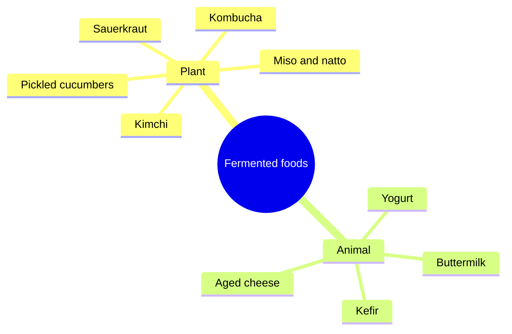

# Fermented foods

## Summary

Fermented foods are made through the controlled growth of microbes that convert food components. They include plant foods (sauerkraut, pickled cucumbers, kimchi, kombucha) and animal foods (kefir, yogurt, buttermilk, aged cheese). Fermentation can add live microbes, change nutrients and produce new compounds. A 2021 trial found that a diet high in fermented foods increased gut microbial diversity and decreased markers of inflammation.

*This note is educational. It is not medical advice and does not replace a doctor, dietitian or pharmacist, especially during pregnancy, illness or when taking medicines.*

## Prerequisites

No prior notes are needed.

## Core concepts

### Definition

*Fermented foods* are "foods made through desired microbial growth and enzymatic conversions of food components" (ISAPP consensus, 2021). Not all contain live microbes: baked sourdough bread and pasteurized pickles do not. *Probiotics* are live microorganisms that, in adequate amounts, give a proven health benefit; most fermented foods are not probiotics in this strict sense.

### Analogy

Fermented foods are like a garden that a gardener (microbes) has partly tended before the food reaches you: some plants are transformed, some new ones planted. The analogy breaks because, unlike plants, many of the microbes do not settle permanently in the gut.

### Mechanism

Lactic acid bacteria convert sugars into lactic acid ([Lactate and fermentation](../../../../natural-sciences/chemistry/biochemistry/lactate-and-fermentation.md)), lowering pH and preserving food. Fermentation can:

- add live microbes that pass through the gut and interact with resident bacteria and the immune system;
- reduce lactose (yogurt and kefir are easier to digest for many lactose-intolerant people);
- produce vitamins (some B vitamins, vitamin K2 in natto) and bioactive peptides;
- reduce some antinutrients (phytates).

The gut benefits from fermented foods of plant origin (sauerkraut, pickles, kombucha) and animal origin (kefir, buttermilk).

The mindmap groups common fermented foods.

### Claimed effects and evidence

Each entry states the proposed effect and how strong the human evidence is, using the grades defined in the [Evidence grades](../evidence-grades.md) note.

- **Increased gut microbial diversity and lower inflammatory markers.** Shown in a 10-week randomized trial (Wastyk and colleagues, 2021). Evidence: limited.
- **Easier lactose digestion from yogurt.** Live cultures in yogurt improve lactose digestion. Evidence: strong.
- **Lower risk of type 2 diabetes with yogurt.** Observational association. Evidence: limited.

## Worked example

In the 2021 Stanford trial, adults increased fermented foods from about 0.4 to about 6 servings a day over 10 weeks (yogurt, kefir, kimchi, kombucha, fermented vegetables). Microbial diversity rose and 19 inflammatory proteins, including interleukin 6, decreased. A practical version: kefir at breakfast, sauerkraut with lunch and a small glass of kombucha.

## Trade offs and when to use it

Fermented foods are generally safe and can diversify the diet. Some are high in salt (pickles, kimchi) or sugar (some kombucha and yogurts); people with histamine intolerance may react to aged and fermented foods.

## Common mistakes

- **Assuming all fermented foods contain live microbes.** Pasteurized or baked products do not.
- **Calling every fermented food a probiotic.** Probiotics require proven strains and doses.

## Practice

1. Give two plant and two animal fermented foods.
2. What did the 2021 trial find?
3. Why is yogurt easier to digest for lactose-intolerant people?

### Answers

1. Sauerkraut and kombucha; kefir and buttermilk.
2. Higher microbial diversity and lower inflammatory markers.
3. Its live cultures break down lactose.

## Further reading

- Marco, M. L., Sanders, M. E., Gänzle, M. et al. (2021). The International Scientific Association for Probiotics and Prebiotics (ISAPP) consensus statement on fermented foods. Nature Reviews Gastroenterology and Hepatology, 18, 196-208. [DOI](https://doi.org/10.1038/s41575-020-00390-5). ISAPP consensus statement on fermented foods.
- Wastyk, H. C., Fragiadakis, G. K., Perelman, D. et al. (2021). Gut-microbiota-targeted diets modulate human immune status. Cell, 184(16), 4137-4153. [DOI](https://doi.org/10.1016/j.cell.2021.06.019). Trial of fermented food diet and immune status.
