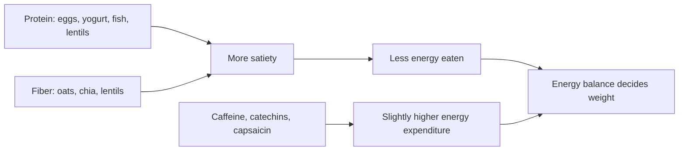

# Foods and satiety

## Summary

Some foods are promoted for reducing appetite or increasing fat burning: spinach, green tea, coffee, avocado, eggs, chili pepper, ginger, natural yogurt, coconut oil, lentils, redfish, chia seeds and oats. Foods high in protein and fiber do increase satiety. The effects of green tea, coffee and chili on energy expenditure are real but small, and the body partly adapts to them. No food causes weight loss without an overall energy deficit.

*This note is educational. It is not medical advice and does not replace a doctor, dietitian or pharmacist, especially during pregnancy, illness or when taking medicines.*

## Prerequisites

No prior notes are needed.

## Core concepts

### Definition

*Satiety* is the feeling of fullness that suppresses further eating after a meal. *Thermogenesis* is heat production; *diet-induced thermogenesis* is the extra energy spent digesting food, highest for protein.

### Analogy

Satiety foods are like slow-burning logs in a fireplace: they keep the fire going longer, so you add wood less often. Spicy foods and caffeine are like opening the damper a little: the fire burns slightly faster. The analogy breaks because opening the damper adds only a little heat, and you get used to it.

### Mechanism

Protein increases satiety hormones (peptide YY, GLP-1) and diet-induced thermogenesis. Fiber adds volume and slows stomach emptying. Caffeine and catechins increase energy expenditure slightly; capsaicin activates TRPV1 receptors and increases thermogenesis and fat oxidation slightly.

| Food | Claim | What is known |
| --- | --- | --- |
| Spinach | Thylakoids reduce appetite and raise leptin | Thylakoid extracts reduced hunger in some trials; effect of whole spinach is unclear |
| Green tea | Regulates blood glucose, cholesterol and blood pressure; caffeine and catechins speed fat burning by about 4 percent | Meta-analysis: small weight loss (about 1 kg) mainly in low caffeine consumers |
| Coffee | About 200 mg caffeine helps break down fat and burn calories; best 30 minutes before eating | Caffeine raises energy expenditure by a few percent; timing claim unverified |
| Avocado | Oleic acid maintains fullness | Some trials show greater satiety after avocado meals |
| Eggs | Protein prolongs fullness and lowers calories eaten | Egg breakfasts reduced later intake in short trials |
| Chili pepper | 1 g reduces appetite, speeds metabolism and fat burning; the body adapts with regular use | Capsaicin modestly lowers appetite and raises expenditure; tolerance develops |
| Ginger | Contains gingerol | Small trials show reduced hunger |
| Natural yogurt | Protein makes it filling; contains probiotic bacteria | Filling; live cultures |
| Coconut oil | Medium-chain fatty acids are digested differently and stored less in fat tissue | MCTs are oxidized faster, but coconut oil is mostly lauric acid and raises LDL ([Coconut oil](../../complementary-medicine/coconut-oil.md)) |
| Lentils | Iron, folate, thiamine, manganese; fiber and protein give fullness | Legumes increase satiety in meta-analyses |
| Redfish | Rich in omega-3; maintains fullness | Fish protein is filling; omega-3 content is moderate |
| Chia seeds | Reduce appetite; high in fiber | Fiber-rich; effects on appetite are small |
| Oats | Fiber keeps you full | Beta-glucan increases satiety |

The flowchart shows how foods affect energy balance.

### Claimed effects and evidence

Each entry states the proposed effect and how strong the human evidence is, using the grades defined in the [Evidence grades](../evidence-grades.md) note.

- **Protein and fiber increase satiety.** Consistent findings. Evidence: strong.
- **Green tea causes weight loss.** About 1 kg over 12 weeks in a meta-analysis. Evidence: limited.
- **Capsaicin reduces appetite and increases fat burning.** Small effects; tolerance develops. Evidence: limited.
- **Thylakoids reduce appetite.** Some trials with extracts. Evidence: limited.
- **Coffee before meals burns fat.** Caffeine raises expenditure slightly; specific timing claim not supported by evidence. Evidence: very limited.

## Worked example

A person wants to eat less without feeling hungry. They switch breakfast from a white roll with jam (about 300 kcal, 6 g protein, 2 g fiber) to two eggs with wholemeal bread and spinach (about 350 kcal, 18 g protein, 6 g fiber). They feel full until lunch and snack less, reducing daily intake by about 200 kcal.

## Trade offs and when to use it

Choosing filling foods helps control intake, but "fat-burning foods" have small effects. Coffee and green tea can cause sleep problems; chili irritates some stomachs.

## Common mistakes

- **Expecting foods to burn fat.** Weight depends on overall energy balance.
- **Adding coconut oil to lose weight.** It adds energy and raises LDL.

## Practice

1. Which nutrients increase satiety most?
2. What happens with regular chili consumption?
3. How large is the weight effect of green tea?

### Answers

1. Protein and fiber.
2. The body adapts, reducing the effect.
3. Small, about 1 kg in a meta-analysis.

## Further reading

- Hursel, R., Viechtbauer, W., Westerterp-Plantenga, M. S. (2009). The effects of green tea on weight loss and weight maintenance: a meta-analysis. International Journal of Obesity, 33(9), 956-961. [DOI](https://doi.org/10.1038/ijo.2009.135). Meta-analysis of green tea and weight loss.
- Whiting, S., Derbyshire, E., Tiwari, B. K. (2012). Capsaicinoids and capsinoids. A potential role for weight management? A systematic review of the evidence. Appetite, 59(2), 341-348. [DOI](https://doi.org/10.1016/j.appet.2012.05.017). Review of capsaicinoids and weight management.
- Stuby, J., Gravestock, I., Wolfram, E. et al. (2019). The effect of thylakoids on appetite and weight: a systematic review and meta-analysis. Nutrients, 11(10), 2341. [DOI](https://doi.org/10.3390/nu11102341). Meta-analysis of thylakoids and appetite.
